# 《现代 CPU 上的性能分析与优化》参考文献深度学习笔记

> 来源：Denis Bakhvalov《Performance Analysis and Tuning on Modern CPUs》中译本（weedge/perf-book-cn）参考文献页，共约 60 篇引用。
> 本文按主题分类，逐篇提取**学习级**详细要点。每篇包含：一句话概括、背景与问题、核心方法/内容详细展开（算法步骤/公式/硬件机制）、关键结论与数据、实战应用（命令与代码示例）、与 perf-book 章节对应、常见误区。

## 目录

- [一、厂商官方手册与规范](#一厂商官方手册与规范)（11 篇）
- [二、性能测量与基准测试方法论](#二性能测量与基准测试方法论)（6 篇）
- [三、性能回归自动检测与统计方法](#三性能回归自动检测与统计方法)（5 篇）
- [四、性能剖析与采样技术（含 TMA 方法论）](#四性能剖析与采样技术含-tma-方法论)（8 篇）
- [五、大规模数据中心与仓库级计算优化](#五大规模数据中心与仓库级计算优化)（4 篇）
- [六、编译器与代码优化](#六编译器与代码优化)（9 篇）
- [七、分支预测](#七分支预测)（4 篇）
- [八、内存层次、缓存与 TLB](#八内存层次缓存与-tlb)（7 篇）
- [九、宏观趋势与背景](#九宏观趋势与背景)（6 篇）
- [附录：精读路线推荐](#附录精读路线推荐)

## 零、初学者预备知识（先读这里）

> 这份笔记涉及的论文默认读者懂 CPU 体系结构。如果你是初学者，先花 15 分钟读完本章，后面的内容会顺畅很多。
> 全章只用生活类比，不讲公式。

### 0.1 一句话看懂这份笔记在讲什么

程序跑得慢，钱就花得多（更多服务器、更差的用户体验）。这本书（和它的参考文献）回答两个问题：
**怎么找到程序慢在哪里（测量与分析），以及找到之后怎么改（优化）。** 难就难在：现代 CPU 极其复杂，
"慢"的原因往往不是你想的那样，所以必须先用科学的方法测量，而不是靠猜。

### 0.2 十个核心概念的通俗解释

**① CPU 流水线（Pipeline）—— 像快餐店的出餐流水线。**
一条指令的执行被拆成好几步：取食材（取指）→ 看菜单（译码）→ 炒菜（执行）→ 装盘（写回）。
流水线让多份订单（指令）同时处于不同工序，出餐速度翻倍。流水线越深，一旦某步出错（比如猜错了顾客要什么），
整条线都要清空重做——这就是"分支误预测"昂贵的原因。

**② 乱序执行与超标量 —— 像后厨有多个灶台的厨师长。**
CPU 不等前一道菜做完才做下一道：只要食材（操作数）齐了，哪个灶台（执行端口）空着就先炒哪道。
最后由"传菜员"（ROB，重排序缓冲）保证按下单顺序上菜。所以指令的实际执行顺序和你写的顺序可能完全不同。

**③ 缓存（Cache）—— 像厨师手边的调料架。**
L1 是手边的调料罐（1 纳秒），L2 是身后的调料架（4 纳秒），L3/LLC 是厨房角落的储藏柜（几十纳秒），
内存 DRAM 是楼下仓库（100 纳秒）。去仓库拿一次东西的时间够炒 200 盘菜。
所以性能优化的很大一部分是：**让数据尽量待在手边**（这就是"缓存友好"）。

**④ 分支预测（Branch Prediction）—— 像老司机猜红绿灯。**
程序里到处是 if-else（岔路口），CPU 不想停下来等判断结果，就先猜一个方向开过去。
猜对了无缝继续，猜错了倒车重来（浪费 15-25 个周期）。CPU 有个超强"直觉"（TAGE 预测器），
能记住每个路口的历史规律——但如果路口方向由**随机数据**决定，谁都猜不中，只能"把岔路修成直路"（无分支编程）。

**⑤ μop（微操作）—— 像把复杂菜拆成标准动作。**
x86 指令有的很复杂（一条指令 = 读内存 + 计算 + 写回），CPU 内部会把它们拆成简单的"微操作"再执行。
理解 μop 才能看懂为什么"一条指令"实际要跑好几个周期。

**⑥ CPI / IPC —— 像"每单平均耗时"和"每小时出单量"。**
CPI = 平均每条指令花几个周期（越低越好），IPC 是它的倒数（越高越好，理想值接近 CPU 宽度 4-6）。
真实数据中心程序的 IPC 常常只有 1 左右——大部分时间在"等"，而不是在"算"。

**⑦ PMU（性能监控单元）—— CPU 自带的"行车记录仪"。**
CPU 芯片里有一组硬件计数器，默默记录：执行了多少指令、猜错了几次分支、缓存 miss 了几次……
性能分析不是靠猜，而是读这些计数器。Linux 的 `perf`、Intel 的 VTune 都是 PMU 的"读表器"。

**⑧ 采样剖析（Sampling）—— 像质检员随机抽查。**
想知道程序时间花在哪，不必盯着每一行代码（那太贵了），而是每毫秒随机"拍个照"记录当前在运行哪行。
拍几千张照片后统计，哪行出现得多，哪行就是热点。开销小，所以能用在生产环境。

**⑨ TMA（自顶向下分析）—— 像医院分诊台。**
CPU 的所有"工时"（流水线槽位）被分成四大桶：干了活（Retiring）、白干了（Bad Speculation）、
前面没料来（Front-End Bound）、后面堵住了（Back-End Bound）。先看哪个桶最大，再往细里查——
这就是"分诊"，避免一上来就陷入几百个计数器里迷路。**这是全书最重要的方法论。**

**⑩ PGO（基于画像的优化）—— 像按客流高峰排班。**
编译器本来不知道程序实际跑起来什么样。PGO 先用真实运行的数据（画像）告诉编译器"这条路热、那条路冷"，
编译器就能把热代码排在一起、冷代码挪走，就像餐厅按高峰多排厨师。数据中心靠这招白捡 5-15% 的性能。

### 0.3 术语缩写速查表

| 缩写 | 全称 | 一句话解释 |
|---|---|---|
| IPC / CPI | Instructions/Cycles Per Instruction | 每周期完成指令数 / 每条指令耗时，衡量 CPU 利用效率 |
| PMU | Performance Monitoring Unit | CPU 内置的硬件性能计数器 |
| TMA | Top-down Microarchitecture Analysis | 自顶向下分层定位瓶颈的方法论（第 0.2-⑨ 条） |
| LLC | Last Level Cache | 最后一级缓存（通常指 L3），多个核共享 |
| TLB | Translation Lookaside Buffer | 虚拟地址→物理地址的翻译缓存，miss 了要翻页表（很慢） |
| 大页 / HugePage | 2MB/1GB 页 | 用大内存页减少 TLB miss |
| ROB | Reorder Buffer | 乱序执行的重排序缓冲，保证按序提交 |
| LBR | Last Branch Record | 硬件记录最近执行的分支轨迹（用于还原执行路径） |
| PEBS / IBS / SPE | Intel/AMD/ARM 精确采样 | 硬件精确记录"哪条指令、等了多久、数据来自哪级缓存" |
| PGO / FDO / BOLT | Profile-Guided Optimization 家族 | 用运行数据指导编译器/二进制重排优化 |
| SIMD / 向量化 | Single Instruction Multiple Data | 一条指令同时算多个数据（AVX/NEON） |
| Skid | 采样偏移 | 采样记录的位置与真实事发指令之间差了几条指令 |
| WCET | Worst-Case Execution Time | 最坏情况执行时间，实时系统关心它胜过平均性能 |
| AoS / SoA | Array of Structs / Struct of Arrays | 两种数据布局方式，SoA 通常对缓存和 SIMD 更友好 |

### 0.4 初学者阅读路线（别按顺序读！）

1. **先读第九章"宏观趋势"**（Leiserson、Hennessy 讲座）——没有公式，告诉你"为什么这件事值得学"，建立动机；
2. **看第八章开头的存储金字塔图**——建立"缓存快慢差 100 倍"的直觉，这是所有优化的物理基础；
3. **读 Yasin 的 TMA 笔记（第四章第 1 篇）+ TMA 树插图**——学会"分诊"思维，这是全书的分析框架；
4. **读第二章 Mytkowicz 那篇**——明白"测量会骗人"，建立对性能数字的怀疑精神；
5. 之后按你当前的问题选读：程序慢在哪 → 第四章；改代码提速 → 第七、八章；编译器相关 → 第六章；
6. 每篇笔记先读"🎓 初学者导读"和"一句话概括"，读得下去再深入"核心方法"；**"实战应用"一节建议照着实操**。

### 0.5 每篇笔记怎么读

每篇笔记有固定的七段结构，初学者只需关注带 ⭐ 的三段：

| 段落 | 初学者怎么用 |
|---|---|
| 🎓 初学者导读 | ⭐ 先读这个，30 秒判断这篇和你有什么关系 |
| 一句话概括 | ⭐ 浓缩版结论 |
| 背景与问题 | 可选，帮你理解动机 |
| 核心方法详细展开 | 深入学习时再读，卡住了先跳过 |
| 关键结论与数据 | ⭐ 记住 1-2 个关键数字就够 |
| 实战应用 | 强烈建议动手照做 |
| 与 perf-book 对应章节 / 常见误区 | 对照原书阅读时用 |

---

## 插图索引（自绘原理示意图，位于 `images/` 目录）

| 插图 | 位置 | 说明 |
|---|---|---|
| `cpu-pipeline.svg` | 一、Intel 优化手册 | 现代乱序超标量流水线：前端三条 μop 供给路径 + 后端执行端口 + 内存子系统 |
| `measurement-noise.svg` | 二、Robust Benchmarking | 为什么多次测量取最小值比均值更接近真实时间 |
| `changepoint.svg` | 三、MongoDB 变点检测 | 从噪声时间序列中自动定位引入回归的 commit |
| `tma-tree.svg` | 四、Yasin TMA 论文 | 流水线槽位的自顶向下分类树（L1 四桶 → L2/L3 分解） |
| `coz.svg` | 四、Coz 因果剖析 | 加速潜力曲线：关键路径 vs 非关键路径代码 |
| `bolt-pipeline.svg` | 五、BOLT | 生产采样 → profile → 二进制重排 → 优化后二进制的完整流水线 |
| `tage.svg` | 七、TAGE 预测器 | 几何历史长度 + 带标签分量 + 最长历史命中规则 |
| `memory-hierarchy.svg` | 八、章节导言 | 存储层次金字塔：寄存器到 DRAM 延迟相差 100 倍 |
| `eytzinger.svg` | 八、Khuong & Morin | Eytzinger 层序布局：把串行 cache miss 变成可预取的并行 miss |
| `cache-cat.svg` | 八、Intel Cache QoS | CAT 按 way 划分 LLC 给不同业务类别 |
| `roofline.svg` | 八、SPEC 特征化 | Roofline 模型：一张图分清内存瓶颈与计算瓶颈 |
| `moore.svg` | 九、Hennessy 图灵奖讲座 | 单线程性能年增长率：52% → 23% → 12% → 3% 的时代变迁 |

---

## 一、厂商官方手册与规范

厂商官方手册是 CPU 性能工程领域最权威、最基础的一手资料。无论是理解微架构细节（流水线、执行端口、缓存层次），还是使用硬件性能计数器（PMU）做量化分析，最终都要回到 Intel、AMD、Arm 官方发布的优化手册、架构参考手册和 PMU 指南。本节收录的 11 篇文献覆盖三大主流指令集阵营，建议把它们当作"工具书"常备手边，遇到具体问题随时查阅，而不是从头通读。

---

### 1. Intel® 64 and IA-32 Architectures Optimization Reference Manual（Intel, 2023）

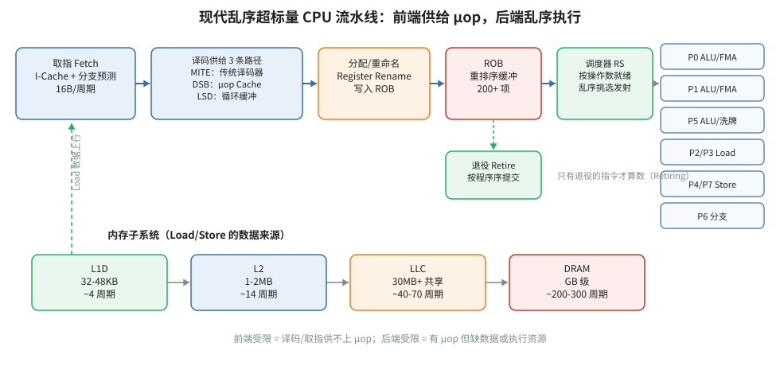


- **🎓 初学者导读**：这本手册就像家电附赠的那本厚厚的"高级使用说明书"，平时用不上，但当你写的程序跑不快、想知道 Intel 处理器内部到底卡在哪时，它就是标准答案。典型场景是：你发现代码慢，怀疑是缓存、分支预测（处理器猜你下一步要执行什么）出了问题，来这里查官方解释。千万别从头读到尾——上千页呢，把它当字典，遇到哪个概念不懂就查哪章，先翻翻目录混个脸熟就够了。

- **一句话概括**：Intel x86 平台上最权威的软件性能优化指南，系统讲解 Intel 各代微架构的流水线结构与优化方法，是 x86 性能工程师的"圣经"。

- **文档定位与适用场景**：
  这是 Intel 官方发布的优化参考手册（常简称 ORM 或 Opt Manual），文档编号 248966，随微架构代际持续更新。当你需要：理解某代 Intel CPU（如 Skylake、Ice Lake、Golden Cove）的前端/后端结构；为热点循环做指令级调优；判断编译器生成的代码为什么不快；理解某个性能事件（performance event）的精确含义——都必须查这份手册。它不是入门教程，而是给已经会用 VTune/perf、需要深入硬件细节的工程师准备的。

- **内容地图**：
  - **前几章：通用优化原则**。讲与具体微架构无关的优化：数据布局、对齐（推荐 16/32/64 字节对齐）、减少分支、循环展开、SIMD 向量化（SSE/AVX/AVX-512 的使用建议）、浮点与整数指令选择等。
  - **微架构详解章节（核心部分）**。按代际展开（如 Sandy Bridge、Haswell、Skylake、Ice Lake、Golden Cove），每代给出流水线框图：前端（取指、译码、uop 供给）、分配/重命名、乱序执行引擎（OOO engine）、内存子系统。这是全书最有价值的部分。
  - **内存优化章节**。缓存层次结构、TLB 组织、预取器（hardware prefetcher）行为、4K aliasing、非临时存储（non-temporal store）、大页（2M/1G huge page）建议。
  - **特定主题章节**。多线程与超线程（Hyper-Threading）、功耗与频率管理、AVX-512 降频问题、指令延迟与吞吐量表（详细表格通常在附录或随附文档中）。
  - **附录**。PMU 事件列表（每代微架构的可编程事件）、指令延迟/吞吐速查。

- **核心知识点**：
  1. **前端三条 uop 供给路径**（自 Sandy Bridge 起的关键概念）：
     - **MITE（Legacy Decode Pipeline）**：传统译码路径，从 L1 I-cache 取指，经过复杂译码器（1 个 complex decoder + 多个 simple decoder）产出 uop，每周期最多供给约 4-6 个 uop（因代际而异）。受限于 16 字节取指窗口、指令长度、macro-fusion 机会。
     - **DSB（Decode Stream Buffer，即 uop cache）**：缓存已译码的 uop，命中时每周期可供给更多 uop（Skylake 上约 6 uop/周期，Golden Cove 更宽），且功耗更低。热点代码能否装进 DSB（通常容量对应数千 uop，按 64 字节 cache line 的 Way 组织，每行最多 6 uop）直接影响前端带宽。
     - **LSD（Loop Stream Detector）**：循环流检测器，对能在 uop 队列中整体放下的小循环（几十到几百个 uop，代际不同）直接循环供给 uop，跳过取指译码，省功耗且不受分支预测影响。
  2. **前端供给的量化**：事件 `IDQ_UOPS_NOT_DELIVERED.CORE` 衡量后端请求 uop 但前端未能供给的 slot 数，是 TMA Frontend_Bound 的直接来源。
  3. **执行端口与调度器**：以 Skylake 为例，有 4 个整数 ALU 端口（Port 0/1/5/6）、2 个 load 端口（Port 2/3，后扩展）、1 个 store address + store data 通路，FMA 在 Port 0/1。做吞吐分析时要查每代的端口映射表，计算 port pressure。
  4. **ROB（Reorder Buffer）容量**：决定乱序窗口大小，Skylake 为 224 项，Ice Lake 352 项，Golden Cove 512 项（数量级记忆即可，具体以手册为准）。`RESOURCE_STALLS.ROB` 事件指示 ROB 满导致的停顿。
  5. **4K aliasing（false store forwarding stall）**：当 load 地址与之前未解析的 store 地址在低 12 位（即页内偏移）相同但实际不同页时，发生假相关，触发约 5 周期惩罚。对应事件 `LD_BLOCKS_PARTIAL.ADDRESS_ALIAS`。规避方法：对齐数据结构、避免地址间隔恰为 4096 字节倍数。
  6. **Memory disambiguation 与 store forwarding**：load 可以投机地越过地址未定的 store 执行；若猜测错误发生 memory order machine clear（事件 `MACHINE_CLEARS.MEMORY_ORDERING`）。
  7. **分支预测与 machine clear**：分支误预测惩罚约 15-20 周期；`BR_MISP_RETIRED.*` 事件族用于量化。
  8. **预取器**：Intel 每级缓存配有硬件预取器（L2 streamer、L2 spatial prefetcher、DCU IP-based prefetcher、DCU next-line prefetcher），可通过 MSR（如 `IA32_MISC_ENABLE` 相关位）开关，用于定位预取器是有益还是有害。
  9. **指令延迟与吞吐**：手册给出关键指令（如 `DIV`、FMA、`SHLD`、跨 lane 的 AVX shuffle）的延迟（latency）与吞吐（throughput，CPI 倒数）表，是手工做静态流水线分析（如 IACA/uica/uiCA 的输入依据）的基础。
  10. **PMU 事件附录**：每代微架构的可编程事件以 `事件名.Umask` 形式列出，例如 `UOPS_ISSUED.ANY`、`CYCLE_ACTIVITY.STALLS_MEM_ANY`，这是 `perf list` 中原始事件（raw event）的来源。

- **实战用法**：
  - 用 `perf list` 查看本机可用事件，再对照手册附录确认事件的精确定义与 umask 编码，例如：`perf stat -e cycles,instructions,branches,branch-misses ./app`。
  - 原始事件语法：`perf stat -e cpu/event=0xA3,umask=0x04,cmask=4/ ./app`（以手册查到的 event/umask 编码为准）。
  - 做循环优化时，先画出手册中对应代际的流水线框图，再用 uops.info（其数据来源即本手册及实测）核对关键指令的端口分布。
  - 手册是 PDF，建议下载最新版后建立书签：前端章节、内存章节、附录事件表是最常翻的三处。

- **与 perf-book 对应章节**：第 3 章（CPU 微架构）、第 4 章（术语与指标）、第 6 章（CPU 特性用于性能分析）、第 8-11 章各优化主题（优化内存访问、计算、多线程）均以本手册的微架构知识为底层依据。

- **常见误区/注意事项**：
  - 手册按代际组织，**一定要确认你手上 CPU 属于哪代微架构**（用 `cpuid` 或查 Intel ARK），不同代的端口数、ROB 大小、DSB 容量差异很大，套用错代际数据会得出错误结论。
  - 手册描述的是"架构能力"，实际可用性还受微码（microcode）更新影响（例如安全补丁禁用某些特性或改变分支预测行为）。
  - 附录事件表与 PMU 驱动实际暴露的事件可能略有出入，以 `perf list` 实际列出为准，但语义以手册为准。

---

### 2. Intel CPU Metrics Reference（Intel, 2023）


- **🎓 初学者导读**：这份文档就像体检报告单后面附的"指标对照表"，告诉你每项数值代表什么、多少算正常。当你用性能分析工具看到一堆缩写（比如 IPC、缓存命中率）却看不懂是什么意思、该高还是该低时，就翻它。建议别单独啃，配合你实际跑出的一份性能报告边看边查，理解会快得多。

- **一句话概括**：Intel 官方的性能指标（metrics）定义文档，把 TMA（Top-down Microarchitecture Analysis）方法论的每一层指标给出精确的事件计算公式，是"看懂 VTune/perf 自顶向下分析结果"的对照字典。

- **文档定位与适用场景**：
  当你用 VTune 的 Microarchitecture Exploration 类型、或 Linux `perf` 的 `--topdown` 功能拿到 "Frontend Bound 35%" 这类结果时，这份文档回答"这个数字到底是怎么算出来的"。适用场景：核对 TMA 指标公式；在没有 VTune 的机器上用 `perf stat` 手工收集原始事件并自行计算 TMA 指标；理解 pipeline slot 的概念。

- **内容地图**：
  - **Pipeline Slot 基础模型**：把 CPU 每个周期每个核能处理的 uop 数定义为 slot 总数（例如 4-wide 机器每周期 4 个 slot），所有指标都是"占总 slot 的百分比"。
  - **TMA 第一层**：`Retiring`、`Bad Speculation`、`Frontend Bound`、`Backend Bound` 四大类的定义与公式。
  - **TMA 第二/三层**：Backend Bound 细分为 `Memory Bound`（再分 DRAM Bound、L1/L2/L3 Bound）与 `Core Bound`（分 Divider、Ports Utilization）；Bad Speculation 细分为 `Branch Mispredicts` 与 `Machine Clears`；Frontend Bound 细分为 `Fetch Latency` 与 `Fetch Bandwidth`。
  - **每项指标给出事件表达式**，例如（以 Skylake 为例）`Frontend_Bound = IDQ_UOPS_NOT_DELIVERED.CORE / (4 * CPU_CLK_UNHALTED.THREAD)`。

- **核心知识点**：
  1. **Slot 总数公式**：`Total Slots = 4 × CPU_CLK_UNHALTED.THREAD`（4 为流水线宽度，宽核如 Golden Cove 为 6 或 8，需按代际调整）。
  2. **Retiring**：`UOPS_RETIRED.RETIRE_SLOTS / Total Slots`，衡量有效工作占比。
  3. **Bad Speculation**：`(UOPS_ISSUED.ANY - UOPS_RETIRED.RETIRE_SLOTS + 4 × INT_MISC.RECOVERY_CYCLES) / Total Slots`，包含误预测流水线冲刷的代价（recovery cycles）。
  4. **Frontend Bound**：前端无法供给 slot 的比例，即 `IDQ_UOPS_NOT_DELIVERED.CORE / Total Slots`。
  5. **Backend Bound = 1 - (Retiring + BadSpec + FEBound)**：TMA 的美妙之处在于第一层是完备的划分，任一项缺失即可由减法得出。
  6. **Memory Bound 的 stall 分解**：用 `CYCLE_ACTIVITY.STALLS_L1D_MISS`、`STALLS_L2_MISS`、`STALLS_MEM_ANY` 等事件逐级归因到 L1/L2/L3/DRAM。
  7. **计数器复用问题**：一次 `perf stat` 能同时采集的 PMU 计数器数量有限（每核通常 4-8 个可编程计数器），多层 TMA 指标需要分组复用（multiplexing），文档会提示哪些事件组可以同测。
  8. **SMT 影响**：开启超线程时 `CPU_CLK_UNHALTED.THREAD` 与核周期的关系需谨慎处理，TMA 在 SMT 下的解释有特殊说明。

- **实战用法**：
  - 快速查看第一层：`perf stat --topdown -a ./app`（较新内核支持）；或用 `perf stat -M TopdownL1 ./app`（依赖内核 metrics 机制）。
  - 手工计算：按文档公式列出事件清单，`perf stat -e '{...}' ./app` 分组采集后代入公式。
  - VTune 中每个指标悬停可见公式，与本文档一致；写报告引用指标定义时应以此文档为准。

- **与 perf-book 对应章节**：第 4 章（术语与指标，尤其是 TMA 一节）、第 6 章（TMA 方法论的实操）。

- **常见误区/注意事项**：
  - TMA 指标是**占比不是绝对量**：Frontend Bound 30% 不代表浪费了 30% 时间，优化收益需结合整体 runtime 估算。
  - 公式中的常数（流水线宽度）随代际变化，套用 Skylake 的 4-wide 公式到 Golden Cove 会系统性偏差。
  - 事件计数受 HT、频率变化影响，跨机器比较前先统一环境。

---

### 3. AMD64 Architecture Programmer's Manual（AMD, 2023）


- **🎓 初学者导读**：这套书相当于 AMD 处理器的"建筑结构图集"，讲处理器底层的指令和运行机制，偏硬件、偏底层。你只有在需要理解某条指令的确切行为、或者排查"为什么这段汇编代码结果不对"这类硬核问题时才会用到它。初学阶段几乎不用碰，知道它存在、放在书架上备查即可，等功力深了再回来翻。

- **一句话概括**：AMD64 架构的多卷本程序员手册，定义了指令集、系统编程接口与性能监控机制的官方规范，是 AMD 平台的"架构宪法"。

- **文档定位与适用场景**：
  这套手册分多卷（Volume 1: Application Programming；Volume 2: System Programming；Volume 3: General-Purpose and System Instructions；以及后续指令集卷）。当你需要：确认某条 AMD 指令的精确语义与异常行为；编写或调试操作系统/内核代码；理解 AMD PMU（Performance Monitor Counters）的编程接口（MSR 地址、寄存器布局）；理解 IBS 的寄存器配置——必须查对应卷。优化代码时它不如优化手册直接有用，但它是**一切细节的权威裁决**。

- **内容地图**：
  - **Volume 1（应用编程）**：x86-64 编程模型、寄存器、数据类型、内存模型、浮点与向量扩展（SSE/AVX）概述。写给应用开发者。
  - **Volume 2（系统编程）**：特权级、段页式内存管理、中断与异常、MSR 体系、**性能监控（包括 PMU 与 IBS 的 MSR 编程接口）**、虚拟化（SVM）。性能工程师最常翻的一卷。
  - **Volume 3（指令参考）**：每条指令的操作码、伪代码语义、标志位影响、异常条件。
  - **后续卷**：AVX/SSE 等扩展指令的完整参考。

- **核心知识点**：
  1. **PMU MSR 布局**：AMD 的性能事件选择寄存器（PerfEvtSel，如 MSR `0xC001_0000` 起的 Core Performance Event Select）与计数寄存器（PerfCtr），以及 Zen 系列扩展的 DF（Data Fabric）、L3、UMC（内存控制器）PMU 的独立 MSR 空间。
  2. **IBS（Instruction Based Sampling）**：AMD 独有的硬件采样机制，分 **IBS Op**（对 retired uop 采样，记录延迟来源，如 load 是否命中 L1/L2/L3/DRAM）与 **IBS Fetch**（对取指行为采样）。控制 MSR：`IBS_OP_CTL`（采样间隔、使能）、`IBS_FETCH_CTL`；数据 MSR 记录采样到的地址、延迟、缓存命中信息。Linux perf 中以 `ibs_op//`、`ibs_fetch//` 伪事件暴露。
  3. **CPUID 体系**：如何用 CPUID 查询核拓扑（Zen 的 CCX/CCD 结构）、缓存参数、特性位（如 AVX2、SVM）。
  4. **APMI/RAPL 类功耗管理接口**：功耗与频率管理相关 MSR（具体依 Family 不同，细节在 PPR 中）。
  5. **内存类型与 PAT/MTRR**：影响内存访问性能的缓存属性控制。
  6. **PMC 计数器数量与宽度**：Zen 系列每核通常提供 6 个可编程核心 PMU 计数器（Zen 早期为 5-6 个，需按 Family 查表），宽度 48 位。

- **实战用法**：
  - 用 `perf list` 查看 AMD 事件，原始事件格式与 Intel 类似：`perf stat -e cpu/event=0x76,umask=0x00/ ./app`，event/umask 编码需查 PPR（文献 4）中的事件表，本手册给出的是**编程接口**，具体事件编号在 PPR。
  - IBS 使用：`perf record -e ibs_op// ./app` 后用 `perf report` 查看按地址归因的内存延迟分布。
  - 读 MSR 调试：`rdmsr`/`wrmsr` 工具（msr-tools 包）直接访问，如 `sudo rdmsr -a 0xc0010000`。

- **与 perf-book 对应章节**：第 6 章（CPU 特性用于性能分析，PMU/IBS 部分）、附录中 AMD 平台的采样技术对比。

- **常见误区/注意事项**：
  - 这套手册讲"架构允许什么"，**具体某代产品实现了什么、事件编号是什么，要查对应 Family 的 PPR**（见文献 4）。手册与 PPR 配合使用的习惯非常重要。
  - 卷数多、页数巨大，善用 PDF 目录与搜索，不要顺序阅读。

---

### 4. Processor Programming Reference (PPR) for AMD Family 19h（AMD, 2021, Zen3）


- **🎓 初学者导读**：这份文档就像某一款具体车型的"原厂维修手册"，只针对 Zen 3 这一代 AMD 处理器，讲它特有的寄存器（处理器内部的小存储格）和配置开关。一般只有做系统软件、固件或极限调优的人才需要，比如你想读取 Zen 3 上某个硬件计数器却找不到入口时。初学者可以直接跳过，先记住"AMD 每代处理器都有一本这样的手册"这个事实就够了。

- **一句话概括**：AMD Zen 3（Family 19h）处理器的寄存器级编程参考，包含完整的 MSR 定义与全部 PMU 事件列表，是在 Zen 3 上做底层性能分析时唯一权威的事件字典。

- **文档定位与适用场景**：
  PPR 按处理器 Family 发布，Family 19h 对应 Zen 3（EPYC Milan、Ryzen 5000 等）。当你需要：查找 Zen 3 上某个性能事件的精确编号（如 L1 cache miss、FLOPs 计数）；配置 DF/L3/UMC 等非核（uncore）PMU；查某 MSR 的位定义——必须查这份文档。它与文献 3（架构手册）的分工是：架构手册讲机制，PPR 讲具体产品的寄存器与事件。

- **内容地图**：
  - **寄存器参考**：所有 MSR 的地址、位域定义，含 APIC、PMU、内存控制器相关。
  - **核心 PMU 事件表**（性能工程师的核心目标）：按功能分组列出数百个事件——取指/译码、分支预测、整数/浮点执行、LS（load/store）单元、L1D/L1I、L2、L3 等，每个事件给出 Event Select 编号与 Unit Mask。
  - **非核 PMU**：Data Fabric（DF）、L3 cache、UMC（统一内存控制器，含 DRAM 带宽计数）的事件与编程方式，这些是分析内存带宽与 CCD 间通信的关键。

- **核心知识点**：
  1. **Zen 3 微架构背景**（PPR 事件表隐含反映的结构）：每核 8-wide 前端、6-wide rename/dispatch、独立整数与浮点调度器、L1D 32KB/L1I 32KB、L2 512KB、L3 按 CCX 共享（Zen 3 起每 CCD 内 8 核共享一个 32MB L3，不再像 Zen 2 那样 CCX 内 4 核分片）。
  2. **事件组织方式**：AMD 事件 = EventSelect（事件号）+ UnitMask，例如 L2 cache 相关事件集中在 `0x60`-`0x7F` 号段（具体以 PPR 表为准）。
  3. **FLOPs 计数**：通过 FP pipe 的 retired uop 事件结合每条 uop 的 FLOP 数推算，用于计算 FP 计算效率（roofline 分析的基础）。
  4. **DRAM 带宽**：需用 UMC PMU 的读写事件（`perf stat -e amd_umc/.../` 或由 AMD 的 uProf 采集）。
  5. **L3 事件**：Zen 3 的 L3 PMU 以 slice 为单位，统计时需按 slice 聚合。

- **实战用法**：
  - 查事件后用原始语法：`perf stat -e cpu/event=0xXX,umask=0xYY/ ./app`。
  - 内核较新时 `perf list` 已内置 Zen 3 事件别名（如 `ls_misal_loads` 等），PPR 用于核对语义。
  - uProf 的 profile 类型里列出的事件名与 PPR 一一对应，可以互相印证。

- **与 perf-book 对应章节**：第 6 章（PMU 使用）、第 9 章（内存优化中 DRAM 带宽测量部分）。

- **常见误区/注意事项**：
  - **Family 号必须对上**：Family 19h（Zen3/Zen4 属同一 Family 但 Model 不同）与 Family 17h（Zen1/Zen2）的事件编号不完全相同，用错 Family 的 PPR 会采到错误事件。先用 `lscpu` 确认 Family/Model。
  - PPR 只给事件定义，不给"哪个事件对应哪个性能问题"的解释——那是优化方法论（如文献 7）的事。

---

### 5. AMD64 Technology Platform Quality of Service Extensions（AMD, 2022）


- **🎓 初学者导读**：这份文档讲的是"合租房里怎么公平分配水电"——当多个程序同时跑在一台服务器上，如何用 AMD 的 QoS（服务质量）功能限制谁能用多少缓存和内存带宽，防止一个"霸道"程序拖慢所有人。你只有在管理多用户服务器、或排查"为什么我的程序和别人一起跑就变慢"时才会用到。初学单机优化可以先不读，等接触到服务器多任务场景再回来。

- **一句话概括**：AMD 平台 QoS（Quality of Service）扩展规范，定义了 L3 cache 分配与内存带宽分配的硬件机制，用于多租户/混部场景下隔离性能干扰。

- **文档定位与适用场景**：
  这份规范描述 AMD 的 Platform QoS 功能（对应 Intel 的 RDT/CAT/MBA）。当你在做：云环境或共享服务器上的 noisy neighbor 问题分析；为关键业务预留 L3 cache 或内存带宽；理解 Linux resctrl 文件系统在 AMD 上的行为——需要读它。普通单应用调优用得少，但做系统级性能隔离时不可或缺。

- **内容地图**：
  - **QoS 架构概述**：基于 COS（Class of Service）的资源标记机制——线程/进程被分配 CLOSID（cache）与 RMID（监控），硬件按 ID 实施分配与统计。
  - **L3 Cache Allocation（类似 CAT）**：通过位掩码（capacity bitmask）限制某 COS 可用的 L3 way 集合。
  - **Memory Bandwidth Allocation（MBA）**：以节流（throttling）方式限制某 COS 的内存带宽。
  - **监控（Monitoring）**：L3 occupancy 与内存带宽的按 RMID 统计，对应 Linux `resctrl` 的 `mon_data`。

- **核心知识点**：
  1. **CLOSID/RMID 模型**：AMD 用 PQR_ASSOC MSR 为每个逻辑核指定当前 CLOSID 与 RMID，上下文切换时由 OS 更新。
  2. **L3 分配粒度**：按 way 的位掩码分配，不同 COS 的掩码可以重叠（共享 way）。
  3. **MBA 机制**：AMD 的带宽分配通过延迟注入（delay throttling）实现，非精确限速，低带宽档位的控制精度有限——这是与 Intel MBA 相似的设计取舍。
  4. **监控事件**：L3 占用字节数与本地/远端内存带宽计数，误差特性需按文档说明理解（占用统计为采样估值）。
  5. **与 NUMA 的关系**：QoS 掩码与监控是 per-L3（在 Zen 上大致对应 per-CCX/CCD）生效，跨 socket 需分别配置。

- **实战用法**：
  - Linux 下通过 resctrl 文件系统操作：`mount -t resctrl resctrl /sys/fs/resctrl`，创建 control group、写入 `schemata`（如 `L3:0=ff;1=ff`、`MB:0=100;1=50`）。
  - `pqos` 工具（intel-cmt-cat 项目也支持 AMD）做命令行配置与监控。
  - 结合监控数据定位 cache contention：`perf stat` 看 L3 miss，再用 resctrl 的 occupancy 数据交叉验证。

- **与 perf-book 对应章节**：第 13 章（多线程/系统级优化中关于资源共享与隔离的讨论）。

- **常见误区/注意事项**：
  - QoS 是**上限控制不是保证**：设了 cache way 掩码不保证应用一定用满这些 way。
  - MBA 的 throttling 在带宽需求低时不生效，读数会"看起来没限速"。
  - 不同 Family（Zen2/Zen3/Zen4）的 QoS 能力与粒度不同，以规范对应版本与 PPR 交叉确认。

---

### 6. AMD uProf User Guide v4.2（AMD, 2024）


- **🎓 初学者导读**：这就像跑步手表配套 App 的使用教程——uProf 是 AMD 官方免费的性能分析工具，这份文档教你怎么安装、怎么采样、怎么看它生成的图表。当你第一次在 AMD 机器上做性能分析、不知道按哪个按钮、看不懂报告里的数字时，它就是操作手册。建议边用边查：先装好软件随便跑一个程序试试，遇到不懂的界面再回来翻对应章节，效果最好。

- **一句话概括**：AMD 官方性能分析工具 uProf 的完整用户手册，覆盖 CPU 采样、PMU 事件采集、IBS、功耗分析与内存分析的用法，是 AMD 平台上 VTune 的对标工具的说明书。

- **文档定位与适用场景**：
  uProf 是 AMD 免费的 GUI + 命令行 profiler（Linux/Windows 均支持）。当你在 AMD 机器上：需要图形化的热点分析；想用 IBS 做精确的内存访问归因（uProf 对 IBS 的支持比开源工具链完整）；需要采集 DF/L3/UMC 等 uncore 事件；做功耗分析（uProf 独有的功耗时间线）——按本手册操作。v4.x 起 GUI 与 CLI 能力趋于完整。

- **内容地图**：
  - **安装与权限**：Linux 下需加载 AMD 的驱动或配置 perf 权限，支持非 root 采集的配置方法。
  - **Profile 类型**：CPU Profile（基于采样）、Assess Performance（预设事件组概览）、Memory Analysis（缓存/内存层次分析）、IBS Profile、Power Profile（功耗）等，手册逐一说明每种类型采集什么、适合回答什么问题。
  - **命令行（AMDuProfCLI）**：所有 GUI 功能均有 CLI 等价物，支持 `collect`、`report` 子命令，适合 CI/自动化。
  - **数据格式与导入导出**：会话数据库结构、与其他工具的数据交换。
  - **远程采集**：在无 GUI 的服务器上 CLI 采集，回传到有 GUI 的机器分析。

- **核心知识点**：
  1. **预设分析类型的含义**：Assess Performance 给出 IPC、分支误预测率、缓存命中率等一屏概览，适合第一刀定位；Memory Analysis 给出 L1/L2/L3/DRAM 各级命中与延迟归因。
  2. **IBS 在 uProf 中的呈现**：采样数据按源码行/指令归因，能直接看到某条 load 的延迟来源分布（命中 L1 还是去了 DRAM），这是做内存优化的利器。
  3. **事件组与复用**：uProf 的自定义 profile 允许挑选 PMU 事件，受硬件计数器数量限制时会自动分组复用，手册说明其精度影响。
  4. **功耗分析**：基于 AMD 的能耗计数器（RAPL 类似物），给出每核/CCD 功耗时间线，用于分析功耗受限场景。
  5. **调用栈**：支持基于帧指针与 LBR 类机制的栈回溯，JIT/解释型语言的支持程度见手册。

- **实战用法**：
  - CLI 采集：`AMDuProfCLI collect --config tbp -o /tmp/out ./app`（time-based sampling）；事件采集：`AMDuProfCLI collect -e <event-list> ./app`。
  - IBS：`AMDuProfCLI collect --ibs ... ./app`（具体选项以手册为准）。
  - 生成报告：`AMDuProfCLI report -i sessiondir`。
  - 与 perf 对比使用：同一负载分别跑 `perf stat` 与 uProf Assess，交叉验证事件语义理解是否正确。

- **与 perf-book 对应章节**：第 5 章（性能分析工具）、第 6 章（采样与 PMU 实操）。

- **常见误区/注意事项**：
  - uProf 在 Intel 平台上也能做基础采样，但 **PMU 事件与 IBS 仅 AMD 平台可用**。
  - 复用（multiplexing）采集的事件是时间片内估算值，解释绝对计数时注意；关键指标尽量一次只采少量事件避免复用。
  - 版本差异：v3.x 与 v4.x 的 CLI 选项与 profile 类型有调整，按实际安装版本读对应手册。

---

### 7. AMD EPYC 7003 (Zen 3) Microarchitecture Overview（Karamatas, 2022）


- **🎓 初学者导读**：这篇文章就像汽车杂志里的"发动机拆解图解"，用比较易懂的方式把 Zen 3 处理器的内部结构——比如它一次能处理几条指令、缓存怎么分层——讲清楚。当你开始好奇"处理器为什么这么设计"或者想理解性能数据背后的原因时，读它正合适。它比官方手册友好得多，可以作为入门 Zen 3 的第一篇读物，泡杯咖啡从头到尾读完就行。

- **一句话概括**：一篇深入剖析 Zen 3 微架构的技术报告，以实测数据展示前端、执行引擎、缓存与 chiplet 拓扑的结构与性能特征，是 AMD 官方资料之外的第三方深度解读。

- **文档定位与适用场景**：
  与厂商手册不同，这类分析文章的价值在于**把架构细节翻译成可测的数字**：各级缓存的实际延迟与带宽、CCD 内/CCD 间通信代价、前端译码带宽实测。当你想在 AMD EPYC Milan（7003 系列）上做精细优化（例如 NUMA 绑核、估算优化上限、理解为什么某优化在 Intel 有效在 Zen 3 无效）时，这类材料帮你建立正确的直觉模型。

- **内容地图**（此类综述文章的典型结构）：
  - **Zen 3 核架构**：前端（取指、uop cache、分支预测）、dispatch、整数与浮点执行单元配置、LSU。
  - **缓存层次与延迟实测**：L1/L2/L3/DRAM 的延迟阶梯与带宽曲线（pointer chasing 类微基准结果）。
  - **Chiplet 拓扑**：CCD（8 核 + 共享 32MB L3）与 IOD（IO die，含内存控制器）的胶水结构，CCD 间经 Infinity Fabric 通信的代价。
  - **与 Zen 2 的对比**：Zen 3 的关键改进——CCX 从 4 核变 8 核统一 L3、前端加宽、IPC 提升的来源。

- **核心知识点**：
  1. **Zen 3 的 CCD/L3 结构变化**：Zen 2 中 8 核分两个 CCX 各持 16MB L3，Zen 3 合并为 8 核共享 32MB L3，显著降低核间通信与 L3 命中延迟的方差——这是 Zen 3 IPC 与游戏性能提升的重要原因。
  2. **执行资源**：整数侧 4 ALU + 3 AGU（可承担 load/store 地址生成），FP 侧 4 pipe（含 2 条 FMA 与 2 条 FADD），256-bit AVX2 全宽执行。
  3. **缓存延迟数量级**：L1D 约 4 周期、L2 约 12-14 周期、L3 依命中核距离数十周期、DRAM 上百周期（具体数字以实测文章为准，数量级直觉是优化判断的基础）。
  4. **NUMA 与 NPS 设置**：EPYC 的 NPS（Nodes Per Socket）BIOS 选项决定 socket 呈现为 1/2/4 个 NUMA 节点，直接影响内存访问局部性与调度策略。
  5. **Infinity Fabric 时钟（FCLK）与内存时钟的配比**：影响内存延迟，1:1 配比最优。

- **实战用法**：
  - 用文章的延迟/带宽数据校准自己的预期：跑 `lmbench lat_mem_rd` 或自写 pointer-chase 微基准，与文中数据对照，验证测试方法学。
  - 容量规划：依据"每 CCD 共享 32MB L3"决定线程绑定策略（`numactl --cpunodebind`、`taskset`），让工作集尽量落在单 CCD 内。
  - 作为写性能模型的输入：做 roofline 或排队论估算时采用文中的实测峰值带宽而非理论值。

- **与 perf-book 对应章节**：第 3 章（微架构）的 AMD 案例、第 9 章（内存优化中的 NUMA 讨论）。

- **常见误区/注意事项**：
  - 第三方文章的实测数字依赖具体配置（内存通道数、频率、固件版本），引用时注明条件；做决策前在自己机器上复测。
  - EPYC 7003 是服务器 SKU，桌面 Ryzen 5000 同为 Zen 3 但 CCD 数与内存通道不同，外推需谨慎。

---

### 8. Arm Architecture Reference Manual Supplement Armv9（Arm, 2022）


- **🎓 初学者导读**：这本手册相当于 Arm 处理器的"法律条文补充本"，权威但极其枯燥，逐条定义 Armv9 架构新增功能的精确行为。只有当你在 Arm 平台上写底层代码、或需要确认某个新特性（比如安全相关功能）的官方定义时才会查它。对初学者来说这本书是"镇宅之宝"而非入门读物，知道有这么个权威出处即可，千万别试图通读。

- **一句话概括**：Armv9 架构在 Armv8 基础上的增量规范，定义了 SVE2、机密计算（CCA/RME）、增强的内存标记与新的性能/安全特性的官方架构语义。

- **文档定位与适用场景**：
  这是 Armv8 ARM（Architecture Reference Manual）的**补充文档**（supplement），必须与 Armv8 主手册配合使用。当你需要：理解 SVE2 指令的架构语义（向量长度无关编程模型）；理解 MTE（Memory Tagging Extension）对内存安全与性能调试的影响；了解 Armv9 新增 PMU 事件与 PMUv3 更新；评估 Armv9 服务器（如 Neoverse V2/N2、Graviton4）新特性——查这份补充。纯性能调优时它的直接价值不如 PMU 指南，但它是理解"这一代 Arm 能做什么"的边界。

- **内容地图**：
  - **SVE2（Scalable Vector Extension 2）**：在 SVE 基础上补齐 DSP/通用向量化指令（如定点、窄化、查表），向量长度硬件实现可从 128 到 2048 位，软件用向量长度无关（VLA）模型编程。
  - **RME（Realm Management Extension）**：机密计算架构（CCA）的硬件基础。
  - **MTE 增强**：内存标记的同步/异步模式，对调试内存越界有价值。
  - **分支记录与 PMU 更新**：BRBE（Branch Record Buffer Extension，Arm 的 LBR 对应物）与 PMUv3 的增强事件。
  - **其他扩展**：如 TME（事务内存，部分实现）、指针认证的更新。

- **核心知识点**：
  1. **SVE2 的 VLA 编程模型**：代码不显式指定向量宽度，用 `cntw`/`whilelt` 等指令按硬件实际宽度运行，同一份二进制可在 128-bit 与 512-bit 实现上都高效——与 AVX-512 的固定宽度模型哲学相反。
  2. **BRBE**：记录分支源/目标/误预测信息的环形缓冲，采样时可还原控制流历史，定位误预测热点，地位等同 Intel LBR。
  3. **PMUv3 增强**：新增架构化事件与更统一的计数器编程模型，跨实现的事件可移植性比 Armv8 时代改善（但实现特定事件仍需查具体核的 TRM/PMU 指南）。
  4. **MTE 的性能视角**：tag checking 带来少量内存开销，但能在生产环境低开销发现 use-after-free/越界，是性能工程师可推荐的调试手段。
  5. **架构特性发现机制**：通过 ID_AA64* 系列系统寄存器查询实现支持哪些扩展，写可移植代码时必备。

- **实战用法**：
  - 确认特性：`cat /proc/cpuinfo` 看 Features 行（sve2、mte、brbe 等）；内核暴露了哪些能力以此为准。
  - SVE2 编程：用 Arm C Language Extensions（ACLE）intrinsics，编译 `-march=armv9-a+sve2`（GCC/Clang）。
  - BRBE 采样：较新内核的 perf 支持（`perf record` 的分支栈选项），配合 SPE（见文献 11）做全链路分析。

- **与 perf-book 对应章节**：第 3 章（微架构中 Arm 部分）、第 6 章（分支记录机制对比）。

- **常见误区/注意事项**：
  - **补充文档不独立**：阅读时必须对照 Armv8 ARM 主文档，章节编号是延续关系。
  - Armv9 是架构，具体核（V1/N2/V2）实现哪些可选特性由实现决定，"Armv9 支持"不等于"你的芯片支持"——查 TRM 与 cpuinfo 双重确认。

---

### 9. Arm Neoverse V1 PMU Guide（Arm, 2022）


- **🎓 初学者导读**：这份指南就像电表的"读数说明书"——PMU（性能监控单元）是处理器里一组专门数数的小计数器，记录缓存未命中多少次、分支猜错多少次之类。当你在 Arm 服务器（Neoverse V1 芯片）上想弄清程序慢在哪、需要这些硬件数字时，就得靠它解释每个计数器在数什么。建议配合实际的分析工具一起用：先跑一次测试拿到数字，再来这里逐个查含义，不用提前背。

- **一句话概括**：Neoverse V1 核的 PMU 事件官方指南，逐个解释数百个性能事件的含义、适用场景与使用陷阱，是在 V1 平台（如 AWS Graviton3）上做计数器分析的字典。

- **文档定位与适用场景**：
  Neoverse V1 是 Arm 面向 HPC/云的高性能核（SVE 2×256-bit）。Arm 服务器生态的工具链不如 Intel 统一，这份指南补上关键一环：当你用 `perf stat -e <event>` 在 Graviton3 上采集时，事件的确切语义（例如"cache miss"到底统计什么、哪些事件有已知 errata）以此文档为准。适用场景：自建 TMA 类分析体系；解读 perf 输出；为监控 agent 选事件。

- **内容地图**：
  - **PMU 架构概述**：V1 的计数器数量（通常 6 个可编程 + 1 个 cycle counter）、PMUv3 编程接口。
  - **事件分类详解**：按流水线阶段组织——前端（取指、分支预测）、dispatch/rename、执行（整数/FP/SVE）、load-store 单元、L1/L2 cache、TLB、访存与预取。每事件给出编号、描述与"何时该用它"。
  - **指南性章节**：常见分析任务（找前端瓶颈、量化分支误预测代价、SVE 利用率）推荐用哪些事件组合。

- **核心知识点**：
  1. **关键架构事件**：如 `CPU_CYCLES`、`INST_RETIRED`、`BR_MIS_PRED`、`L1D_CACHE_REFILL`、`L2D_CACHE_REFILL`、`LL_CACHE_MISS_RD`（跨实现较可移植的一组）。
  2. **V1 特有事件**：如 stall 类事件（dispatch stall 的各种原因：ROB 满、物理寄存器耗尽、LSQ 满）、SVE 指令计数（区分不同向量操作）、预取器相关计数。
  3. **stall 归因思想**：与 Intel TMA 类似，V1 提供按资源划分的前端/后端停顿事件，可自建 top-down 分解（Arm 后来形式化为文献 10 的方法论）。
  4. **事件精度说明**：部分事件是近似计数（如基于微架构内部信号），文档标注了哪些是"imprecise"，做精细分析时优先选 precise 事件。
  5. **SVE 量化**：用 SVE 指令退役事件除以总指令数评估向量化程度，配合 `INST_RETIRED` 算有效工作占比。

- **实战用法**：
  - `perf list` 在 V1 机器上列出的事件名与本指南一一对应：`perf stat -e l1d_cache_refill,l2d_cache_refill,cpu_cycles,inst_retired ./app`。
  - 原始编号：`perf stat -e rXX ./app`（XX 为指南中的事件号，perf 的 `rNM` 语法）。
  - 建议把常用事件组合写成脚本，每次实验固定采集同一组，保证纵向可比。

- **与 perf-book 对应章节**：第 4 章（指标）、第 6 章（PMU 实操，Arm 侧）。

- **常见误区/注意事项**：
  - **事件语义因核而异**：同为 `L1D_CACHE_REFILL`，不同 Arm 核的统计边界可能不同，不要跨核直接对比绝对计数。
  - 6 个可编程计数器的限制下，大事件组必然复用，注意 `perf stat` 输出的 "scaled" 百分比标记。
  - 留意文档中的 errata 注记，个别事件在特定 stepping 上计数不准。

---

### 10. Arm Neoverse V1 Core: Performance Analysis Methodology（Arm, 2023）


- **🎓 初学者导读**：这份文档像老中医的"诊疗流程"——它不教你背药性，而是教你一套思路：在 Neoverse V1 上发现程序慢了之后，先查什么、再查什么，按步骤一步步缩小范围找到病根。当你面对一堆性能数据不知从何下手、分析没有章法时，这篇正合适。对初学者很友好，建议完整读一遍，把它的排查流程图记下来当成自己的 checklist（检查清单）。

- **一句话概括**：Arm 官方的 V1 性能分析方法论文档，相当于 Intel TMA 在 Arm 生态的对等物——给出基于 PMU 事件的自顶向下瓶颈定位流程与指标树。

- **文档定位与适用场景**：
  文献 9 告诉你"有哪些事件"，本文档告诉你"**按什么顺序、用什么组合分析**"。当你在 V1（Graviton3 等）平台上拿到一个新负载，需要系统化地回答"瓶颈在前端、后端、内存还是分支"时，按这份方法论的指标树逐层下钻。它特别适合作为团队统一的分析 SOP，也适合写监控告警的指标选型依据。

- **内容地图**：
  - **方法论框架**：以 pipeline slot / cycle 为分母的层次化分解，第一层区分有效工作（retiring）与各类停顿。
  - **指标树**：前端 bound（取指延迟/带宽、分支预测）、后端 bound（执行资源、load-store）、内存子系统（L1/L2/LL/DRAM 逐级）、投机浪费等，每层给出事件公式。
  - **案例章节**：用真实负载（如 SpecCPU、数据库类负载）演示完整下钻过程，从第一层异常追到具体事件与源码。
  - **与微基准的配合**：用微基准标定的事件阈值（如 L1 延迟对应的每指令 stall 基线）来判读指标。

- **核心知识点**：
  1. **V1 流水线背景**（方法论的前提）：宽发射乱序核、2×256-bit SVE、较大的乱序窗口——指标树的分层反映这些结构。
  2. **第一层指标**：例如 IPC、每周期 retired uop 占比、stall 周期占比的公式化定义（事件组合除以周期数）。
  3. **内存层次归因**：用 refill/miss 事件的层级差分（L1 refill - L2 refill ≈ L2 命中等）估算各级缓存的 miss 代价贡献，思想与 Intel `CYCLE_ACTIVITY` 分解一致但事件不同。
  4. **分支分析**：误预测率（`BR_MIS_PRED / BR_RETIRED`）与误预测代价（乘以平均 penalty 周期）的量化流程。
  5. **SVE/向量化效率**：向量指令占比与期望加速比的换算方法。

- **实战用法**：
  - 按指标树自顶向下：先采第一层（cycles、instructions、stall 总类事件），异常处下钻第二层，直到具体微架构资源。
  - 把文档公式实现为脚本（perf 采集 + awk/python 计算），形成可重复的分析流水线。
  - 阈值判读：文档给出的案例数据可作为"健康值"参考，但最终应在自己平台用微基准标定。

- **与 perf-book 对应章节**：第 6 章（TMA/自顶向下方法论的 Arm 实现）、第 4 章（指标体系）。

- **常见误区/注意事项**：
  - 方法论依赖文献 9 的事件语义，两份文档要一起用；换核（V1→V2/N2）后指标树结构类似但事件名与阈值必须更新。
  - 自顶向下给的是"瓶颈方向"，不直接给优化方案；方向确定后仍需结合源码与微架构知识定位根因。

---

### 11. Arm Statistical Profiling Extension (SPE) Methodology（Arm, 2023）


- **🎓 初学者导读**：这篇文章介绍的是"抽样调查"技术——SPE 是 Arm 的一项硬件功能，能在程序运行时随机抽取一些指令做详细记录（比如这次访存花了多久），比传统计数器信息更丰富。当你在 Arm 平台上做深入分析、普通工具给出的数字不够细、想知道"到底是哪几条 load 指令拖慢了程序"时，就该了解它了。属于进阶内容，建议先掌握基本分析方法后再来读，读时重点关注"什么时候该用 SPE"这部分。

- **一句话概括**：Arm SPE 硬件采样机制的官方方法论指南，讲解如何用 SPE 对指令流做统计采样，精确归因每条 load/store/分支的延迟与行为，是 Arm 平台上对标 Intel PEBS 与 AMD IBS 的技术。

- **文档定位与适用场景**：
  SPE 自 Armv8.2 引入，Neoverse V1/N1 之后的核普遍支持。它与 PMU 计数器互补：PMU 回答"有多少"，SPE 回答"**在哪条指令上、发生了什么**"——每条样本记录指令 PC、操作类型、数据虚拟地址、延迟、缓存命中层次、是否误预测等。当你需要：定位具体哪条 load 造成了 cache miss；分析数据结构访存模式（按地址分布）；找误预测最严重的分支指令——用 SPE，并读这份方法论学"怎么采、怎么解读"。

- **内容地图**：
  - **SPE 架构机制**：采样单元在流水线中随机抽取操作（operation sampling），随其流经流水线收集全生命周期信息，写入内存环形缓冲（用 AUX buffer，与 CoreSight/perf 的 AUXTRACE 机制集成）。
  - **记录格式**：每条样本的字段——PC、操作类型（load/store/branch/其他）、数据地址、总延迟与分级延迟来源（如 issue latency、translation latency）、事件包（events packet：如 L1D miss、TLB miss、分支误预测等标志位）。
  - **采样控制**：采样间隔（sampling interval，倒数即采样率）、**过滤器**（按操作类型过滤，如只采 load、只采 store、只采 branch；按延迟阈值过滤，只采超过 N 周期的慢操作）。
  - **方法论章节**：常见分析工作流——内存延迟归因（找出慢 load 及其数据地址）、数据结构热点（地址直方图）、分支误预测定位，每类给出采样配置建议与解读步骤。

- **核心知识点**：
  1. **统计采样 vs 精确计数**：SPE 是抽样（如每 N 个操作采 1 个），样本量足够大时分布收敛，但不能直接给绝对计数；PMU 计数器才用于总量。
  2. **过滤机制的价值**：配合延迟阈值过滤（如只采延迟 > 某周期的 load），可让小缓冲捕获到稀有的"坏"样本，极大提升分析信噪比——这是 SPE 相对简单采样的杀手锏。
  3. **延迟归因字段**：样本中的延迟来源分解能区分"等 L1 命中"、"等 TLB"、"等 DRAM"，直接指向优化方向（换大页、改数据布局、加预取）。
  4. **虚拟地址记录**：记录数据虚拟地址使 SPE 能做数据级分析（哪条 cache line 最热），Intel PEBS 的 Data Address 与 AMD IBS Op 有类似能力，三者思想相通。
  5. **与 perf 集成**：Linux perf 通过 AUX buffer 支持 SPE（`perf record -e arm_spe_0/.../`），`perf report --itrace` 类流程解析样本。

- **实战用法**：
  - 基本采集：`perf record -e arm_spe_0/ ./app`（内核与 perf 版本需支持 SPE）。
  - 带过滤采集：`perf record -e arm_spe_0/ts_enable=1,load_filter=1,min_latency=32/ ./app` 形式（具体 filter 名以 perf 文档为准：如 `store_filter`、`branch_filter`、`min_latency`）。
  - 报告：`perf report` 查看按符号/源码行归因的样本；`perf mem report` 类流程做内存层次归因；用 `perf script -F` 导出原始字段做自定义分析（如地址直方图）。
  - 采样率调优：先低采样率试跑估计开销与样本量，再为关键场景收紧过滤条件。

- **与 perf-book 对应章节**：第 6 章（硬件采样特性：PEBS/IBS/SPE 对比）、第 8-9 章（内存访问优化中用采样定位问题的实操）。

- **常见误区/注意事项**：
  - SPE 是**实现相关**特性：核支持 SPE 还需内核/固件使能，先在 `/proc/cpuinfo` 与 `perf list | grep arm_spe` 确认可用性。
  - 采样偏差：SPE 对操作类型的采样权重可能不完全均匀（文档有说明），做占比类结论时用方法论中给的校正思路或交叉用 PMU 验证。
  - 缓冲溢出：高采样率 + 长运行会导致 AUX buffer 溢出丢样本，`perf report` 会提示 lost 事件，需降采样率或加过滤。
  - 只采到 retired 路径相关操作，投机执行被冲刷的操作不出现在样本中——解释数据时记得这一点。

## 二、性能测量与基准测试方法论

测量的可信度决定了一切优化工作的可信度。现代 CPU 的乱序执行、变频、多级缓存与操作系统的调度噪声叠加在一起，使得"跑一遍看时间"这种朴素做法几乎必然得到误导性结论。本章 6 篇文献从微基准工程实践、噪声统计模型、实验设置偏差、运行时随机化、底层计时指令到系统级方法论，覆盖了"如何把性能测准"这一问题的完整谱系。

### 1. 《Pro .NET Benchmarking》（Andrey Akinshin, 2019）


- **🎓 初学者导读**：测程序性能就像称体重——刚吃饱称和早上起来称，数字能差好几斤，环境稍变结果就不一样。这本书能帮你避开"优化了半天，一上线效果就没了"的坑：很多时候你测到的提升只是随机波动，而不是代码真的变快了。书里内容很厚，但入门只需先记住一点：别只跑一次计时就下结论，至少跑几十次再看分布。

- **一句话概括**：BenchmarkDotNet 主要作者撰写的微基准测试（microbenchmarking）方法论集大成之作，系统讲解了从计时器分辨率、JIT 干扰到统计分析的全套陷阱与对策。

- **背景与问题**：微基准看似最简单——包住被测代码、取时间差——却是陷阱密度最高的测量形式。JIT 编译器会做 dead code elimination（被测代码结果被丢弃时整段被删）、inlining（被测方法被内联后测的其实是调用方）、constant folding；CLR 的 tiered compilation 让同一段代码在"冷""热"状态下速度差几个量级；Windows 默认时钟中断粒度约 15.6 ms，`DateTime.Now` 根本无法测微秒级操作；GC、CPU 变频、SMT 邻居线程都会注入噪声。前人大量博客与论文中的微基准结论，事后被证明测的是这些干扰项而非目标代码。

- **核心方法/内容详细展开**：
  - **计时器分层**：`DateTime.Now`（约 15 ms 粒度，禁用）→ `Stopwatch`（基于 `QueryPerformanceCounter`，典型分辨率 0.3–0.5 μs，可用）→ `RDTSC`（周期级，见 Paoloni 一文）。书中给出判断 Stopwatch 是否走 TSC 的方法（`Stopwatch.IsHighResolution`、`Frequency`）。
  - **BenchmarkDotNet 的四阶段流水线**，是全书方法论的工程结晶：
    1. **Pilot（试航）**：以指数增长的 invocation count 运行，直到单次 iteration 耗时超过计时器分辨率一个安全倍数，从而确定每次 iteration 内应调用多少次被测方法，把计时开销摊薄到可忽略；
    2. **Warmup（预热）**：反复运行直到迭代时间进入稳态（JIT 完成编译、缓存/分支预测器热起来），预热结果全部丢弃；
    3. **Actual（正式测量）**：运行多轮 iteration，每轮返回一个"每次调用耗时"样本；
    4. **Overhead correction（开销校正）**：用空方法测量调用循环本身的开销，从结果中扣除。
  - **防优化三件套**：返回值必须被消费（BenchmarkDotNet 把返回值存进 `Consumer`，其内部用 `Volatile.Read` 阻止提升）；被测方法视场景加 `[MethodImpl(MethodImplOptions.NoInlining)]`；不要跨 benchmark 共享可变静态状态（会被 JIT 当作可折叠的常量）。
  - **统计学章节**是本书超出一般工程书的部分：性能样本几乎从不服从正态分布，常见右偏、多峰（modal）形态；因此**不要只报均值**，要画直方图、看众数（mode）、报告 median 与 IQR；均值对离群点极敏感，而离群点在性能测量中恰恰携带信息（page fault、GC、中断）。书中用统计模拟展示了"样本量 5 就下结论"的荒谬。
  - **Diagnosers**：MemoryDiagnoser 通过 ETW/GC API 报告每次调用的分配字节数与 Gen0/1/2 GC 次数；HardwareCounters 诊断器读 PMU 计数器（branch mispredictions、cache misses），把微基准与硬件层归因打通。

- **关键结论与数据**：书中实测显示 Windows 默认 `DateTime` 粒度下测出的"耗时"会阶梯状量化到 15.6 ms 的整数倍；dead code elimination 示例中，未消费结果的循环被完整删除后"耗时"为 0；`Stopwatch` 在现代 Windows 上频率通常为 10 MHz（QPC 走 HPET 时更低），决定了可测操作的下限约为数百纳秒。

- **实战应用**：
  ```csharp
  [MemoryDiagnoser]
  public class MyBench {
      [Benchmark(Baseline = true)]
      public int Old() { var s = 0; for (int i = 0; i < N; i++) s += Calc(i); return s; }
      [Benchmark]
      public int New() { ... return s; } // 必须 return，返回值被框架消费
  }
  // dotnet run -c Release  —— 永远不要在 Debug 下测
  ```
  可迁移到任何语言的通用清单：(1) Release 构建；(2) 预热至稳态后丢弃预热数据；(3) 结果必须被消费防死代码消除；(4) 报 median/IQR 并看直方图；(5) 减去空循环开销；(6) 样本量 ≥ 15–30 次 iteration。

- **与 perf-book 对应章节**：第 2 章 "Measuring Performance"（计时、基准测试噪声）；其统计观点也呼应 perf-book 关于"比较两组测量"的讨论。

- **常见误区/注意事项**：把 microbenchmark 的结论直接外推到生产负载（cache 状态、分支历史完全不同）；在 Debug 或带 debugger 附加时测量；只看 `Mean` 列而忽略 BenchmarkDotNet 已标红的 `Outliers` 警告；用 `[IterationSetup]` 不当导致 setup 污染测量。

### 2. "Robust Benchmarking in Noisy Environments"（Jiahao Chen & Jarrett Revels, arXiv:1608.04295, 2016）

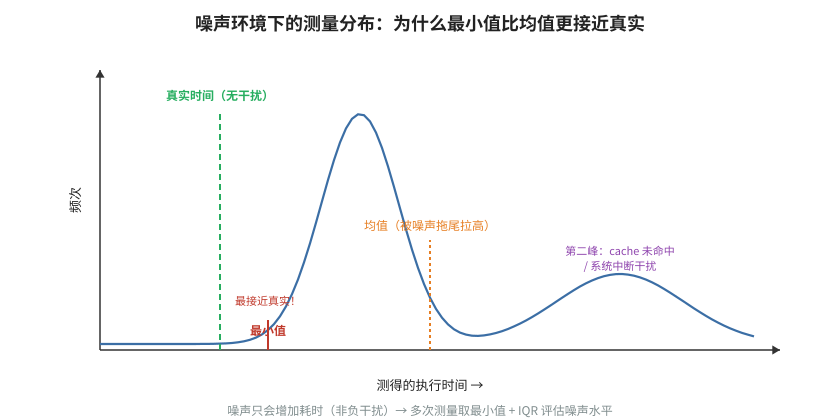


- **🎓 初学者导读**：在嘈杂环境里测速，就像在菜市场里用电子秤称菜——旁边有人碰一下秤，读数就跳一下。这篇论文告诉你，当电脑后台有别的程序在跑（比如杀毒软件突然扫描），你测出来的平均值会严重失真，从而误以为优化没效果。统计部分看不懂没关系，先记住结论：多测几次，然后优先看最小值而不是平均值，因为最小值最接近"没被干扰"的真实速度。

- **一句话概括**：为噪声环境下的计时建立了一个显式噪声模型，并从理论上论证**多次独立测量取最小值（minimum）是真实耗时的最稳健估计量**，该思想是 Julia BenchmarkTools 的设计基础。

- **背景与问题**：工程界对"多次测量后取什么统计量"长期凭习惯行事：取均值、取中位数、取最小值都有人用。本文指出在共享机器/CI 等噪声环境中，均值和中位数都会被噪声系统性地"顶上去"——因为几乎所有测量噪声都是**正向延迟**（抢占、中断、page fault、降频只会让你变慢，不会让你比物理极限更快）。前人做法的缺陷在于没有写出噪声的显式模型，也就无法分析估计量的偏差。

- **核心方法/内容详细展开**：
  - **噪声模型**：把单次测量时间建模为 `t = τ + b + Σᵢ tᵢ`，其中 `τ` 是理想耗时（被估参数），`b` 是始终存在的背景噪声（background noise），`tᵢ` 是若干种**触发式噪声**（triggered noise，如 OS 抢占、GC、cache 被邻居污染），第 i 种噪声以概率 `pᵢ` 出现。关键结构性假设：所有噪声项都是**非负**的——机器不可能比无噪声时跑得更快。
  - **均值为什么坏**：`E[t] = τ + E[b] + Σᵢ pᵢ·E[tᵢ] > τ`，偏差由噪声分布决定，噪声越大均值越乐观地"虚高"，且不同机器上的偏差不可比——这正是"同一段代码换台机器均值差 30%"的统计学解释。
  - **最小值为什么好**：最小值 `min(t₁…tₙ)` 只在"某次测量恰好躲过所有噪声"时取到接近 `τ + b_min` 的值。论文给出核心概率公式：设单次测量落在 `[τ, τ+ε]` 内的概率为 `q(ε) > 0`，则
    `P(min ≤ τ + ε) = 1 − (1 − q(ε))ⁿ`
    即只要 `q(ε)` 非零，样本量 `n` 增大时最小值以概率 1 收敛到 `τ`（加不可约背景噪声的下界）。反过来可用该式**反推需要的样本量**：想以 99% 概率拿到 `ε` 精度，需要 `n ≥ ln(0.01)/ln(1 − q(ε))`。
  - **最小值的代价**：它对**计时器分辨率**敏感——若分辨率粗于 `τ` 的真实差异，min 会粘在量化阶梯上；它也丢弃了分布形状信息（见误区）。
  - 论文还讨论了何时每种估计量适用：独占静音机器上均值可用；共享/噪声环境用 min；想刻画用户体验类指标时反而要看尾部分位数（噪声本身就是要测的东西）。

- **关键结论与数据**：论文用受控注入噪声的实验验证了模型：人为加入周期性抢占噪声后，均值偏差随噪声概率线性上升，而最小值在约数百次采样后即稳定贴地；并给出 BenchmarkTools.jl 的默认策略——每次 evaluation 至少运行足够长以摊薄计时开销，取大量 evaluation 的最小值作为报告值。

- **实战应用**：
  ```python
  import time, statistics
  def bench(f, n=100):
      for _ in range(5): f()          # 预热
      samples = []
      for _ in range(n):
          t0 = time.perf_counter_ns(); f(); samples.append(time.perf_counter_ns()-t0)
      return min(samples), statistics.median(samples)  # 报 min 为主，median 辅助
  ```
  Julia 中直接 `@btime f($x)`（内部即取 min）；C++ Google Benchmark 里用 `--benchmark_repetitions=N --benchmark_report_aggregates_only=false` 后自行取各 repetition 的最小值，或用 `--benchmark_min_time` 保证总采样时长。CI 环境（共享 runner）务必用 min 而不是 mean。

- **与 perf-book 对应章节**：第 2 章 "Measuring Performance" 中关于噪声来源与测量统计量的讨论。

- **常见误区/注意事项**：min 只告诉你"最好情况"，若你的目标是最坏情况延迟（实时系统）应该看 p99 而非 min；min 会把**真实回归**和噪声一起滤掉——如果代码有两条性能模式（如分支预测时好时坏），min 只看好的那个模式；样本量不足时 min 不稳定，应配 bootstrap 置信区间；计时开销本身（`perf_counter` 调用约 20–50 ns）是 min 的下限。

### 3. "Producing Wrong Data Without Doing Anything Obviously Wrong!"（Todd Mytkowicz, Amer Diwan, Matthias Hauswirth, Peter Sweeney, ASPLOS 2009）


- **🎓 初学者导读**：这篇就像你换了双新鞋去跑步，成绩变快了，你以为鞋有魔力，其实只是那天顺风而已。它能帮你避开一个隐蔽的坑：仅仅改一下环境变量长度或者链接顺序（跟你的优化毫无关系的改动），测出来的性能就能差 5% 以上，让你白高兴或白沮丧一场。读不懂细节不要紧，记住这个震撼人心的结论就行：测出来的差异不一定是你的代码造成的，可能只是内存布局碰巧变了。

- **一句话概括**：经典警世之作：仅改变 **UNIX 环境变量总大小**或**链接顺序**这类"与代码无关"的因素，就能让同一对二进制之间的相对性能出现两位数的正负摆动，足以推翻诸如 "−O3 比 −O2 快" 的结论。

- **背景与问题**：当时的性能评估范式是"固定一套实验设置 → 跑基准 → 比较均值"。作者怀疑：**结论有多少来自被测改动本身，多少来自实验设置的偶然性**？前人（包括许多顶会论文）完全不控制、不报告这些外部因素，因此结论的复现性存疑。

- **核心方法/内容详细展开**：
  - **两个被操纵的"无辜"变量**：
    1. **环境变量大小**：在 shell 中追加不同长度的无用环境变量再启动程序。因为环境变量存放在进程地址空间顶端、紧邻栈底，其总大小改变会使**栈基址整体平移**，进而改变所有局部变量的对齐——某个关键 spill slot 是否跨 cache line、store-to-load forwarding 是否命中，都会随之改变。
    2. **链接顺序（link order）**：将目标文件按不同排列传给链接器。链接顺序决定各函数在地址空间中的落位，改变**代码对齐**（循环入口是否落在 16/32 字节边界）、函数间相对位置（i-cache 冲突、分支目标缓冲 BTB 混叠）。
  - **实验设计**：在 SPEC CPU2006 上，对同一编译选项组合，系统性地枚举多种环境大小与多种链接顺序，对每种设置测 `−O3` 相对 `−O2` 的"加速比"，然后考察加速比的**跨设置分布**。
  - **因果链分析**：论文用硬件计数器和对齐敏感性分析，把性能摆动归因到具体微架构事件（cache 冲突未命中、4K aliasing 导致的 load-store 冲突、分支预测器混叠），证明这不是"测量噪声"而是**布局决定的系统性偏差**——重跑同一设置结果稳定，换设置结果就跳。
  - **统计建议**：结论应以"跨多种设置的性能分布"形式给出（箱线图），用适当的显著性检验判断"优化是否稳健地为正"，而不是单一设置下的一对数字。

- **关键结论与数据**：论文报告在多个 SPEC 基准上，仅环境变量大小不同造成的性能差异可达约 5%，链接顺序造成的差异同样达数个百分点；叠加后 `−O3` vs `−O2` 的表观加速比在不同设置间可以从"明显为正"翻转到"明显为负"——即**同一个编译器问题，不同的无辜设置会导出相反的工程结论**。个别基准（如对对齐极度敏感的 perlbench）波动超过 10%。

- **实战应用**：
  - 复现实验 A（环境变量）：`pad=$(head -c $N /dev/zero | tr '\0' 'x'); env "DUMMY=$pad" ./mybench`——在 N 取 0、100、500、2000 下各测若干次，看结果是否漂移；漂移大说明结论可能被对齐主导。
  - 复现实验 B（链接顺序）：`gcc *.o` 时 shuffle `.o` 列表（`ls *.o | shuf`），或直接用 `lld` 的 `--shuffle-sections`。
  - 工程对策：(1) 任何 A/B 性能对比都在 ≥ 3 种布局扰动下重复；(2) 报告跨设置分布而非单点；(3) 若结论对布局敏感，用 PGO/BOLT 这类显式布局优化把"好布局"固化下来，而不是碰运气；(4) 读到"我们的方法快 7%"的论文时先问：方差多大、几种设置。

- **与 perf-book 对应章节**：第 2 章 "Measuring Performance"（perf-book 明确引用本文讨论测量偏差）；也与第 11 章代码布局优化（PGO/BOLT）互为因果。

- **常见误区/注意事项**：把这 ±5% 当成"随机噪声用多次平均就能消掉"——它是**设置内确定、设置间跳变**的系统偏差，同一设置跑一万次也平均不掉；以为现代 CPU 对对齐不敏感——4K aliasing、DCU split 至今存在；CI 性能测试中每次构建二进制布局都会变，等于每轮 CI 都在抽"布局彩票"，这是回归误报的重要来源（引出下一篇 STABILIZER）。

### 4. "STABILIZER: Statistically Sound Performance Evaluation"（Charlie Curtsinger & Emery Berger, ASPLOS 2013）


- **🎓 初学者导读**：想公平地比较两位选手，就得让他们在同一条件下比赛，而不是一个顺风一个逆风。这篇接着上一篇的问题给了解药：它做了一个工具，每次运行都故意把代码和数据在内存里的摆放位置打乱，让那些"碰巧"的布局因素互相抵消，这样剩下的差异才真正来自你的改动。工具实现看不懂没关系，先记住理念：测不准时就想办法把运气因素随机化，多随机几次取统计结果。

- **一句话概括**：通过在运行时持续随机化**函数位置、栈帧位置、堆对象位置**三大布局，使程序执行时间收敛到近似正态分布，从而让经典的 t 检验可以严格地回答"这个优化到底有没有用"。

- **背景与问题**：Mytkowicz 等人（上一篇）证明了布局是隐藏的混杂变量，但他们的对策（手动枚举几种设置）既不彻底也不成体系：布局空间是天文数字，采 5 个点无法代表总体；而且固定布局下的重复测量不独立，违反统计检验假设。Curtsinger & Berger 的思路釜底抽薪：**与其控制布局，不如把布局变成显式的随机变量并充分采样**，让中心极限定理（CLT）把性能分布"洗"成正态，之后一切经典统计工具都合法。

- **核心方法/内容详细展开**：
  - **实现**：STABILIZER 是一个 LLVM 编译器 pass + 运行时库，对目标程序透明（重编译即可，不改源码）。
  - **机制一：函数重排（function randomization）**。编译时给每个函数体前后插入随机长度的 pad（0–255 字节的随机对齐填充），消除函数内代码对齐的影响；运行时一个专用线程**每 500 ms（默认间隔）把全部函数整体搬迁到新的随机地址**——通过维护一张间接跳转表（relocation table）实现，搬迁时更新表项，调用方无需修改。于是一次运行内就采样了成百上千种代码布局，函数间 i-cache/BTB 冲突被均匀化。
  - **机制二：栈随机化（stack randomization）**。每个函数调用被改写为先执行一个随机大小（最多一页 4096 字节内）的栈填充（相当于随机 `alloca`），再进入真正的函数体。这样局部变量相对页/cache line 的对齐在调用间随机变化，等价于把 Mytkowicz 的"环境变量大小扰动"自动化、密集化。
  - **机制三：堆随机化（heap randomization）**。替换分配器为 DieHard 风格：堆按 size class 分区，每个 size class 的空闲槽位用随机化空闲表管理，分配时随机选槽；大对象额外随机加 pad。对象间 cache 冲突、false sharing 的位置关系被随机化。
  - **统计框架**：三管齐下后，作者验证多个基准的执行时间直方图呈单峰近似正态（论文给出分布检验）；于是对"优化前 vs 优化后"两个样本做 **Student's t 检验**（或速度比的配对检验），报告 p 值与置信区间。STABILIZER 还提供 API 让 benchmark 在函数搬迁边界对齐计时，保证每次计时落在单一布局内、样本独立。
  - **开销**：间接跳转 + 定期搬迁约带来中等个位数到 ~15% 的平均性能损失（视工作负载），但作为**评估工具**而非生产运行时，这个代价可接受。

- **关键结论与数据**：作者在 SPEC CPU2006 上用 STABILIZER 重测了 `−O3` 相对 `−O2` 的效果：在随机化布局下，多数基准上 O3 的表观加速**在统计上不显著**（95% 置信区间跨过 0）——这与 Mytkowicz 的警告相互印证：许多被当作"编译器优化收益"的数字其实是布局运气。论文还复现了若干已发表优化技术，显示部分结论在严格检验下缩水。

- **实战应用**：
  - 直接启示（不必真的部署 STABILIZER）：**A/B 对比必须配统计检验**。最小可用流程：两个版本各跑 n ≥ 15–30 次（跨进程重启、跨二进制布局扰动），用 t 检验（分布近似正态时）或 Mann-Whitney U 检验（不假设分布）：
    ```python
    from scipy.stats import mannwhitneyu
    stat, p = mannwhitneyu(times_new, times_old, alternative='less')
    # p < 0.05 且效应量（中位数差/噪声尺度）有实际意义，才宣称"更快"
    ```
  - 报告格式：`new/old = 0.97 ± 0.02 (95% CI), p = 0.01`，而不是 "快了 3%"。
  - 无法重编译时，用链接顺序 shuffle + 环境变量 padding（上一篇的手法）做穷人版布局随机化。

- **与 perf-book 对应章节**：第 2 章 "Measuring Performance" 中 "comparing performance measurements" 的统计学部分（perf-book 直接讨论 STABILIZER 与 t 检验）。

- **常见误区/注意事项**：正态性是**随机化的结果而非假设**——不在 STABILIZER 下跑就直接用 t 检验，遇到多峰/重尾分布（有 page fault、GC 的样本）会失效，这时用非参数检验或 bootstrap；t 检验显著 ≠ 实际重要，务必同时看效应量；500 ms 搬迁周期意味着短于该周期的 benchmark 只能采到一种布局，需显式多次运行；间接跳转开销使绝对数值不代表生产性能，STABILIZER 只用于相对比较。

### 5. "How to Benchmark Code Execution Times on Intel IA-32 and IA-64 Instruction Set Architectures"（Gabriele Paoloni, Intel, 2010）


- **🎓 初学者导读**：用 CPU 自带的计时器读时间，就像用一把刻度极细的尺子量东西——但尺子的零点可能不准，得先扣掉尺子本身的误差。这篇 Intel 官方文档能帮你避开"测一个 1 微秒的操作，结果 0.5 微秒都是计时开销"的坑，教你正确使用 rdtsc（CPU 内部的时间戳计数器）这类底层工具。汇编代码看着吓人，但核心套路就一句：先空跑一次测出"计时本身花多少时间"，再把它从结果里减掉。

- **一句话概括**：Intel 官方白皮书，给出在乱序执行 CPU 上用 `RDTSC`/`RDTSCP` + `CPUID` 精确测量代码段执行周期的**标准指令序列**，并处理频率缩放、多核迁移、测量开销扣除等问题。

- **背景与问题**：`RDTSC` 读取 Time Stamp Counter，是用户态最廉价的周期级时钟（单次约 20–40 周期开销）。但现代 x86 乱序执行意味着指令完成顺序与程序顺序不同：**`RDTSC` 可能在其"之前"的指令尚未执行完时就发出**，测出的区间会漏掉被测代码的尾部；同理区间的开始也可能被污染。此外老式处理器的 TSC 频率随核频变化（变频时"周期数"失去意义），多核之间 TSC 可能不同步（线程迁移后计数跳变）。不了解这些就直接包 `RDTSC`，得到的数字系统性地错误。

- **核心方法/内容详细展开**：
  - **序列化语义**：`CPUID` 是**完全序列化指令**（执行前清空流水线，之前的指令全部退休后才执行，之后的指令不得提前开始）；`RDTSC` 无序化；`RDTSCP` 是**部分序列化**——它等待所有先前的指令在本地执行完毕后才读取计数器，但后续指令仍可提前开始，所以它适合放在区间**末尾**（再补一个 `CPUID` 防止后面的代码混入），不适合放在开头。
  - **标准测量序列**（论文核心贡献）：
    ```asm
    ; ---- 区间开始 ----
    CPUID            ; 序列化：等前面的指令全部退休
    RDTSC            ; 读 TSC -> EDX:EAX，存起来
    ; ---- 被测代码 ----
    ...
    ; ---- 区间结束 ----
    RDTSCP           ; 等被测代码全部执行完，再读 TSC
    CPUID            ; 阻止后续指令提前进入测量区间
    ```
    开头用 `CPUID;RDTSC`（RDTSC 放在 CPUID 之后，CPU 保证其不被提前）；结尾用 `RDTSCP;CPUID`（RDTSCP 自身保证被测代码已排空，CPUID 兜底防止后续代码渗入）。
  - **不变 TSC（invariant TSC）**：通过 `CPUID.80000007H:EDX[8]` 检查 `constant_tsc`/`nonstop_tsc` 标志。现代 Intel/AMD CPU 的 TSC 以恒定速率运行且跨核同步，此时 TSC 测的是"墙钟周期"而非"核周期"——论文要求基准测试前确认此特性，否则必须禁用变频（TurboBoost、SpeedStep）或改用核周期计数器（PMU 的 `CPU_CLK_UNHALTED`）。
  - **测量开销扣除**：用上面的序列包一个**空区间**，重复多次取最小值作为测量自身开销 `o`；之后所有结果减去 `o`。论文实测给出典型开销在数十周期量级（因微架构而异，必须自测）。
  - **实验规程**：(1) 预热（先跑几遍让代码/数据进 cache、分支预测器训练好）；(2) 用线程亲和性（affinity）把线程钉在一个核上，防止迁移破坏 TSC 一致性与 cache 热度；(3) 关闭或固定变频（BIOS/电源策略），否则周期数与秒数不可换算；(4) 提升优先级/关中断窗口减小抢占；(5) 重复测量取最小值（呼应 Chen & Revels 的模型：噪声皆为正）；(6) 测量区间应远大于开销（建议被测段至少数百周期，或用重复展开放大）。
  - **IA-64 部分**：Itanium 上用 `mov ar.itc` 读 Interval Time Counter，配合 `;;` 停顿与序列化语义做同样的事；原理相同，细节从略。

- **关键结论与数据**：论文给出 RDTSC 读取本身的开销与波动实测（约 20–40 周期的量级，依平台不同），并展示了不做序列化时测量结果出现的负偏差/错乱样例；强调只要有 invariant TSC + affinity + 预热 + 扣开销，RDTSC 方案对几十到几万周期量级的代码段都能给出可复现的周期数。

- **实战应用**（C 内联汇编，GCC/Clang，x86-64）：
  ```c
  static inline uint64_t tsc_begin(void) {
      unsigned aux; __builtin_ia32_lfence();            // lfence 也常用来替代 cpuid（更便宜）
      return __builtin_ia32_rdtscp(&aux);               // 开始：lfence + rdtsc 亦可
  }
  static inline uint64_t tsc_end(void) {
      unsigned aux; uint64_t t = __builtin_ia32_rdtscp(&aux);
      __builtin_ia32_lfence(); return t;
  }
  // 校准开销：o = min over k of (tsc_end()-tsc_begin()) 空对
  // 正式测量：cycles = min over k of (tsc_end()-tsc_begin()) - o
  ```
  检查 invariant TSC：`grep -o 'constant_tsc\|nonstop_tsc' /proc/cpuinfo`；钉核：`taskset -c 3 ./bench` 或 `sched_setaffinity`；注意 RDTSC 与 `perf` 的关系——`perf stat` 用 PMU 的 `cycles` 事件往往更方便且自动处理序列化语义，RDTSC 适合嵌在代码内部做细粒度分段计时（如 Agner Fog 风格的微基准）。

- **与 perf-book 对应章节**：第 2 章 "Measuring Performance"（perf-book 介绍了 RDTSC 计时法及其适用场景）；PMU 替代方案对应第 6 章。

- **常见误区/注意事项**：在变频开启时把 TSC 差值当"核周期"（TSC 恒定走参考频率，核频在跳，二者背离）；线程未钉核导致跨核 TSC 比较；忘记扣测量开销——测 50 周期的代码段时 30 周期开销是致命的；把 RDTSC 序列插进被编译器重排的代码中间而不加编译器屏障（`asm volatile` + `"memory"` clobber 缺一不可）；SMT 兄弟线程的干扰会让"独占核"假设失效，严谨场合关 HT。

### 6. 《Systems Performance: Enterprise and the Cloud》（Brendan Gregg, 2013；第二版 2020）


- **🎓 初学者导读**：排查系统慢的原因就像医生看病——不能病人说"不舒服"就直接开刀，得先量体温、验血、拍片，一步步缩小范围。这本书能帮你避开"凭直觉乱优化"的坑：很多人生怕程序慢，上来就改代码，结果真正瓶颈其实在磁盘或网络上，白忙一场。书很厚不用全读，新手先学会它的思路就够了：先问"系统整体哪里最堵"，再决定改哪行代码，并且每次只改一处、改完必复测。

- **一句话概括**：系统性能工程的方法论总纲——以 **USE 方法**（Utilization, Saturation, Errors）、负载特征化（workload characterization）、主动基准测试（active benchmarking）和对基准测试陷阱的系统清算著称。

- **背景与问题**：在 Gregg 之前，性能分析高度依赖个人经验与"随手跑个 top 看看"的随机游走：症状驱动的排查既慢又容易漏掉根因；基准测试则普遍是"装个工具跑分，信了它的数字"。Gregg 指出两大缺陷：(1) **缺少方法论**——没有从"全部资源"出发的完备检查路径，排查覆盖度靠运气；(2) **基准测试诚信缺失**——厂商基准测的是基准工具自己，工程师常犯 passive benchmarking（跑完不分析、照单全收）的错误。

- **核心方法/内容详细展开**：
  - **方法论章节**（第 2 章）是全书灵魂：
    - **USE 方法**：对每个资源（CPU、内存、磁盘、网络、总线……）只检查三个指标——**使用率**（utilization，忙的时间比例）、**饱和度**（saturation，排队/溢出程度，如 run queue 长度）、**错误**（errors）。它把"该看什么"从无穷多的指标压缩为 3×N 的完备清单，保证不漏资源。CPU 例子：utilization 看 `%usr+%sys`，saturation 看 load average / run queue 长度（> 核数即有排队），errors 看机器检查、可纠正 ECC。
    - **负载特征化 vs 钻取分析（drill-down）**：性能问题分两类——负载问题（谁来都慢：先特征化负载本身，问"谁、什么、为什么"，如 80% 请求来自一个失控的客户端）与架构问题（同样的负载别人快：自顶向下逐层钻取）。两者方法论不同，混淆会浪费时间。
    - **延迟分析**：以延迟（而非 IOPS/吞吐）为主指标，因为延迟可分解（排队延迟 + 服务延迟）且直接对应用户体验；强调延迟分布几乎总是**非正态**——必须看直方图、热力图和 p50/p99/max，均值会藏住尾部。
    - **反方法论清单**（极具教学价值）：streetlight anti-method（只看方便看的指标，如只盯 CPU）、drunk man anti-method（随机调参直到"看起来"好转）、random change（盲改配置碰运气）、passive benchmarking（跑完基准不验证它到底测了什么）。
  - **基准测试章节**：区分 **micro-benchmark**（测单一维度，如磁盘顺序读带宽）与 **macro-benchmark**（模拟真实负载，测系统整体）；提出 **active benchmarking** 规程：跑基准的同时用其他工具观察系统，验证基准确实在施压于你以为的部件（"double-check what the benchmark measures"）；基准设计检查单包括：测量目标（不是工具本身）、ramp-up 预热、多次重复报方差、记录全部配置、确认未触到无关瓶颈（如网卡打满时测不出 CPU 差异）。
  - **CPU 章节**（与本书主题最相关）：缓存层级与访问延迟数量级表（著名的 "latency numbers every programmer should know" 的系统化版本）；run queue 与调度延迟；`mpstat -P ALL` 看单核不均衡、`perf` 做 cycle 级归因；CPU affinity、变频（turbo）对测量的影响。
  - **统计学基础**：均值/中位数/百分位的适用性，CoV（变异系数 = σ/μ）作为噪声指标，以及"先画分布再谈均值"的一贯主张。

- **关键结论与数据**：书中给出的数量级表（L1 ~1 ns 级、内存 ~100 ns 级、SSD ~100 μs 级、磁盘 ~ms 级）是性能直觉的锚点；USE 方法在 Netflix 等生产环境中被验证为值班排查的标配流程；Gregg 展示过多个"基准工具自己被 benchmark 骗了"的案例（如工具默认用小文件全命中 page cache，测的不是磁盘）。

- **实战应用**：
  - USE 一行流：`vmstat 1`（r 列 = CPU 饱和）、`mpstat -P ALL 1`、`iostat -x 1`（%util + avgqu-sz）、`free -m`、`sar -n DEV 1`，30 秒完成一轮全资源扫描。
  - 主动基准示例：跑 `fio` 测磁盘时同时 `iostat -x 1` + `perf top` 确认 I/O 真的落盘（`O_DIRECT`）且 CPU 没先打满。
  - 延迟观测：`perf record` + 直方图，或 eBPF 的 `funclatency`/`runqlat`（run queue 延迟，直接量 CPU 饱和度）。
  - 任何性能结论附三件套：负载描述（什么请求、多大并发）、分布（p50/p99/max，不是均值）、系统状态（USE 三指标截图）。

- **与 perf-book 对应章节**：与 perf-book 第 2 章（测量）与第 5 章（性能分析方法）直接对应；Gregg 的系统级视角与 perf-book 的微架构级视角互补——先用 USE/负载特征化定位到"是 CPU 瓶颈"，再进 perf-book 的自顶向下微架构分析。

- **常见误区/注意事项**：USE 的 utilization 对短时尖峰不敏感（1 秒采样会抹平 10 ms 突发），饱和指标更诚实；load average 在 Linux 包含不可中断 I/O 线程，不是纯 CPU 排队；"%util 100%" 不代表设备是瓶颈（现代 SSD/RAID 可并行，util 只反映"有请求在飞"）；基准测出的峰值吞吐不等于生产延迟表现——吞吐与延迟由 Little's Law 耦合，高利用率下延迟非线性爆炸。

## 三、性能回归自动检测与统计方法

单次测量再精确，也解决不了持续集成中的核心矛盾：每个 commit 都可能引入回归，而性能数据噪声大、分布怪、标签稀缺，靠人肉盯图或固定阈值要么误报成灾要么漏报致命。本章 5 篇文献构成一条清晰的演进线：从变化点检测的统计学根基（E-Divisive），到 MongoDB 把它工程化为 CI 流水线，再到 HPC 场景的无监督异常检测与 LinkedIn 的分位数指标检验——回答的是"如何自动、可信、可规模化地说：这次变慢了"。

### 7. "A Zero-Positive Learning Approach for Diagnosing Software Performance Regressions"（S. Alam et al., NeurIPS 2019）


- **🎓 初学者导读**：让机器自动发现性能退化，就像教保安看监控——难点在于"正常"的样子千千万，你却几乎拿不出几个"出事"的录像给他学习。这篇论文解决的正是这个尴尬：性能退化（新版本突然变慢）的例子太少见，传统方法学不会报警，作者们用"只学正常模式、不正常就算异常"的思路绕了过去。机器学习的公式可以跳过，记住启发即可：盯着"和平时不一样"的信号，往往比定义"什么叫慢"更实用。

- **一句话概括**：针对"几乎没有带标注的回归样本"这一现实，提出**只用正常（无回归）运行的硬件计数器数据训练 autoencoder**，以重构误差作为回归告警分数的无监督检测方法。

- **背景与问题**：HPC 与大型系统软件的性能回归检测面临一个机器学习上的尴尬：想做监督学习需要大量"回归/正常"标注样本，但真实回归**极少发生且事后标注昂贵**——训练集里几乎全是"正常"（zero positive examples）。固定阈值法对噪声和负载漂移无能为力；而 HPC 环境还有作业调度、节点差异等额外噪声。前人用的简单统计过程控制（控制图）假设数据平稳且单变量，面对几十维硬件计数器向量力不从心。

- **核心方法/内容详细展开**：
  - **问题形式化**：每次运行（某 commit / 某作业）采集一组性能特征向量 `x ∈ R^d`——硬件计数器（cycles、instructions、cache misses、branch mispredictions 等，经 PAPI/perf 采集）及派生指标（IPC 等）。正常样本构成训练集 `D = {x₁…xₙ}`；测试时对新样本判断其是否来自"正常分布"。
  - **Autoencoder 检测器**：训练一个欠完备自编码器 `f = dec(enc(x))`，瓶颈层维度远小于 `d`，使网络只能学会**正常数据的低维流形**；正常样本重构误差 `r(x) = ‖x − f(x)‖²` 小，回归样本因偏离流形而 `r(x)` 大。阈值取训练（或留出验证）集重构误差的高分位数（如 99 分位），测试样本超过阈值即告警。
  - **诊断（diagnosing）而非仅检测**：重构误差可**逐特征分解** `r(x) = Σⱼ (xⱼ − f(x)ⱼ)²`，把贡献最大的 top-k 特征（如 L2 miss、IPC）报告给开发者，直接提示回归的可能性质——这是标题中 "diagnosing" 的含义，也是相对黑盒异常分数的关键增值。
  - **与基线对比**：论文将该方法与 one-class SVM、PCA 重构误差法、单变量控制图等比较，在 HPC 代理应用（mini-apps）+ 注入式回归（人为引入性能退化代码改动）的评测协议下比较 precision/recall/F1。Autoencoder 在非线性计数器相关性上优于 PCA，对噪声更鲁棒。
  - **训练细节要点**：特征需标准化（计数器量级差异巨大）；用交叉验证选瓶颈维度与阈值分位数；训练集要覆盖"正常的多样性"（不同输入规模、不同节点），否则把正常波动也当异常。

- **关键结论与数据**：论文报告在注入回归的 HPC 代理应用数据集上，autoencoder 方案的检测精度显著优于 one-class SVM 与 PCA 基线，且能在不产生大量误报的前提下捕捉小到中等幅度的注入回归；逐特征归因与已知注入改动的性质（如内存访问模式改动 → cache 计数器异常）相符。

- **实战应用**（自建最小可用版本）：
  ```python
  # 每个 commit 跑基准时收集：perf stat -e cycles,instructions,L1-dcache-load-misses,... ./bench
  # 训练（只喂 main 分支的健康样本）
  from tensorflow.keras import Sequential
  from tensorflow.keras.layers import Dense
  ae = Sequential([Dense(8, activation='relu', input_shape=(d,)),
                   Dense(4, activation='relu'),
                   Dense(8, activation='relu'), Dense(d)])
  ae.compile(optimizer='adam', loss='mse'); ae.fit(X_normal, X_normal, epochs=100)
  err = ((ae.predict(X_normal) - X_normal)**2).mean(axis=1)
  threshold = np.quantile(err, 0.99)
  # CI 中：err_new > threshold → 告警；打印 (x - f(x))² 最大的 3 个特征
  ```
  落地要点：计数器集合要固定且与微架构绑定（换 CPU 型号要重训）；先把计数器归一化为比率（IPC、miss rate）比原始计数更稳；阈值分位数决定误报率预算。

- **与 perf-book 对应章节**：第 2 章 "Measuring Performance" 中关于自动化回归检测的讨论；采集层对应第 6 章 PMU 硬件计数器。

- **常见误区/注意事项**："零正例"方法检测的是**异常**而非**回归**——变好也会告警（其实是好事，值得人工看一眼）；训练集若混入未发现的回归，模型会把病灶学进"正常流形"（数据卫生是最大风险）；autoencoder 需要相当数量的正常样本，新测试刚上线、历史不足时应退回简单方法（如中位数 ± k·MAD）；阈值告警后仍需人工/二次复测确认，不宜直接自动回滚。

### 8. "The Use of Change Point Detection to Identify Software Performance Regressions in a CI System"（David Daly, William Brown, Henrik Ingo, James O'Leary, David Bradford, ICPE 2020）

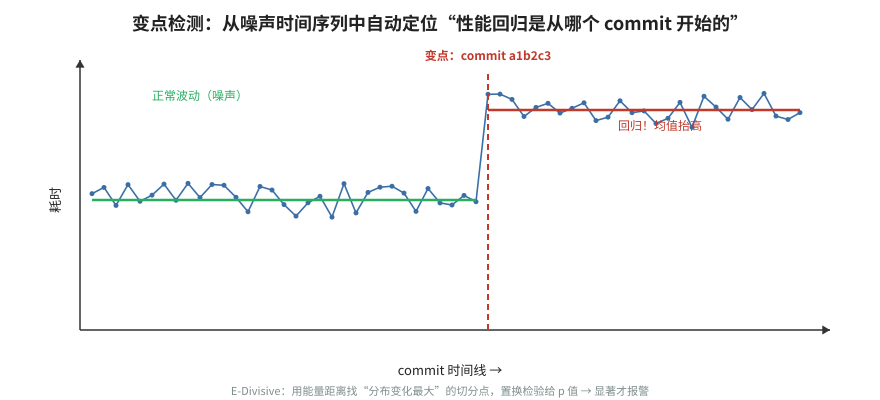


- **🎓 初学者导读**：每天自动跑性能测试，数据就像一条心电图——噪声让曲线天天抖动，真正的问题是哪一跳才算"心梗"而不是"手抖"。这篇来自 MongoDB 的实战论文能帮你避开"每次提交都报警、最后没人理报警"的坑：它用变点检测（找到数据从某个点开始整体变差的方法）来区分"偶然波动"和"真的退化"。统计推导看不懂没关系，记住场景结论：性能回归要找的是"持续的台阶式变化"，而不是"某一天的毛刺"。

- **一句话概括**：MongoDB 性能团队把基于能量距离的非参数变化点检测（E-Divisive）引入持续集成，替代人工阈值与看图分诊，实现了**对每个性能测试时间序列自动发现"分布发生持久改变的那个 commit"**。

- **背景与问题**：MongoDB 的 CI（Evergreen）对每个 commit 跑大量系统级性能测试，产生海量时间序列。此前的做法——固定百分比阈值、滑动窗口比较、工程师每日看图分诊——有三宗罪：(1) 阈值一刀切，对低方差测试太松（漏报小回归）、对高方差测试太紧（误报成灾）；(2) 性能回归常在 commit 合入后由**后续数据**才能确认，人工盯不过来；(3) 分诊成本高到工程师开始忽略告警（告警疲劳）。业界同期常见方案（如单变量控制图、双侧 t 检验滑窗）要么假设正态，要么只能发现均值跳变且对多峰噪声鲁棒性差。

- **核心方法/内容详细展开**：
  - **检测对象**：每个测试的历史结果按 commit 顺序构成时间序列 `y₁…y_T`（每个 commit 通常只有 1 个或少数几个样本——这是与"重复测量"场景的本质区别，也是必须逐点检测的原因）。
  - **核心算法**：采用 Matteson & James 的 **E-Divisive with Medians（EDM）**：对序列做分裂式递归切分，每一步寻找使左右两段"分布差异"（能量统计量）最大的切点，用置换检验（permutation test）判断显著性（详见下一篇的方法分解）。它**非参数**（不假设分布形状）、能检测**任意分布变化**（不止均值，方差/形状突变也能抓住）。
  - **CI 集成流水线**：新数据点到达 → 对该测试序列运行 E-Divisive → 若发现新变化点，将其映射到具体 commit → 自动生成 JIRA 工单进入分诊队列 → 工程师确认（真回归转开发修复 / 误报标记反馈）。论文强调**把历史已确认回归作为评测集**，离线调参（显著性水平、最小分段长度、置换次数）后再上线。
  - **工程调参经验**：`min.size`（最小分段长度）太小会追逐瞬时毛刺，太大会漏掉紧邻的连续回归；显著性水平直接是误报率预算；对异方差测试序列，先对序列做稳健化（如取每个 commit 多次运行的 median）再检测；变化点定位存在滞后——新数据点越多，对"几天前那个 commit"的判断越准，因此流水线会**回溯修正**此前判定。

- **关键结论与数据**：论文报告该系统在 MongoDB 生产 CI 上线后，相对此前的人工/阈值流程**显著降低了误报率并缩短了回归发现时间**；用历史已知回归做回放评测，E-Divisive 方案在可接受误报率下找回了绝大多数真实回归，包括一些幅度小但持久的"温水煮青蛙"型退化。该工作使 MongoDB 把性能分诊从"全职人肉"变为"算法初筛 + 人工复核"。

- **实战应用**：
  ```r
  library(ecp)
  # ys: 按 commit 顺序的测试结果向量（每点一次运行或多次运行的 median）
  res <- e.divisive(matrix(ys, ncol = 1), sig.lvl = 0.05, R = 499, min.size = 10)
  res$estimates   # 估计出的变化点位置（1-based），最后一个即最新回归点
  ```
  CI 集成检查单：(1) 每个测试维护持续序列（键 = 测试 × 平台 × 负载配置，千万别混平台）；(2) 新点到来时对尾部窗口（而非全史）跑检测以控时延；(3) 告警带上下文：变化点 commit、变化前后中位数比、置信度；(4) 保留人工"误报"标注回流，定期重调参数；(5) 多测试并发行进时做多重比较意识（成百上千个序列 × 5% 显著性 = 大量期望误报，可收紧 sig.lvl 或用分层检测）。

- **与 perf-book 对应章节**：第 2 章 "Measuring Performance" 中 "automated detection of performance regressions" 一节正是以 MongoDB 这套实践为原型。

- **常见误区/注意事项**：变化点检测回答"**何时**分布变了"，不回答"**哪次提交是罪魁**"——一个变化点区间内可能含多个 commit，需 bisect；基础设施变更（换机型、换内核、编译器升级）会制造巨量"真实但无关代码"的变化点，必须把环境版本纳入序列键或作为协变量；序列太短（< 2×min.size）无法检测，新测试要有静默期；E-Divisive 计算量为 O(R·T²)，长序列需截窗。

### 9. "A Nonparametric Approach for Multiple Change Point Analysis of Multivariate Data"（David S. Matteson & Nicholas A. James, JASA 2014）


- **🎓 初学者导读**：找成绩下滑的时间点，就像回看一个学生一年的考试分数，找出他到底是哪个月开始掉队的——而且可能掉队了不止一次。这篇是上一篇用到的数学工具（E-divisive 变点检测）的原始论文，能帮你理解"为什么这种方法不用提前假设数据长什么样也能找出多个突变点"。数学证明完全可以跳过，只需知道：这是一个现成的、把"一段时好时坏的数据切成若干稳定段"的通用工具，很多语言都有现成库可直接调用。

- **一句话概括**：提出 **E-Divisive** 算法——以**能量距离（energy distance）**度量分布差异、以分裂式层次切分定位多个变化点、以置换检验控制显著性的完全非参数变化点检测方法，是 MongoDB CI 方案（上一篇）的统计学根基。

- **背景与问题**：经典变化点方法（CUSUM、二元分割的均值检验、似然比检验）大多只能检测**均值**变化且假设分布形式（正态/指数族）；真实性能数据多峰、重尾、异方差，回归有时只表现为**方差变大或分布形状改变**而均值几乎不动——这类回归对参数方法隐形。多变量场景（多维计数器向量）下问题更甚。需要一种不假设分布、能检测**任意分布变化**且能找**多个**变化点的方法。

- **核心方法/内容详细展开**：
  - **能量距离（energy distance）**：对分布 F、G，取独立样本 `X, X′ ~ F`，`Y, Y′ ~ G`，定义
    `D(F, G) = 2·E‖X − Y‖ − E‖X − X′‖ − E‖Y − Y′‖`
    其中 `‖·‖` 为欧氏范数（可推广为 `‖·‖^α`，`α ∈ (0, 2)`，论文用 α=1 为主）。性质：`D ≥ 0`，且 **D = 0 当且仅当 F = G**——这是它强于"比较均值"的根本原因：任何分布差异都会使 D 为正。直觉解读：前一项是跨组平均距离，后两项是组内平均距离；两组同分布时三者相消。
  - **样本版散度统计量**：把序列在候选切点 τ 处分成 `X = {z₁…z_τ}` 与 `Y = {z_{τ+1}…z_T}`，定义经验散度
    `Q(τ) = (τ·(T−τ)/T) · [ (2/(τ(T−τ)))ΣᵢΣⱼ‖xᵢ−yⱼ‖^α − C(τ,2)⁻¹Σ_{i<i′}‖xᵢ−xᵢ′‖^α − C(T−τ,2)⁻¹Σ_{j<j′}‖yⱼ−yⱼ′‖^α ]`
    即"缩放后的组间能量统计量"。遍历 τ 取 `Q` 最大者为候选变化点。
  - **置换检验定显著性**：无分布假设下如何给 `Q_max` 定阈值？把序列顺序随机打乱 R 次（R 常取 499/999），每次重算 `Q_max`，得到原假设"无变化点"下的参考分布；若真实 `Q_max` 超过置换样本的 (1−sig.lvl) 分位数，判定该变化点显著。
  - **分裂式递归（divisive hierarchy）**：若切点显著，则把序列在该点断开，对左右两段**分别递归**重复上述过程，直到每段内不再有显著变化点或段长小于 `min.size`。这一"自顶向下二分"策略自然产生**多个**变化点，且每个都带显著性背书。论文证明了该程序在相当一般的条件下的相合性（样本趋于无穷时变化点集合估计收敛）。
  - **计算复杂度**：单轮 `Q` 的朴素计算为 O(T²)，乘 R 次置换与递归深度——对长序列是主要成本，实践中配合截窗或子采样。
  - **E-Divisive with Medians（EDM）**：针对每个时间点只有一次观测、组内距离退化的场景，作者（及后续工作）给出基于中位数的变体，更适合 CI 逐 commit 单点序列——MongoDB 用的正是它。

- **关键结论与数据**：论文在模拟数据上展示：对纯方差变化、重尾分布变化等"均值检验完全失明"的场景，E-Divisive 仍能高功效定位变化点；与二元分割（binary segmentation）+ 参数检验相比，在非正态数据上误报控制明显更好；并应用于实际金融与基因数据。JASA 发表使其成为非参数多变点检测的标准参照方法。

- **实战应用**：
  ```r
  library(ecp)
  X <- matrix(series, ncol = 1)          # 或多维计数器矩阵
  out <- e.divisive(X, sig.lvl = 0.05, R = 499, min.size = 15, alpha = 1)
  out$estimates                          # 变化点下标（含首尾哨兵）
  out$p.values                           # 每个变化点的置换检验 p 值
  ```
  Python 侧：`ruptures` 库无原生 E-Divisive，可用 `rpy2` 调 ecp，或自行按上式实现 + 置换检验（几百行内）。参数经验：`min.size` 取你"能容忍的最小稳定段"（CI 场景常 10–30）；`R=499` 起步，显著性 0.05 对应的分辨率极限约 1/(R+1)；多变量版本直接把每行的计数器向量喂进去，但维度越高置换检验功效越依赖样本量，建议先用 PCA/手工挑选降到个位维数。

- **与 perf-book 对应章节**：第 2 章中自动化回归检测与"比较两组测量"的统计学基础；能量距离思想也可直接用于"A/B 两组测量是否同分布"的检验（优于只比均值的 t 检验）。

- **常见误区/注意事项**：能量距离用 α=1 时对**位置（location）漂移**最敏感、对高阶差异较钝——极小但持久的方差回归需要较长段才能显著；置换检验假设段内样本可交换，序列有**自相关/趋势**（如缓存温升、负载爬坡）时 p 值失真，应先去趋势或改用 block permutation；递归切分是贪心的，两个紧邻反向变化点（快-慢抵消）可能互相掩盖；`min.size` 与 `sig.lvl` 是业务参数不是统计参数——按"误报成本 vs 漏报成本"调，不是按教科书默认值。

### 10. "Automated System Performance Testing at MongoDB"（Henrik Ingo & David Daly, DBTest 2020）


- **🎓 初学者导读**：给数据库做自动化性能测试，就像给新车建一条标准化的测试跑道——每次改动都上同一跑道跑一圈，成绩才有可比性。这篇是工业界的完整落地经验，能帮你避开"性能测试靠人肉、想起来才跑一次"的坑，展示如何把它嵌进日常开发流程，让每次提交代码都自动体检。架构细节可以略读，重点记住他们的取舍：宁可测试少一点但稳定可复现，也不要测试很多但结果天天漂。

- **一句话概括**：MongoDB 自动化系统性能测试平台的工程全景：Evergreen CI 触发 → DSI 框架在真实云硬件上部署集群并执行负载 → 结果入时序库 → E-Divisive 变化点检测 → 自动建单分诊，形成"检测—确认—修复"闭环。

- **背景与问题**：数据库系统的性能回归检测比一般微服务难得多：必须在**真实多节点集群、真实负载**下测（单机 micro-benchmark 测不出复制、分片、WiredTiger 缓存行为）；每个 commit 全量跑成本不可承受；噪声源横跨云硬件邻居、OS、编译器与代码本身。此前 MongoDB 靠专门的性能团队定期跑版本对比，回归常常在数周后、甚至用户报告后才被发现，bisect 成本高。本文（与 ICPE'20 那篇互为姊妹篇，一篇讲算法一篇讲系统）描述把整个流程**左移到每个 commit**所需的完整基础设施。

- **核心方法/内容详细展开**：
  - **分层架构**：
    1. **Evergreen**（MongoDB 自研 CI）：每个 commit 触发构建与性能任务调度；性能测试被建模为一等公民的 task，与单元测试并列。
    2. **DSI（Distributed Systems Infrastructure）**：性能测试执行框架。负责按声明式配置在 AWS 上 provision 真实集群（mongod/mongos/客户端节点的拓扑、实例类型固定）、部署指定版本二进制、运行负载发生器（YCSB 类与真实场景脚本）、采集结果与监控数据，并在结束时销毁资源。**固定实例类型与拓扑**是控制环境噪声的第一道闸。
    3. **结果存储**：每次运行的吞吐/延迟等指标连同 commit hash、环境版本、测试配置写入专用时间序列数据库，形成"（测试 × 配置）→ 按 commit 排序的序列"。
    4. **分析与告警**：对每条序列运行 E-Divisive（EDM）变化点检测（见 ICPE'20 论文）；检测到新变化点 → 自动创建分诊工单，附上变化点前后性能对比、嫌疑 commit 区间与历史图表链接。
    5. **分诊工作流**：工程师处理工单——确认真回归（转交对应团队，启动 `git bisect` 定位）、标记误报（基础设施噪声、测试自身抖动）、或标记"预期变化"（已知权衡改动）。误报标注回流用于评估与调参。
  - **成本工程**：全量性能测试不可能每 commit 跑——采用分层调度（核心测试每 commit，重负载测试定时/按需）、变化点回溯修正（新数据使旧判定更准）来控制预算。
  - **统计与系统的接口**：检测算法输出的不只是"有/无变化点"，还有变化幅度估计（前后段中位数之比）与时间点置信度，分诊界面直接消费这些字段，把统计学转译成工程师可执行的下一步。

- **关键结论与数据**：论文报告该平台上线后，性能回归的**平均发现时间从周/月级缩短到天级**，分诊从全职人肉看图变为处理算法初筛后的工单流；系统在维持可接受误报率的同时捕捉了包括渐进式退化在内的多类真实回归。论文也坦承误报（尤其基础设施变更引发的"真变化、假回归"）仍是主要运营成本。

- **实战应用**（把这套蓝图缩放到中小团队）：
  - 最小可行栈：CI（GitHub Actions/GitLab CI）定时或按 label 触发 → 固定规格的裸金属/独占云实例跑基准脚本 → 结果追加写入 SQLite/InfluxDB → 每晚跑一遍 ecp 检测脚本 → 有变化点就开 issue。
  - 关键纪律（比工具更重要）：(1) 序列键必须包含环境指纹（实例类型、内核、编译器版本），环境一变就另起序列或打标记点；(2) 每个数据点记录 commit 全哈希，变化点才能映射回代码；(3) 告警必须附"下一步动作"（bisect 命令、对比图链接），否则工单会被忽略；(4) 误报标注是资产，定期回顾调 `sig.lvl`/`min.size`。
  - bisect 集成：变化点给出区间后，`git bisect run ./perf_check.sh`（脚本内跑基准并对阈值退出非零）可自动收敛到罪魁 commit。

- **与 perf-book 对应章节**：第 2 章 "Measuring Performance" 中持续集成与自动化回归检测部分（perf-book 明确引用 MongoDB 的工作作为范例）。

- **常见误区/注意事项**：云实例即使同型号也有"邻居噪声"与代际漂移，关键测试尽量用独占/裸金属并记录具体宿主机代次；测试代码本身的变更（负载脚本升级）会伪造变化点——测试与被测系统要**分别版本化**；告警疲劳是系统失败的头号模式，宁可漏报从严也不可让信噪比跌破工程师的信任阈值；DSI 式真实集群测试与 micro-benchmark 互补而非替代——前者发现"系统级是否慢了"，后者定位"哪个函数慢了"。

### 11. "Large-Scale Online Experimentation with Quantile Metrics"（Min Liu, Xiaohui Sun, Maneesh Varshney, Ya Xu, LinkedIn, 2019）


- **🎓 初学者导读**：只看网站的平均响应时间，就像餐厅只看"平均上菜时间"——大部分客人 10 分钟吃上饭，少数客人等了两小时，平均值看起来却还行。这篇 LinkedIn 的论文能帮你避开"平均数掩盖长尾问题"的坑：用户体验好坏往往取决于最差的那部分人（比如第 99 百分位，即最慢的 1% 请求），而检验分位数指标需要更精细的统计方法。数学部分可以先放一放，记住行动建议：监控性能时除了平均值，务必同时盯 p95、p99 这类"最差用户体验"指标。

- **一句话概括**：针对 A/B 实验中的**分位数指标**（如页面加载时间的 p90），给出可扩展到亿级用户规模的方差估计与假设检验方案——以**用户级 bootstrap** 为核心，解决均值检验对长尾延迟不敏感、以及请求级重抽样违反独立性两大问题。

- **背景与问题**：LinkedIn 的大量产品决策指标本质是分位数：页面加载 p50/p90、消息延迟 p99。但实验平台的统计引擎是按**均值类指标**（点击率、人均浏览量）建的，直接套用有双重错误：(1) 均值对尾部不敏感——一个只伤害 5% 用户的改动，均值检验可能完全看不到，而这 5% 往往是最想保护的重度用户场景；(2) 分位数的抽样分布**不是正态现成的**——它依赖未知密度在分位点处的取值 `f(x_p)`，且同一用户的多次观测彼此相关（clustered data），按请求粒度当作 i.i.d. 会低估方差、虚增显著性。渐近公式 `Var(q̂_p) ≈ p(1−p)/(n·f(x_p)²)` 需要密度估计，在重尾、离散的延迟数据上极不稳定。

- **核心方法/内容详细展开**：
  - **指标定义**：对处理组与对照组分别计算样本分位数 `q̂_p`（如延迟的 p90），关心的是差值 `Δ = q̂_p^T − q̂_p^C`（或比值）。检验 `H₀: Δ = 0`。
  - **为什么均值检验不够用**：论文用实际产品场景说明——缓存退化、慢查询回归只影响分布尾部，均值可能纹丝不动而 p90 已恶化 20%；反之某些优化只改善尾部。分位数指标把"保护最差体验"变成可检验的统计量。
  - **渐近方差的困境**：分位数渐近正态，`q̂_p ≈ N(x_p, p(1−p)/(n·f(x_p)²))`，但 `f(x_p)` 是密度在分位点处的值——延迟分布重尾、多峰、有原子值（大量相同取整值），核密度估计的带宽选择使方差估计本身波动巨大，实验平台无法对每个指标手工调。
  - **用户级（cluster）bootstrap**：把重抽样单位从"请求"提升到"**用户**"——每个 bootstrap 样本：有放回地抽取 N 个用户，带上其**全部**观测，分别在两组重算 `q̂_p` 得到 `Δ*`；重复 B 次（如 400–1000），用 `{Δ*_b}` 的经验分布构造置信区间（percentile 法）与 p 值。用户级重抽样保持了用户内相关性，方差估计诚实；不依赖任何密度估计，对分布形状零假设。
  - **规模化实现**：朴素 bootstrap 在亿级用户 × 数千实验 × 数十指标下不可行。论文给出工程化解法：以用户为键的汇总数据结构 + **Poisson/多项式权重化 bootstrap**（不为每个 replica 实际重采样数据，而是给用户随机权重后加权汇总分位数近似，可用单次数据扫描 + 并行权重生成完成），在 Spark 类框架上把 B 次 bootstrap 摊薄到接近一次全量扫描的成本；并用 A/A 实验（无处理的对照）验证检验的实际假阳性率符合名义水平。
  - **功效与样本量直觉**：越靠尾部的分位数（p99 vs p90）有效样本越少，方差越大——检验 p99 需要比 p50 多得多的用户量才能达到同等功效，论文以模拟与实测给出选型指导（产品上用 p90 常是灵敏度与稳定性的甜点）。

- **关键结论与数据**：论文报告在 LinkedIn 平台上，所提 bootstrap 方案在 A/A 实验中假阳性率与名义水平一致，而请求级重抽样与密度渐近法分别出现假阳性膨胀与方差估计不稳；加权 bootstrap 实现使分位数指标的统计计算成本降到可纳入日常实验流水线，支撑全平台大量实验的延迟类护栏指标（guardrail metrics）。

- **实战应用**（可直接搬到性能回归 A/B 场景：比较两版二进制的 p95 延迟）：
  ```python
  import numpy as np
  def cluster_boot_p95(lat_A, lat_B, groups_A, groups_B, B=1000):
      # lat_*: 观测值；groups_*: 每条观测所属的用户/会话 id
      def p95(lat, g, w):
          df = weighted_by_user(lat, g, w)   # 用户级权重展开
          return np.percentile(df, 95)
      deltas = []
      for _ in range(B):
          wA = np.random.multinomial(nA, np.ones(nA)/nA)  # 用户级多项权重
          wB = np.random.multinomial(nB, np.ones(nB)/nB)
          deltas.append(p95(lat_A, groups_A, wA) - p95(lat_B, groups_B, wB))
      lo, hi = np.percentile(deltas, [2.5, 97.5])
      return (lo > 0) or (hi < 0)   # 区间不含 0 → 显著
  ```
  与前面各篇的衔接：CI 回归检测（第 8–10 篇）处理"时间序列上何时变了"，本篇处理"两组样本的分位数差是否显著"——perf 工程师做双机/双版本对比时，若关心尾延迟，这就是正确的检验姿势；配合 Chen & Revels 的 min（最好情况）形成"min + median + p95"的三件套报告。

- **与 perf-book 对应章节**：第 2 章 "comparing performance measurements" 的统计学部分；也与第 4 章延迟/吞吐指标讨论呼应。

- **常见误区/注意事项**：千万不要按请求/样本粒度 bootstrap 用户内相关的数据（方差被低估，假阳性暴涨）；分位数差为零不代表分布相同（两条分布可在 p90 相交而尾部迥异），分位数检验是护栏不是全貌；p99+ 的检验功效极低，小样本下"不显著"多为"测不出"而非"没差异"；离散化严重的数据（如 ms 取整的计时）会让 percentile 法区间退化，需加微小抖动或用 BCa 区间；比值型分位数指标（T/C）的 bootstrap 同样适用，但注意对照组分位数本身不稳时比值会爆炸。
## 四、性能剖析与采样技术（含 TMA 方法论）

性能剖析（profiling）是现代 CPU 性能工程的第一步：在改动任何一行代码之前，必须先弄清楚"时间到底花在了哪里、瓶颈属于哪一类"。本节围绕 8 篇经典文献展开，覆盖从方法论（Top-down Microarchitecture Analysis, TMA）到硬件机制（PMU、PEBS、IBS、LBR），再到大规模与特殊场景下的剖析技术（数据中心级持续剖析、虚拟化环境、延迟检测、因果剖析、串行瓶颈检测）。学习主线建议是：先精读 Yasin 的 TMA 论文建立分析框架，再理解采样硬件的精度与开销权衡，最后扩展到 Coz、GAPP 这类"超越热点列表"的高级剖析思想。

---

### 1. A Top-down Method for Performance Analysis and Counters Architecture（Yasin, 2014）

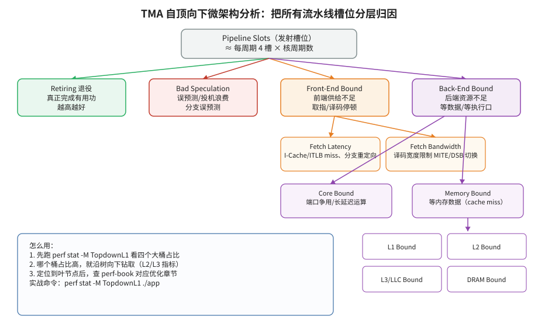


- **🎓 初学者导读**：TMA（自顶向下微架构分析法）就像医院的分诊台：病人一进大门，先问几个关键问题把人分到"发烧科""骨科"还是"内科"，而不是一上来就做全身检查。它帮你解决最经典的困惑——程序慢，但到底是 CPU 前端喂不上指令、后端算不动、还是在等内存？这篇是整套笔记里最重要的一篇，强烈建议第一个精读，把那张分诊流程图看懂就值回票价了。

- **一句话概括**：提出了 Top-down Microarchitecture Analysis（TMA）—— 一种把 CPU 流水线资源按层级二分分解、用少量 PMU 计数器就能定位瓶颈类别的系统化方法论，已成为 Intel VTune 和 Linux perf 内建分析能力的理论基础。

- **背景与问题**
  - 在 TMA 之前，工程师面对数百个 PMU 事件时往往"盲人摸象"：不知道先看哪个计数器，也不知道某个计数器偏高意味着什么，缺乏从症状到根因的系统性路径。
  - 传统做法如 CPI（cycles per instruction）只给出一个汇总数字，无法区分瓶颈来自前端取指、后端执行、访存延迟还是分支误预测。
  - 作者 Ahmad Yasin 是 Intel 的架构师，论文发表于 ISPASS 2014，并获得了该会议的最佳论文奖，是 TMA 方法论的奠基性文献。

- **核心方法/内容详细展开**

  **1. Pipeline Slot（流水线槽位）概念**
  - TMA 的基本度量单位不是"指令"也不是"周期"，而是 pipeline slot：CPU 每个周期能处理的微操作（uop）名额。对一个 4 宽（4-wide）超标量核心，每周期有 4 个 slot。
  - 在单线程占用一个核（关闭 SMT 或只统计单线程）时：
    ```
    Total Slots = 4 × CPU_CLK_UNHALTED.THREAD
    ```
  - 每个 slot 在整个程序生命周期中只会处于四种互斥且完备（MECE）的状态之一，这构成 L1 层的四分类。

  **2. L1 四分类的精确定义与公式**
  - **Retiring（正常退休）**：slot 中的 uop 顺利执行并在 ROB 中退休，即"有用的工作"。
    ```
    %Retiring = UOPS_RETIRED.RETIRE_SLOTS / Total_Slots
    ```
    Retiring 越高越好；达到 100% 意味着机器满负荷做有用功（实际上受限于 port 竞争很难达到，好的 HPC 内核可以达到很高比例）。
  - **Bad Speculation（错误推测）**：slot 被分配给最终因分支误预测等原因被丢弃的 uop，外加流水线清空后重新填充的惩罚。
    ```
    %Bad_Speculation = ( UOPS_ISSUED.ANY − UOPS_RETIRED.RETIRE_SLOTS
                         + 4 × INT_MISC.RECOVERY_CYCLES ) / Total_Slots
    ```
    其中 `UOPS_ISSUED.ANY − UOPS_RETIRED.RETIRE_SLOTS` 是"发射了但没退休"的 uop 数；`INT_MISC.RECOVERY_CYCLES` 是误预测后流水线恢复的周期数，乘以宽度 4 折算成 slot。
  - **Frontend Bound（前端瓶颈）**：后端执行端口空闲、但前端（取指/译码/分配）没有交付足够 uop 的 slot 占比。用 IDQ（Instruction Decode Queue）未能向下游交付 uop 的 slot 数来度量：
    ```
    %Frontend_Bound = IDQ_UOPS_NOT_DELIVERED.CORE / Total_Slots
    ```
  - **Backend Bound（后端瓶颈）**：前端有 uop 可交付，但后端因资源不可用（等待操作数、port 被占、ROB/RS 满等）无法接收的 slot 占比。用反推法计算：
    ```
    %Backend_Bound = 1 − ( %Frontend_Bound + %Retiring + %Bad_Speculation )
    ```
    这是 TMA 最巧妙之处：不需要直接测量"后端拒绝接收"这个难以观测的状态，用总量减去其余三类即可。

  **3. L2 层分解（逐级下钻）**
  - TMA 是一棵树：如果某 L1 类别占比超过阈值（工具通常以约 20% 作为需要关注的经验阈值），就沿该分支向下分解，而不是平均用力。
  - **Frontend Bound → Fetch Latency vs Fetch Bandwidth**
    - Fetch Latency：整个周期一个 uop 都没交付（交付 0 个）的情况，说明前端完全"断粮"，通常是事件驱动的停顿：ICache miss、ITLB miss、分支重定向（Branch Resteers）、译码器切换（DSB 与 MITE 之间切换、microcode sequencer 介入）。
    - Fetch Bandwidth：每周期交付了 1~3 个 uop（少于最大宽度 4），是持续性效率问题，如译码宽度限制、DSB（uop cache）覆盖率低、LSD 停用等。
    - 两者的区分依赖对 `IDQ_UOPS_NOT_DELIVERED` 类事件按"每周期交付数"做 cmask/threshold 过滤计数。
  - **Backend Bound → Memory Bound vs Core Bound**
    - Memory Bound：执行停顿与未完成（outstanding）的 cache miss 相关。在 Sandy Bridge 上用 `CYCLE_ACTIVITY` 事件按"有 L1D miss 待处理时的停顿周期""有 L2 miss 待处理时的停顿周期"来分层估计：
      ```
      %Memory_Bound ≈ CYCLE_ACTIVITY.STALLS_L1D_PENDING / Clocks
      ```
    - 继续下钻为 L1 Bound / L2 Bound / L3 Bound / DRAM Bound；DRAM Bound 再分为 Memory Latency（受延迟限制，缺 miss 并行度 MLP）与 Memory Bandwidth（带宽打满）。细分需要配合 OFFCORE_RESPONSE 这类事件统计 miss 落到哪一级。
    - Core Bound：后端瓶颈中扣除 Memory Bound 的部分：
      ```
      %Core_Bound = %Backend_Bound − %Memory_Bound
      ```
      再分解为 Divider（`ARITH.FPU_DIV_ACTIVE / Clocks`，除法器占用）与 Ports Utilization（端口饱和，需要用各 port 的 uop 分发计数器分析具体哪个 port 是瓶颈）。
  - **Bad Speculation → Branch Mispredicts vs Machine Clears**：前者占绝大多数，对应分支预测优化；后者包括自修改代码、FP 辅助操作（assists）、内存序冲突（memory ordering machine clears）等。
  - **Retiring → 看微指令构成**：判断是否为 microcode 密集、FP 运算占比等，Retiring 高时优化方向转向"减少指令数"（算法、编译器优化、向量化）。

  **4. 计数器架构（Counters Architecture）部分**
  - 论文后半部分讨论了 PMU 硬件设计：TMA 公式需要同时采集多个事件，而通用计数器数量有限，需要多轮复用（multiplexing），会引入误差。
  - 作者提出可以在硬件中内建专用逻辑直接计算 TMA 指标，降低采集复杂度——这一思想后来部分体现在 Intel 每代 PMU 的演进中（更多专用事件、PMU 事件表与 metric 定义随产品发布）。

  **5. 方法论精髓**
  - 自顶向下、逐级二分：每一层只回答"瓶颈属于两大类中的哪一类"，把搜索空间指数级缩小。
  - MECE 保证不重复、不遗漏，各类别占比之和恒为 100%。
  - 迭代式优化：修掉当前最大瓶颈后重新测量，瓶颈会迁移，循环直到 Retiring 足够高或收益递减。

- **关键结论与数据**
  - 论文用大量真实负载（SPEC 等）验证了四分类的完备性与可操作性，证明 TMA 能用极少数事件替代"扫射式"的计数器分析。
  - 一个被反复引用的定性结论：很多看似"计算密集"的负载实际 Backend/Memory Bound 占主导；而通用服务器负载往往 Frontend Bound 占比不可忽视。

- **实战应用**
  - Linux perf 已内置 TMA metric group（Intel 平台）：
    ```bash
    # 查看可用的 metric group
    perf list metricgroups
    # L1 层四分类
    perf stat -M TopdownL1 -- ./my_app
    # 输出示例（字段含义）：
    #  BE      Backend_Bound:   45.2%
    #  FE      Frontend_Bound:  10.1%
    #  BAD     Bad_Speculation:  5.3%
    #  RET     Retiring:        39.4%
    # 继续下钻
    perf stat -M TopdownL2 -- ./my_app
    # 只关心后端分解
    perf stat -M Backend_Bound -- ./my_app
    ```
  - Intel VTune：运行 `vtune -collect uarch-exploration -- ./my_app`（旧版叫 general-exploration），打开 "Microarchitecture Exploration" 视图，顶部就是 TMA 的 L1 条形图，点击任何类别可展开到 L2/L3 并直接关联到热点函数与源码行。
  - 解读顺序：先看哪个类别占比最高 → 沿该分支下钻 → 找到具体函数/循环 → 优化 → 复测。

- **与 perf-book 对应章节**
  - 第 5 章 "Performance Analysis Approaches" 中的 Top-down Microarchitecture Analysis 一节（perf-book 的 TMA 讲解即以本篇为蓝本）；相关硬件基础见第 6 章（PMU）。

- **常见误区/注意事项**
  - TMA 各层百分比只在"瓶颈定位"上有意义，不能直接相加成"还能提速多少"的预测。
  - 事件名随微架构变化（如 `IDQ_UOPS_NOT_DELIVERED.CORE` 在新架构上被 `TOPDOWN` 事件族或更名事件替代），不同代 CPU 的公式细节要查该代的手册/perf metric 定义，不要照搬 Sandy Bridge 的事件名。
  - SMT 开启时 slot 在两个硬件线程间动态分配，单线程指标需要按 perf/VTune 给出的修正口径解读。
  - 多路复用（multiplexing）会让同一次运行中不同事件被分时计数，TMA 各类别占比会产生轻微不一致，关键结论应用 `perf stat --no-metric-only` 多次复跑确认。
  - Backend Bound 是"反推"出来的，其精度依赖其余三项的准确性；若采集有误（如虚拟化中 PMU 未透传），BE 会吸收所有误差。

---

### 2. The Overhead of Profiling Using PMU Hardware Counters（Nowak & Bitzes, 2014）


- **🎓 初学者导读**：这篇就像研究"给运动员戴上心率表会不会影响他的成绩"——用 PMU（CPU 内置的硬件性能计数器）去观察程序，观察这个动作本身也会拖慢程序。它能帮你判断：用 perf 之类的工具采样时，开几个计数器、采样多频繁才不会"测出来的慢其实是工具造成的慢"。建议在做实际测量前翻一翻这篇，先对开销有个数量级的直觉，免得被自己的工具骗了。

- **一句话概括**：系统测量了用 perf 基于 PMU 进行计数（counting）与采样（sampling）时的运行时开销，给出"采样频率—开销"定量关系，是选择采样参数前必读的经验依据。

- **背景与问题**
  - 性能工具都声称自己"低开销"，但开销到底多大、与采样频率如何变化，用户往往没有概念，导致要么采样太稀（统计不显著），要么太密（观察者效应扭曲结果）。
  - 该报告面向 HPC 用户，测量对象是 Linux perf（perf_events）在 Intel 平台上的实际开销。

- **核心方法/内容详细展开**
  - **两种采集模式的开销结构**
    - Counting 模式（`perf stat`）：只在进程开始/结束（或定时）读一次计数器，运行期间零干预，开销可以忽略。这是开销的"地板"。
    - Sampling 模式（`perf record`）：每次计数器溢出（overflow）触发一次性能监控中断（PMI），开销来源包括：
      1. 硬件中断响应与 PMU 冻结/复位；
      2. 内核中断处理程序：读取采样 IP、寄存器、构建 sample 记录；
      3. 把记录写入 per-cpu 的 mmap ring buffer；
      4. 若启用调用栈回溯（`--call-graph dwarf/fp`），每次采样还要做栈回溯，这是最大的单项开销，且与栈深成正比；
      5. 用户态 `perf record` 进程异步地从 ring buffer 取数据并落盘（CPU 与 I/O 开销）。
  - **定量关系**：总开销 ≈ 样本数 × 单样本处理成本。单样本成本在微秒量级（栈回溯会显著抬高它），因此开销随采样频率近似线性增长。报告测出了不同事件、不同配置下的"每样本成本"，并据此给出推荐频率区间。
  - **perf 采样数据通路（理解开销来源）**
    - 计数器溢出 → 硬件触发 PMI → 内核 perf_events 中断处理 → 组装 sample（event id、IP、regs、可选 callchain/branch stack）→ 写入 per-cpu mmap ring buffer。
    - ring buffer 达到一定水位后唤醒用户态 `perf record` 线程批量读出并写文件；若写入速度跟不上产生速度，buffer 满则丢样本（lost samples）。
    - 因此总开销 = 内核中断路径成本（与采样率成正比）+ 用户态搬运/落盘成本（与样本字节率成正比）+ 磁盘 I/O。
  - **计数器复用的隐性开销与缩放**
    - 一次监控的事件数超过物理计数器个数（通常每核 3~8 个通用计数器，视微架构与是否开 SMT 而定）时，内核做 time multiplexing：各事件分时占用计数器。
    - perf 会用 `count × (time_enabled / time_running)` 把读数缩放回全程估计值，比值越小于 1 说明复用越严重，估计的方差越大——`perf stat` 输出末尾会打印该比例，值得关注。
  - **事件速率驱动的参数设计**
    - 先用 counting 模式跑一次，得到目标事件的全程计数 `E` 与时长 `T`，估算速率 `r = E / T`。
    - 期望采样率 `f`（如每事件每秒几百到几千个样本，视负载时长而定）→ period 设为 `N = r / f`。
    - 验证：带采样重跑一次，对比 wall time 增幅；若增幅超过自己设定的预算（如 1%~5%），调大 period 重试。
  - **选择采样周期的原则**
    - 用 period（每 N 次事件采一次）而非固定 frequency 思维来估算：先估计目标事件的发生速率（如 LLC-miss 每秒多少次），再决定 period，使最终采样率落在开销可接受的范围（一般控制在百分之一到百分之几的扰动以内）。
    - 避免恰好同步的采样率：采样周期若与程序自身周期性行为同步，会产生系统性偏差（这也是 perf 默认用 99 Hz 而非 100 Hz 的原因之一）。

- **关键结论与数据**
  - Counting 模式开销可忽略，应作为第一遍分析的手段；sampling 模式开销与频率成正比，调用栈回溯是开销放大器。
  - 只要采样率设置合理，基于 PMU 的 profiling 可以把扰动控制在很小的个位数百分比以内，远优于插桩式工具（后者动辄带来成倍的减速，且改变内联与优化决策）。
  - 报告给出的核心工程建议可归纳为：先 counting 摸底、再对少数关键事件采样、按事件速率反推 period、用 wall time 对比验证扰动是否在预算内。

- **实战应用**
  ```bash
  # 第一步：counting，零成本摸清事件量级
  perf stat -e cycles,instructions,LLC-load-misses -- ./app
  # 第二步：按事件速率设定 period 而不是盲目用默认 frequency
  perf record -e LLC-load-misses -c 100000 -- ./app     # 每 10 万次 miss 采一次
  # 需要调用栈时，优先 frame pointer，dwarf 最重
  perf record -e cycles -c 1000000 --call-graph fp -- ./app
  # 检查复用缩放比例（输出末尾的 time enabled/running 信息）
  perf stat -e cycles,instructions,branches,branch-misses,cache-misses -- ./app
  # 检查采样本身是否显著：比较带采样与不带采样的 wall time
  time ./app && time perf record -o /tmp/p.data -e cycles -c 1000000 -- ./app
  ```

- **与 perf-book 对应章节**
  - 第 2 章（Measuring Performance，测量误差与观察者效应）与第 6 章（PMU 采样机制）、第 7 章（perf 工具用法）。

- **常见误区/注意事项**
  - 不要对高频事件（如 cycles、instructions）配很小的 period，会瞬间把开销拉爆；高频事件用大 period 或只用 counting。
  - ring buffer 溢出（数据丢失）时 perf 会在 report 中提示 lost samples，此时应增大 buffer（`-m` 参数）或降低采样率，否则热点分布失真。
  - 多线程程序每个 CPU 都在独立采样，总开销 = 单核开销 × 核数，需要全局评估。
  - 采样率与程序周期行为共振会产生"梳状"偏差：避免使用 100 Hz、1000 Hz 这类整数频率，perf 默认 99 Hz 正是为此。
  - 在容器/受限环境中，`perf_event_paranoid` 内核参数与 capabilities 会限制可采集的事件范围，采样失败先查权限而非怀疑工具。

---

### 3. Google-Wide Profiling: A Continuous Profiling Infrastructure for Data Centers（Ren et al., 2010）


- **🎓 初学者导读**：这篇讲的是"给整个城市装摄像头"而不是"给一辆车装行车记录仪"——Google 在所有数据中心的机器上常年开着低开销采样，谁家的程序在烧钱随时可查。它解决的是大公司级别的实际难题：程序跑在成千上万台服务器上，怎么知道全公司最耗 CPU 的函数是哪个？初学者不用细抠基础设施的实现，重点体会"持续剖析比临时抓包更有用"这个思路就够了。

- **一句话概括**：Google 的全数据中心持续剖析基础设施（GWP），用"低占空比随机采样 + 跨机聚合"在几乎零开销的前提下，回答"整个数据中心的 CPU 周期花在了哪些函数/库/应用上"这类宏观问题。

- **背景与问题**
  - 单机 profiler 回答的是"这台机器上这个进程为什么慢"；而数据中心运营者关心的是跨数万台机器的聚合问题：哪个函数消耗了全公司最多的 CPU？共享库的代价有多大？硬件换代对整体负载的收益如何？
  - 挑战在于：剖析本身有开销，不可能在所有机器上全时开启；不同机器跑着异构负载，直接混合统计会产生偏差。

- **核心方法/内容详细展开**
  - **整体架构**：GWP 由三部分组成——每台机器上的采集代理（collector）、中心化的聚合存储、以及查询/展示层。采集代理基于 Linux 内核的硬件计数器支持（perfctr 体系）实现全系统采样。
  - **为什么选"整系统 + 随机机器"而不是"每进程 attach"**
    - 数据中心里机器角色随时在变，按进程 attach 会漏掉短时任务与内核开销，且引入选择偏差。
    - 整系统采样把内核、守护进程、所有用户负载统一纳入，度量的是"这台机器作为资源的总去向"，与计费/容量口径一致。
    - 随机选机器则把"哪些机器"这一维度的偏差也消除掉，两层随机（机器随机 × 时间随机）保证样本是总体的无偏代表。
  - **低占空比随机采样（stable sampling）**
    - 任一时刻只有随机选出的很小一部分机器在采集，每台机器也只在其"轮次"内短暂开启 profiling；随时间推移，所有机器被均匀覆盖。
    - 随机化保证样本对全机群无偏：聚合结果可按采样比例外推成全机群估计值。
    - 因为占空比极低，分摊到每台机器的平均开销可忽略不计，因此可以 7×24 常开——"continuous profiling"的关键不是单次采集便宜，而是期望开销便宜。
  - **采集内容**
    - 整系统（全机器，不限于某个进程）的调用栈样本：定时对 CPU 上正在执行的指令采样，回溯调用栈，得到"样本 → 调用链 → 函数 → 符号化后的二进制/共享库"的归属链。
    - PMU 硬件事件：除 cycles 外，还采集 instructions、流水线停顿、各级 cache miss、分支误预测等，使聚合分析可以按"事件类型"提问（例如"全机群有多少周期是因 cache miss 停顿的"）。
    - 采样是"全系统视角"的：不针对特定进程附加 profiler，因此同一台机器上所有进程的代价都被统一纳入统计口径，天然适合做横向汇总。
  - **跨机聚合统计**
    - 所有样本打上机器、时间、二进制、函数等维度标签后汇入中心存储。
    - 聚合时按采样概率加权还原总体分布，支持按任意维度切片：按函数排序找全局热点、按共享库统计"基础设施税"（RPC、序列化、压缩等公共组件的总成本）、按硬件平台对比、按时间观察趋势与回归。
    - 符号化与二进制归属在中心侧离线完成，避免在采集机上做重活。
    - 因为是稳定采样（stable sampling），聚合结果可以外推出"全机群每天在某函数上消耗的核·小时"这类带量纲的估计，直接对接容量规划与成本核算。
  - **能回答的问题类型**：全局热点函数 TopN；某次库升级对全机群的影响；为硬件采购/编译器优化提供"哪类操作值得优化"的数据支撑；对比不同硬件代际在真实混合负载下的 CPI 差异。
  - **工程化细节（论文中值得一提的设计决策）**
    - 剖析数据本身敏感（调用栈与符号泄露程序内部结构），集中存储需要配套的访问控制与保留策略——这是把剖析做成"基础设施"必须解决的问题之一。
    - 采集代理必须对"被剖析机器自身过载"有自适应能力：系统繁忙时降低采集频率，避免剖析成为压垮机器的最后一根稻草。
  - **后续影响**：GWP 是"continuous profiling"这一品类的开创者；Google 后来基于同类数据完成了著名的 WSC（Warehouse-Scale Computer）负载研究（Kanev et al., ISCA 2015，提出"datacenter tax"概念），并催生了 Cloud Profiler 及一大批开源持续剖析产品。

- **关键结论与数据**
  - 论文展示了 GWP 在 Google 生产环境长期运行的事实，证明"常开、低占空比、随机化"的设计在超大规模下可行，且聚合视角能发现单机视角看不到的瓶颈（如无处不在的公共库开销）。
  - 一个著名启示：数据中心级优化要盯"横向公共成本"，单个函数哪怕只占 1%，乘以全机群也是巨大收益。

- **实战应用**
  - GWP 的思想已经产品化/开源化，可直接体验：
    - Google Cloud Profiler（生产环境的商业化版本）。
    - 开源：Parca、Pyroscope、Grafana Phlare/Profiles、Datadog Continuous Profiler 等都遵循同一架构。
  - 自建最小版本：在每台机器上用 `perf record -F 99 -a -g -- sleep 30` 定时采集系统级调用栈，把 perf.data 集中到一台机器上用 `perf report --stdio` 或 flamegraph 工具聚合，即是 GWP 的"手工版"。
  - 聚合分析的典型查询模式（在任何持续剖析系统中通用）：
    - 差分分析：同一函数在两个版本/两个时间段之间的占比变化 → 性能回归定位；
    - 共享成本归集：按共享库/基础组件分组求和 → 评估"优化公共库"的全局收益；
    - 硬件相关分析：按 CPU 型号分组比较 IPC/CPI → 指导机型选型与调度策略。
  - 分析时的关键动作：始终按"采样权重"而非"原始条数"解读聚合结果；对比两个时间段时先确认采样率一致。

- **与 perf-book 对应章节**
  - 第 5 章中关于 sampling/continuous profiling 的方法论讨论；第 7 章工具综述部分。

- **常见误区/注意事项**
  - 聚合热点 ≠ 单机可优化热点：全机群第一的函数在单机上可能只占 2%，是否值得优化要看"全局总量 × 优化可行性"。
  - 采样覆盖要足够随机：如果采集总是落在同一类机器/同一时段，聚合结论会有系统偏差。
  - 共享库内联、符号缺失会让归属失真，需要保证构建时保留符号/帧指针，或使用可靠的 unwinder。
  - 不要把不同代硬件、不同负载类型的机器简单混合求平均 CPI 或 IPC；先按机器/负载分层（stratify）再聚合，否则辛普森悖论会给出错误结论。
  - 外推总量时必须使用带权重的估计（样本 ÷ 采样概率），直接用原始样本条数排序在采样率不均时会失真。
  - 持续剖析系统的自身成本（存储、网络、符号化）也要纳入预算；占空比与样本保留策略需要在"统计灵敏度"与"运营成本"之间权衡。

---

### 4. Performance Profiling in a Virtualized Environment（Du et al., 2010）


- **🎓 初学者导读**：在虚拟机里做性能剖析，就像隔着一层毛玻璃看手表——时间大概看得见，但秒针走字就模糊了，因为硬件计数器被虚拟化层挡住了。如果你以后要排查"程序在云服务器上变慢了但本地好好的"这类问题，这篇能告诉你为什么虚拟环境里好多性能数据会缺失或失真。新手了解个大概即可，知道"虚拟机里测性能有坑"这个结论就已经赚到了。

- **一句话概括**：在 Xen 上实现了 PMU 虚拟化（vPMU），让虚拟机内的 profiler 能像在裸机上一样使用硬件计数器，并正确地把事件归属到 guest 与 hypervisor，是云上性能分析可行性的奠基工作。

- **背景与问题**
  - 虚拟化环境中，PMU 是全局共享的稀缺硬件资源，默认由 hypervisor 独占；guest 直接访问会被拦截或读到被其他 VM 污染的数据。
  - 朴素方案为什么不行：直接把 PMU 透传给某个 guest，会让其他 VM 的执行计入其计数（数据污染），且 PMU 编程冲突可能导致 hypervisor 自身失去性能观测能力；多个 guest 同时要求使用计数器时资源不够分。
  - 两大难题：(1) **归属（attribution）**——一次 cache miss 到底算 guest 应用的、guest 内核的、还是 hypervisor 为服务该 VM 花的？(2) **复用（multiplexing）**——多个 VM 共用同一组物理计数器，必须随 VM 切换保存/恢复计数器状态。
  - 这在 2010 年尤其尖锐：云计算刚兴起，"虚拟机里性能为什么差"几乎只能靠猜；该工作与同时期 VMware 的 vPMC 一起，确立了 PMU 虚拟化的标准做法。

- **核心方法/内容详细展开**
  - **vPMU 架构（以 Xen 为原型）**
    - 向每个 guest 暴露一组**虚拟计数器与虚拟 PMU 控制寄存器**；guest 中的 perf/oprofile 对这些虚拟 MSR 编程。
    - hypervisor 在 VM 进入（vmentry）时把该 VM 的虚拟计数器配置加载到物理 PMU，在 VM 退出（vmexit）时保存其状态，实现跨 VM 的计数器上下文切换——思路与 OS 对进程做计数器上下文切换完全同构，只是下移了一层。
    - 计数语义：guest 的计数器只在它实际占用物理 CPU 的窗口内计数，其他 VM 运行不会污染其读数。
  - **开销归属**
    - 论文特别处理了"hypervisor 替 guest 干活"的时间（设备模拟、调度、内存虚拟化）：通过在 vmexit 时采样/记账，把 hypervisor 内的执行归因到对应的 guest，使"guest 视角的慢"与"VMM 视角的忙"能对上账。
    - 这揭示了虚拟化负载分析中常被忽略的一部分开销：不打开 VMM 侧数据，guest 内部剖析会把这段时间当成"凭空消失的周期"。
    - 典型的 VMM 侧开销来源包括：vmexit 处理本身、影子页表/EPT（扩展页表）缺页处理、I/O 与设备模拟、虚拟中断注入、vCPU 调度等待（steal time）。
  - **采样支持**：虚拟化 PMI 的投递——计数器溢出发生在哪个 VM 的执行窗口，中断就归哪个 VM；在 hypervisor 窗口溢出则归 hypervisor，保证采样 IP 的归属正确。
  - **实现要点总结**：vPMU 本质上把 OS 对进程级的 PMU 上下文切换、归属、中断路由整套机制"下移一层"到 hypervisor，对 guest 内的工具（perf、oprofile）完全透明——这是该设计与后续 KVM vPMU 共用的核心思想。

- **关键结论与数据**
  - 虚拟化 PMU 后，guest 内的剖析结果与裸机高度一致，且虚拟化引入的额外剖析开销适中，证明"云上也能做严肃的性能分析"。
  - 实测展示了若干负载在虚拟化下的开销来源分解，量化了 hypervisor 归因部分，说明忽略 VMM 开销会系统性误判。
  - 论文的一个方法论贡献是给出了"虚拟化环境剖析正确性"的验收方式：同一负载在裸机与 VM 中分别剖析，对比事件计数与热点分布的一致性——今天评估云平台 vPMU 质量仍可沿用这一思路。

- **实战应用**
  - 现代等价物：KVM 的 vPMU（内核参数/启动项启用），云厂商部分实例类型已开放 PMU 透传（如 AWS 的裸金属与部分虚拟化实例提供 vPMU，阿里云/腾讯云类似）；VMware 平台对应特性为 vPMC（virtual Performance Monitoring Counters），需在 VM 设置中显式打开。
  - 检查 guest 内 PMU 是否可用：
    ```bash
    perf stat -e cycles -- sleep 1     # 显示 <not supported> 即 vPMU 未启用
    dmesg | grep -i pmu                # 查看内核识别到的 PMU 型号
    ```
  - KVM 场景分析宿主机+虚拟机整体：
    ```bash
    perf kvm stat record -- ./qemu-system-x86_64 ...   # 统计 vmexit 原因与耗时
    perf kvm stat report
    ```
    guest 内部则直接使用普通 perf（前提是 vPMU 已启用）。
  - 分析流程建议：先在 guest 内做常规 TMA/采样，若数据异常（如 Backend Bound 莫名偏高、IPC 周期性塌陷），再到 host 侧用 `perf kvm stat` 看 vmexit 频率与原因（EPT violation、I/O 模拟、定时器中断等）。
  - 常见 vmexit 原因的解读速查：EPT_MISCONFIG/EPT violation 高 → 内存虚拟化压力，检查大页；MSR_WRITE/CPUID 高 →  guest 频繁访问被拦截的 MSR，可能是监控代理导致；HLT 高 → guest 空闲，正常；IO_INSTRUCTION 高 → 老旧的端口 I/O 模拟路径，应改用 virtio 半虚拟化驱动。
  - 验证剖析正确性的方法（沿用论文思路）：同一微基准（如 STREAM、Linpack）在裸机与 VM 中各跑一次 `perf stat`，对比 cycles/instructions/cache-misses 的量级一致性，偏差过大说明 vPMU 配置或宿主环境有问题。

- **与 perf-book 对应章节**
  - 第 6 章（PMU 硬件机制）的延伸；第 7 章工具部分关于 `perf kvm` 的讨论。
  - 思想上也呼应第 2 章关于"测量环境一致性"的要求：虚拟化是引入测量环境差异的典型场景，跨环境对比数据前先确认剖析链路每一层的归属语义。

- **常见误区/注意事项**
  - 云上实例默认大多不开放 PMU，先要确认实例类型与 hypervisor 是否启用 vPMU，否则 `perf stat` 会显示 `<not supported>`。
  - 有些云即使开放 vPMU，也只透传"架构级"事件（cycles、instructions、branch 等少数几个），非架构级的微架构专属事件（如各级 cache 细分事件）可能仍不可用——先做事件可用性盘点再设计剖析方案。
  - 迁移（live migration）会改变底层硬件代际，迁移前后采集的 PMU 数据不可直接拼接；长期监控系统中应为样本打上"宿主 CPU 型号"标签。
  - guest 内读到的计数是"该 VM 实际运行窗口"的数据，受 steal time 影响的周期不在其中；解释 CPI 升高时要结合 host 侧超售（overcommit）情况。
  - 部分 PMU 高级特性（PEBS、LBR）在虚拟化下的支持晚于基础计数器，老 hypervisor 上可能不可用。
  - 在 guest 里测得的"cache miss 率"与真实硬件行为之间可能隔着 EPT/NPT 二级地址转换：大页配置在虚拟化下对 TLB 压力的影响比裸机更敏感，分析内存子系统瓶颈时务必检查透明大页（THP）与 EPT 大页映射。
  - 时钟源也会影响测量：guest 的 TSC 可能经过 hypervisor 偏移/缩放，跨 host 迁移的 VM 前后性能数据不宜直接对比。
  - 归因要分层进行：guest 应用、guest 内核、hypervisor、其他合租 VM（noisy neighbor）四层各占多少，单层工具看不到全貌。

---

### 5. Hardware-Assisted Instruction Profiling and Latency Detection（Dagenais, 2016）


- **🎓 初学者导读**：普通采样像质检员抽查流水线，这篇则是给每个工件装上 GPS 追踪器——借助 LTTng 这类硬件辅助的追踪手段，精确到每一条指令花了多久、卡在哪。它适合回答"我的程序里到底是哪一行、哪一次内存访问拖了后腿"这种精细问题。这篇偏硬核，建议在你已经用过 perf 做过粗粒度采样、想往更深处挖时再来读。

- **一句话概括**：论证了用 Intel 的硬件辅助机制（PEBS、LBR）配合 Linux perf/内核 tracepoint，可以以远低于软件插桩的开销做指令级剖析，并精确定位偶发的长尾延迟执行路径。

- **背景与问题**
  - 软件插桩（如 gprof 的 mcount、手工计时打点）会显著改变被测程序行为，对"偶发的长尾延迟"尤其无力——插桩本身可能就消除了竞态或 cache 行为。
  - 需要一种"轻到可以常开"的手段，在延迟毛刺发生的瞬间保留足够上下文（执行路径、寄存器状态）供事后分析。

- **核心方法/内容详细展开**
  - **LBR（Last Branch Record）工作机制**
    - CPU 内部维护一个环形栈（一组 MSR 寄存器对），记录最近 N 次分支跳转的 源地址/目标地址 对（FROM_IP/TO_IP；不同微架构深度不同，常见 16~32 级，新架构还带 mispredict、预测命中等标志位）。
    - 可通过过滤寄存器（LBR_SELECT）选择只记录特定类型分支（如只记 near call/return、只记条件跳转）或特定特权级（用户态/内核态），避免无关分支冲刷有效历史。
    - 平时零开销自动滚动记录；当 PMI（采样中断）或断点命中时，硬件可将 LBR 栈冻结（FREEZE_LBRS_ON_PMI），中断处理程序把整段分支历史转储出来。
    - 分析价值：采样点本身只告诉你"此刻在哪"，LBR 告诉你"是怎么走到这的"——对长延迟区间，能重建进入慢路径前的执行轨迹，定位是哪条分支路径导致了毛刺。
    - 与 Intel PT（Processor Trace）对比：PT 记录完整控制流、信息量最大但需要专用解码与较大带宽/存储；LBR 只保留最近 N 跳、随采样顺带转储，几乎免费——两者是"全量录像"与"行车记录仪缓存"的关系。
  - **PEBS（Precise Event-Based Sampling）记录格式**
    - 计数器溢出时，硬件直接把一条记录写入内存中的 PEBS buffer（Debug Store 区域），内容包括触发时刻的指令指针（IP）、通用寄存器组、标志位等架构状态；对访存类事件（PEBS with Load Latency / Data Address），记录还包含数据线性地址、该 load 的实际延迟周期数、命中来源（L1/L2/L3/远端 cache/DRAM）。
    - 攒够阈值才触发一次中断让内核统一取走，摊薄了中断开销；且因为记录由硬件在退休点生成，IP 归属远比普通采样精确（"precise"一词的来源）。
    - Load Latency 模式的工作方式：硬件给每个 load 微操作计时，只有延迟超过可配置阈值（如 ≥30 周期，即"错过 L1"级别）的 load 才生成记录——天然聚焦"值得关注的访存"，这就是 `perf mem` 的底层机制。
  - **与 tracepoint 结合的方法学**：作者把内核 tracepoint（LTTng/perf trace 生态）给出的"何时发生了长系统调用/长关中断区间"等事件时间线，与 perf 的硬件采样 + LBR 分支历史对齐，形成"宏观时间线 + 微观执行路径"的联合视图，用于解释高性能计算/高吞吐程序中的偶发延迟。
  - **开销对比论证**：全程基于硬件机制的剖析开销远低于插桩，可应用于对扰动敏感的负载。

- **关键结论与数据**
  - 硬件辅助采样（PEBS/LBR）能把指令级归因和延迟检测的扰动降到可接受水平，足以在准生产条件下定位软件插桩无法捕捉的问题。
  - LBR 分支历史对解释"为什么这次特别慢"（路径敏感的长尾）具有普通火焰图无法提供的价值。
  - 论文的实践立场：把 perf（硬件采样）与内核 tracing（tracepoint）当作互补而非替代——前者回答"慢在哪条路径"，后者回答"慢在什么时刻、与什么系统事件相关"。

- **实战应用**
  ```bash
  # 采样时抓取 LBR 分支栈
  perf record -b -e cycles -- ./app
  perf report -D | less          # 查看原始样本中的 branch stack
  # 用 LBR 代替栈回溯生成调用图（低开销，但深度受 LBR 级数限制）
  perf record --call-graph lbr -e cycles -- ./app
  # LBR 分支类型过滤（视 perf 版本支持）：只记录条件跳转/调用返回
  perf record -j cond,call -e cycles -- ./app
  # 访存延迟剖析：PEBS Load Latency（perf mem 封装）
  perf mem record -- ./app
  perf mem report                 # 按延迟区间/数据源(L1/L2/L3/DRAM)展示热点 load
  perf mem report --sort=symbol,mem,lat
  # 延迟检测工作流（论文方法学的落地）：
  # 1) 用调度/中断类 tracepoint 找出长尾窗口
  perf record -e 'sched:sched_switch' -e 'irq:irq_handler_entry' -a -- sleep 60
  # 2) 同负载下带 LBR 采样
  perf record -b -e cycles -c 100000 -- ./app
  # 3) 对齐两边时间戳，重建长延迟发生时的执行路径
  ```
  - VTune 等价物：Microarchitecture Exploration 报告中的 "Branch Mispredict" 热点配合 LBR 数据；内存分析（Memory Access）类型即基于 PEBS-LL，输出 Load Latency 分布与 Data Source 分解，与 `perf mem report` 同源性阅读。

- **与 perf-book 对应章节**
  - 第 6 章 "CPU Features for Performance Analysis"（PEBS、LBR、PT 等硬件特性的专门章节）；第 7 章 perf 用法。

- **常见误区/注意事项**
  - LBR 深度有限且被中断/异常冲刷的风险存在，重建的路径可能不完整；虚拟化下 LBR 需要 hypervisor 支持。
  - `--call-graph lbr` 对深递归/深调用栈会截断，且 LBR 只记录分支，内联函数天然不可见；需要完整深栈时仍应使用 frame pointer 或 dwarf 回溯。
  - PEBS 记录虽有 precise IP，但仍存在少量 skid（见下一篇），对"单条指令定罪"要保留怀疑，结合多条样本看分布。
  - `perf mem` 依赖 PEBS-LL 类功能，仅部分 Intel 微架构可用；AMD 对应物是 IBS（见第 6 篇）。
  - LBR 只记"分支"，直线代码段内部的轨迹不可见；若需要完整控制流重建（如安全事故取证、覆盖分析），应使用 Intel PT 而非 LBR。
  - 在内核版本较老或 PMU 驱动受限的环境（部分云实例、SELinux 严格策略），`-b`/`--call-graph lbr` 可能静默退化为无分支栈，产出前用 `perf report -D` 抽查一条样本确认 branch stack 确实存在。

---

### 6. Precise Event Sampling on AMD versus Intel: Quantitative and Qualitative Comparison（Sasongko et al., 2023）


- **🎓 初学者导读**：这篇像测评两家不同品牌的体温计：Intel 的 PEBS 和 AMD 的 IBS 都是"精确采样"技术（能告诉你出事时具体是哪条指令），但量出来的温度能不能对上、谁更准，得实测才知道。它帮你解决一个很现实的坑：换了一台不同品牌 CPU 的机器，perf 报告里的热点地址怎么突然对不上号了？文章比较新（2023 年）、贴近实战，适合当作进阶读物，等你需要跨平台对比数据时再细看。

- **一句话概括**：对 AMD IBS 与 Intel PEBS 两种"精确事件采样"硬件做了系统的定量对比，量化了 skid、归因准确率与开销差异，纠正了"PEBS/IBS 的 IP 就是罪魁祸首指令"这一天真假设。

- **背景与问题**
  - 现代剖析工具（HPCToolkit、perf、VTune、uProf）都依赖 PEBS（Intel）或 IBS（AMD）把事件归到具体指令。但两家机制的实现哲学不同，"precise"的程度、偏差方向、适用事件集合都不一样；此前缺乏同口径的对比研究，工具开发者和用户容易误读采样数据。
  - 现实痛点举例：同一段密集访存代码，在 Intel 上样本集中在某条 load 的**下一条**指令，在 AMD 上则准确落在肇事指令上——不了解机制差异的用户会得出"两家编译产物质量不同"的错误结论。

- **核心方法/内容详细展开**
  - **Intel PEBS 机制回顾**：计数器溢出时由硬件转储一条记录（IP + 寄存器 + 访存元数据）到内存 buffer。IP 取自事件触发附近退休的指令，但由于乱序执行与事件检测点的位置，记录的 IP 与真正"制造"该事件的指令之间可能存在若干条指令的偏移——即 **skid**。新架构对特定事件有改进（如 PDIR 等精确分发机制），但一般场景下 skid 不可忽略。
  - **PEBS 的演进脉络**：基础 PEBS（IP + 寄存器）→ PEBS-LL（Load Latency，加数据地址与延迟）→ 记录格式随微架构扩展更多字段（如更细的数据源编码、TSX/PTX 信息）。论文对比时考虑了代际差异，提醒"PEBS 精度"不是一个固定常数，而是随 CPU 代际变化的。
  - **AMD IBS 机制**：分两种模式。
    - **IBS Fetch Sampling**：按周期性的取指窗口对前端采样，关注取指延迟、ITLB/ICache 行为。
    - **IBS Op Sampling**：按间隔"点名"一个即将分派的微操作（tagged op），随后**全程跟踪该 op 穿越流水线直到退休**，记录其总延迟、各阶段停顿、访存数据地址与命中来源（L1/L2/L3/远端/DRAM）、分支结果等。因为是从头跟到尾，op 的属性记录精确，归因不依赖事后猜 IP。
    - 已知偏差：周期性点名意味着**执行时间长的 op 更容易被采到**（在采样时刻更可能"在场"），即对慢 op 的过采样偏差；解读 IBS 延迟分布时要做加权修正。
  - **论文的对比方法**：设计受控微基准（已知哪条指令产生 cache miss、分支误预测、除法停顿等），分别在两家硬件上采集，统计采样 IP 到真实肇事指令的距离分布（skid 直方图）、不同事件类型的归因正确率、以及同等样本量下的开销。
  - **主要发现（定性）**
    - PEBS 的 skid 随事件类型不同而异：有的事件 IP 相当准，有的会系统性偏移几条指令；需要 skid 修正启发式（如向后搜索最近的候选 load/branch）。
    - IBS op sampling 在 op 级归因上更"忠实"，且天然携带延迟与数据源信息，但存在上述长 op 过采样偏差，且 IBS 支持的事件集合与 PEBS 不同（例如对非访存类微架构事件的覆盖口径不同）。
    - IBS fetch sampling 关注前端：记录取指是否完成、取指延迟、ITLB/ICache 命中情况，适合做指令供给（frontend）侧分析——与 PEBS 偏重退休点状态的视角互补。
    - 两者开销特征不同：PEBS 摊薄中断成本低；IBS 跟踪单 op 的成本结构不同，采样率过高时同样可观。
    - 结论对工具作者的含义：跨平台剖析工具不能假设两家语义等价，归因展示层应暴露"采样机制 + 置信度"信息；HPCToolkit 等工具即依据该研究对两平台分别处理。
  - **skid 的成因（补充理解）**：乱序核心中，事件（如 L1 miss）在流水线深处被检测到时，前端仍在取指译码，等中断/记录动作发生时，指令指针已经向前漂移；且不同事件的检测点（dispatch、execute、retire）不同，漂移量不同——这解释了为什么 skid 是"事件相关"的系统性偏移而非纯噪声。

- **关键结论与数据**
  - "precise"是相对概念：PEBS 与 IBS 都比普通中断式采样精确得多，但各自有可量化、可建模的偏差；工具若不做修正，单样本级别的归因可能指错指令，聚合到分布层面才是可靠的。
  - 该论文已成为 HPCToolkit 等工具处理两平台采样数据的理论依据。
  - 对终端用户的直接启示：看到"样本集中在某指令的下一条/相邻几条"时，先怀疑 skid 再怀疑代码；把归因结论稳定在"指令邻域"而非"单条指令"粒度，两平台的结论就能对齐。

- **实战应用**
  ```bash
  # Intel：PEBS 事件用 pp/pPPP 修饰（精确级别），如
  perf record -e cycles:pp -- ./app
  perf record -e mem-loads:pp -- ./app      # 等价于 perf mem record 的核心事件
  # AMD：IBS（perf 中的原始事件接口）
  perf record -e ibs_op// -- ./app           # 视内核版本，也可用 amd_uProf 工具链
  # 指令级归因查看（两边通用）：
  perf annotate --stdio <symbol>            # 样本按指令行展开，观察 skid 造成的"涂抹"形态
  # HPCToolkit（论文作者团队的工具）：
  hpcrun -e CYCLES -e MEM_LOADS ./app       # 事件名依平台自动映射到 PEBS 或 IBS
  hpcstruct hpctoolkit-app-measurements
  hpcprof -I . hpctoolkit-app-measurements
  ```
  - 解读习惯：在指令级视图中，把样本"涂抹"在 2~3 条相邻指令上的现象默认归因于 skid 而非"多条指令都有问题"；真正的多指令热点在分布上会更宽、更均匀。
  - AMD 侧除 perf 外，AMD uProf 对 IBS 的封装更完整（fetch/op 两种模式、数据源分解、功耗事件），做 AMD 平台深度分析时优先考虑。

- **与 perf-book 对应章节**
  - 第 6 章（PEBS/IBS 硬件特性）；第 7 章工具（AMD uProf 与 perf 的差异）。

- **常见误区/注意事项**
  - 不要把任何单一样本的 IP 当成确定结论；正确用法是把样本在"疑似肇事指令及其邻近指令"上的分布作为证据。
  - IBS 的慢 op 过采样偏差会夸大长延迟指令的占比，做"平均延迟"类统计前需按偏差模型加权。
  - 两家硬件支持的可精确采样事件清单不同，移植剖析脚本时要逐事件核对。
  - 虚拟化/容器中 PEBS 与 IBS 的可用性进一步受限，先在目标环境验证事件可采。
  - skid 修正启发式（如"向前/向后找最近的 load 指令"）本身可能指错，尤其在密集访存代码段；修正结果应标注为推断而非事实。
  - 同一程序在两平台上跑出的"指令级热点"分布会因机制差异而不完全可比；跨平台对比应停在函数/循环粒度，不要比单条指令的样本数。
  - 精确采样仍受统计学约束：稀有事件（如特定行的 LLC miss）需要足够长的采样时间才能积累显著样本量，"precise"不解决"样本太少"的问题。

---

### 7. GAPP: A Fast Profiler for Detecting Serialization Bottlenecks（Nair & Field, 2020）


- **🎓 初学者导读**：多线程程序里的串行瓶颈，就像高速公路突然收窄成一条车道的路段——GAPP 这个工具专门负责找出这些"单车道"，看线程们排队等了多久。如果你遇到"加了更多线程程序却没变快"的困惑，这篇正好对症下药：多半是某段代码被迫串行执行，拖住了所有人。概念不算难，结合 Amdahl 定律（并行度再高也快不过串行部分）一起理解效果最好。

- **一句话概括**：GAPP 通过低开销地周期采样"当前并行执行中的线程数"，构建并行度随时间的剖面，并用 Karp-Flatt 串行分数量化程序的串行成分，从而快速定位多线程程序中的串行化瓶颈（锁、串行阶段、负载不均）。

- **背景与问题**
  - 传统 profiler 回答"时间花在哪些代码上"，但对并行程序更关键的问题是"为什么扩不上去"：加速比在更多核上趋于饱和，往往是因为存在串行段、锁竞争或线程等待，而热点列表未必能直接揭示这些。
  - Amdahl 定律给出定性约束，但工程上需要一个可测量、可归因到代码区域的"串行程度"指标。
  - 已有的重量级手段（全量锁追踪、VTune Threading 深度分析、HPCToolkit 的 blame shifting 等）开销大、上手重，不适合频繁地"随手一测"；GAPP 的定位是把串行瓶颈检测做成轻量的日常工具。
  - 串行化损失的隐蔽性：等待时间往往均匀散布在所有线程上（每个线程都"有点慢"），任何单线程视角的剖析都看不到一个明确的"热点函数"，必须换用并行度视角。

- **核心方法/内容详细展开**
  - **Karp-Flatt 串行分数（serial fraction）**
    - 已知 p 个处理器上的实测加速比 `S_p = T_1 / T_p`，假设程序由"完全串行部分"与"完美并行部分"组成，则串行分数：
      ```
      e = ( 1/S_p − 1/p ) / ( 1 − 1/p )
      ```
    - `e` 随 p 的变化比单点的 Amdahl 估计更有信息量：若 `e` 随 p 上升，说明存在随规模增长的串行/同步成本（如锁竞争加剧），而不只是固定串行段。
  - **GAPP 的测量思路**
    - 不插桩每条语句，而是低频周期性地采样"此刻有多少线程处于运行/可运行状态"，得到并行度（active thread count）的时间序列与直方图——即程序的"并行度剖面"。
    - 由剖面可以算出不同规模下的有效并行度与随时间变化的串行区间：采样开销极低（只是计数与轻量记录），因此对程序扰动小、剖析速度快，这是 "Fast Profiler" 名称的由来。
    - 将低并行度区间与调用栈/代码位置关联（在采样的同时获取线程所处位置），把"串行化发生在什么时间"进一步映射到"由哪段代码造成"，指导工程师直击锁、全局屏障或单线程阶段。
    - 与重量级方案（全量追踪每次锁获取/线程迁移，或 VTune 的深度线程分析）相比，GAPP 牺牲了事件级精度，换取"接近生产速率"的剖析速度，适合作为并行程序性能回归测试中的常开检查。
  - **并行度剖面的典型形态与解读**
    - 直方图峰值在满线程数、尾部很短：健康，扩展性受硬件限制而非软件。
    - 双峰（满线程与 1 个线程各一个峰）：存在明显串行阶段（如单线程 I/O、初始化、结果归并）。
    - 分布弥散、中等并行度占比高：锁竞争或负载不均，线程频繁互相等待。
  - **与 Amdahl/Karp-Flatt 的结合**：实测并行度剖面提供多点的 `S_p` 数据，代入 Karp-Flatt 公式得到串行分数曲线，既能定位瓶颈又能预测继续加核的边际收益。

- **关键结论与数据**
  - 在多个并行程序上，GAPP 以远低于重量级并行剖析工具的开销复现了对串行瓶颈的定位结论，证明"并行度采样 + Karp-Flatt 量化"是性价比极高的第一遍分析手段。
  - 论文表明串行化瓶颈常被传统热点剖析掩盖（等待时间散落在各处），而并行度视角能直接暴露它。

- **实战应用**
  - 手工复现 GAPP 思想（无需专用工具）：
    ```bash
    # 粗粒度并行度观测：反复采样 /proc/<pid>/status 的 Threads 与运行态，
    # 或用 pidstat/top -H 观察各线程 CPU 占用随时间的变化
    pidstat -t -p <pid> 1
    # 更细的"有效并行度"：整机视角看运行队列与各核利用率
    mpstat -P ALL 1
    # 锁竞争定位（配合并行度低谷出现的时间点）
    perf lock record -- ./app
    perf lock report
    # off-CPU 剖析：线程为什么不在 CPU 上（等锁/等 IO）
    perf record -e sched:sched_switch -g -- ./app    # 配合 off-cpu 火焰图工具
    # 规模扫描：p = 1,2,4,8... 分别计时，代入 Karp-Flatt 公式手算串行分数 e
    for p in 1 2 4 8 16; do
      /usr/bin/time -f "$p threads: %e s" ./app --threads=$p
    done
    ```
  - VTune 对应视图：Threading 分析的 Summary 页给出 "Effective CPU Utilization" 与 CPU 利用率直方图（等价于并行度剖面），Spin and Overhead Time 高亮即串行化信号；Bottom-up 视图按 "Function / Sync Object" 分组可直接跳到争用最严重的锁。
  - 分析流程：先看并行度剖面是否存在低谷/塌陷 → 低谷时段做 off-CPU 或 lock 剖析 → 计算 Karp-Flatt `e` 判断是否值得继续加核。

- **与 perf-book 对应章节**
  - 第 13 章 "Optimizing Multithreaded Applications"（并行效率、锁与扩展性分析）；方法论上与第 5 章的剖析方法综述呼应。

- **常见误区/注意事项**
  - Karp-Flatt 的 `e` 假设"串行+完美并行"两段模型，真实程序还有 cache 效应、NUMA、调度抖动，`e` 应视为诊断指标而非精确预测。
  - 并行度采样看到的是"OS 调度后的结果"，超额订阅（线程数 > 核数）会制造假的低并行度，分析前确认线程数与核数匹配。
  - 串行低谷若极短（毫秒级以下），低频采样可能采不到，需要提高采样率或改用 trace 手段。
  - "线程在运行"不等于"线程在做有用功"：自旋等待（spinlock busy-wait）的线程看起来满并行，实际在烧电——并行度剖面需与 IPC 或进度点速率结合解读。
  - 线程池/工作窃取（work stealing）运行时天然存在任务排空期的并行度下滑，属正常形态，不要误判为串行瓶颈；结合任务粒度统计判断。
  - 跨核扩展性测试要固定内存绑定策略（numactl/线程亲和），否则 NUMA 效应会与串行分数的变化混淆。

---

### 8. Coz: Finding Code That Counts with Causal Profiling（Curtsinger & Berger, 2018）

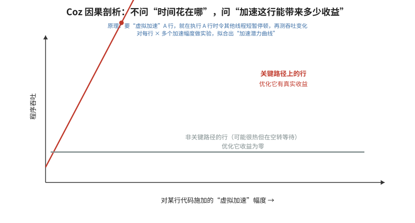


- **🎓 初学者导读**：普通剖析器告诉你"这段代码最花时间"，Coz 则像追问"修好这条路，上班到底能快几分钟"——它通过虚拟加速实验，直接预测优化某行代码后整体能提速多少。这解决了初学者最容易踩的坑：花一周优化了占用时间最长的函数，结果总时间几乎没变。强烈推荐精读这篇，Coz 的"因果剖析"思想会彻底改变你挑选优化目标的方式。

- **一句话概括**：Coz 提出因果剖析（causal profiling）：不回答"时间花在哪"，而是回答"如果把这行代码优化掉/加速 X%，整个程序会快多少"，通过"虚拟加速"实验直接测量每行代码对性能的因果贡献。

- **背景与问题**
  - 传统 profiler 的热点排名与"优化收益"经常脱节：耗时最多的函数不一定是瓶颈（它可能与其他工作并行重叠）；而只占少量时间的代码却可能卡在关键路径上，优化它能显著提速。优化者因此常在"热门但无所谓"的代码上浪费精力。
  - 多线程程序尤其如此：wall-clock 采样会把并行执行的时间重复计算，热点与真实提速潜力严重背离。

- **核心方法/内容详细展开**
  - **核心思想：虚拟加速（virtual speedup）**
    - 理想实验是"把第 X 行变快 p% 再测程序性能"，但不可能为每行代码都写出优化版本。
    - Coz 的关键洞察：**加速一段代码，等价于让其他所有并发执行的代码相对变慢**。因此对选中的代码行 L，Coz 不加速 L，而是在 L 执行期间，**暂停（pause）所有不在执行 L 的线程**，使 L 相对"变快"了。
    - 等价性的直观论证：设 L 原本耗时占程序总时间的比例为 `t`，把 L 加速 p%，程序节省的时间取决于 L 与其他工作的重叠程度；而"在 L 执行时让其他代码慢下来 p% 对应的量"产生的相对变化，与直接加速 L 在数学上同构——两者改变的都是"L 与其余代码的相对速率比"。Coz 论文给出了这一等价性的形式化论证。
    - 实现机制：Coz 是一个注入目标进程的运行时库（LD_PRELOAD）。它基于硬件性能计数器采样每个线程正在执行的代码行；当某次实验选中代码行 L、虚拟加速比例为 p% 时，凡发现某线程在 L 上执行，就让其余线程累积相应的"暂停债务"（delay）：线程轮流被插入短暂睡眠。睡眠时长按 L 的累计执行时间与 p% 的比例换算。最终 L 所代表的代码路径相对其他代码获得了 p% 的相对加速。
    - 暂停通过注入信号/短时阻塞实现，颗粒度很小且投放位置随机化，避免与被测程序自身的周期性同步。
    - **delinquent threads（欠账线程）问题**：若某线程从不执行 L，它会白白吃满所有暂停，导致过度减速、扭曲结果。Coz 给这类线程记"暂停额度欠账"，在其后暂停投放中给予豁免，保证各线程承受的减速总量公平。
  - **Progress Points（进度点）**
    - 程序"变快"的度量不能再用执行时间（实验本身改变了时间），Coz 改用**吞吐量/延迟型进度点**：
      - 延迟型：`COZ_BEGIN("name")` / `COZ_END("name")` 标记一次操作，统计完成次数；
      - 吞吐型：`COZ_PROGRESS("name")` 宏，每执行到计一次；
      - 不显式打点时，也可用"某行代码被执行的次数"（line visits）作为隐式进度点。
    - 实验过程中统计进度点的完成速率，作为"程序性能"的读数。
    - 选择进度点的原则：它应该是"用户/上层业务关心的工作完成事件"，如请求处理完毕、一帧渲染完成、一次查询返回——进度点速率的变化才对应真实的性能收益。
  - **实验设计与加速潜力曲线**
    - 一次运行中，Coz 以随机化的方式进行大量短实验：随机选中一条"正在被频繁执行"的代码行，在 0%~50% 之间随机选一个虚拟加速比例，运行一段固定长度的实验区间，记录该比例下进度点速率的变化。
    - 累积多个 (虚拟加速比例 → 程序提速) 数据点后，对每行代码拟合一条**加速潜力曲线**（program speedup vs. 该行被加速的幅度），并外推到 100%（即该行耗时降为零）的情形。
    - 解读：曲线斜率大的行 = 因果瓶颈，值得优化；斜率接近 0 的行即使占用大量 CPU 时间也不必碰（典型如与其他线程充分重叠的工作）。Coz 的报告直接按"优化收益预期"给代码行排序。
    - 曲线的形状本身携带信息：线性且陡峭说明该行独立位于关键路径；斜率随加速比增大而衰减（下凹）说明存在"接力瓶颈"——加速该行到一定程度后，瓶颈转移到别处，符合 Amdahl 定律的预期。
    - 与传统剖析的对比定位：传统采样 profiler 给出"相关性"（这行代码与耗时同时出现），Coz 通过受控实验给出"因果性"（干预这行代码的速率，观察程序性能随之变化）——这是 causal profiling 名称的由来，也使其结论可直接指导优化优先级。
  - **为何对多线程正确**：暂停投放按"线程时间"记账，天然把 wall-clock 中重叠的部分剥离，测出的是关键路径贡献而非总占用。

- **关键结论与数据**
  - 论文（CACM 2018 版，前身为 SOSP'15 论文）报告：在多个经过充分调优的真实程序（包括 PARSEC 基准与 SQLite 等）中，Coz 指出的优化点经人工实施后获得了显著的双位数百分比级提速，且其中多处是传统 profiler 排名并不靠前、靠人力很难想到的代码行。
  - 同时证明：传统热点剖析给出的许多"头号热点"，虚拟加速曲线斜率近乎为零——经验地量化了"热点 ≠ 值得优化"。

- **实战应用**
  ```bash
  # 1) 构建时保留 -g（行号信息），链接 pthread
  # 2) 在代码中加进度点（可选但推荐）：
  #    #include "coz.h"
  #    COZ_PROGRESS("queries");          // 每次处理完一个请求
  #    或 COZ_BEGIN/COZ_END 包住一次操作
  # 3) 运行剖析（coz 通过 LD_PRELOAD 工作）
  coz run --- ./my_app arg1 arg2
  # 4) 生成 profile.coz，用官方 viewer 打开：
  #    每行代码一条"虚拟加速-程序提速"曲线，按潜在收益排序
  ```
  - 使用技巧：进度点要放在"用户可感知的工作完成处"（如请求处理完毕）；实验区间太短会噪声大，长时间运行能提高曲线拟合置信度；对计算型单行循环，Coz 的因果排序可与传统热点列表对照，差异最大的地方往往就是最有价值的优化机会。

- **与 perf-book 对应章节**
  - 第 5 章 "Performance Analysis Approaches"（Coz/causal profiling 作为剖析方法家族的一员）；第 13 章多线程优化中关于"并行程序热点误读"的讨论。

- **常见误区/注意事项**
  - Coz 测的是"把这行变快的收益"，不是"删掉这行的收益"；曲线外推到 100% 是上限估计，实际优化很少能达到。
  - 没有合适进度点时结果会噪声很大甚至无意义；纯批处理程序建议用 `COZ_PROGRESS` 标记每次迭代。
  - 暂停机制改变线程间时序，对时序敏感（依赖特定竞态窗口）的程序可能出现行为变化；结果应多次运行取稳定趋势。
  - Coz 目前主要支持 Linux 上的本地代码（C/C++/Rust 等），JIT/解释型语言支持有限。
  - 虚拟加速曲线斜率大只说明"值得优化"，不说明"容易优化"——仍需结合代码可改性判断投入产出。
  - 运行时间太短则实验点不足、曲线拟合置信区间宽；长时间运行（让 Coz 积累数百个实验区间）才能得到稳定排序。
  - Coz 的优化建议以"代码行"为粒度给出，但同一行的收益可能属于整个循环/函数；落地时把相邻高斜率行聚合成一个优化候选区域更实用。
  - 对 I/O 主导的程序，进度点速率可能由外部系统决定，虚拟加速曲线的斜率会系统性偏低——Coz 最适合 CPU 受限的吞吐型/服务型程序。

> 本文扩写 perf-book-cn（Denis Bakhvalov《Performance Analysis and Tuning on Modern CPUs》中译本）参考文献中的两个主题：
> 「五、大规模数据中心与仓库级计算优化」（4 篇）与「六、编译器与代码优化」（9 篇）。
> 每篇笔记包含：一句话概括、背景与问题、核心方法/内容详细展开、关键结论与数据、实战应用、与 perf-book 对应章节、常见误区/注意事项。

---

## 五、大规模数据中心与仓库级计算优化

> 数据中心负载（搜索、广告、微服务、大数据）与教科书上的 SPEC 基准截然不同：代码体积巨大（数百 MB 机器码）、工作集远超缓存容量、内核与运行时开销占比高。这一类文献回答了"在仓库级计算机（Warehouse-Scale Computer, WSC）上，性能瓶颈到底长什么样、又该如何用 profile 驱动的编译与二进制优化去压缩它们"。这 4 篇文献构成了一条完整的技术线：Kanev 等人先用全集群采样"看清病灶"，AutoFDO 解决了"如何低成本拿到生产 profile"，HFSort 与 BOLT 则分别给出函数级与二进制级的布局优化手段。

### 1. Profiling a Warehouse-Scale Computer（Kanev et al., 2015）


- **🎓 初学者导读**：Google 给自家几万台服务器做了一次大规模"体检"，结果发现瓶颈和大家想当然的完全不一样——CPU 大半时间不是在算，而是在等数据。这篇能帮你建立正确直觉：优化前先搞清楚时间到底花在哪，而不是闷头改代码。细节里的各种指标名可以先不纠结，记住一句话：在大程序里，"取不到指令和数据"往往比"算得慢"更致命。

- **一句话概括**：Google 用全集群连续采样剖析（Google-Wide Profiling, GWP）首次大规模刻画了 WSC 负载的微架构行为，发现前端停顿、数据缓存未命中和"杀手微秒"（killer microseconds）是主要瓶颈，与 SPEC 类基准画像差异巨大。

- **背景与问题**：
  - 传统性能研究基于 SPEC CPU 等基准测试，但 Google 数据中心里跑的负载（搜索、Gmail、MapReduce、Bigtable 等）在代码规模、内存工作集、指令混合、内核交互上都与 SPEC 完全不同。用 SPEC 结论指导 WSC 机器选型和优化方向，可能南辕北辙。
  - 数据中心拥有数万台机器、数百个应用，"哪台机器上什么函数花了多少时间"是一个大数据问题，单机的 gprof/VTune 方法论无法直接扩展。
  - 核心研究问题：能否以可忽略的开销对全部机器做连续、低开销的采样剖析，并据此回答负载级（而非单机级）的性能问题？

- **核心方法/内容详细展开**：
  - **GWP（Google-Wide Profiling）架构**：
    1. 在每台机器上以很低的采样率（远低于单机剖析的典型频率）持续运行基于 perf_events 的采样器；由于机器数量巨大，低单机频率 × 海量机器 = 统计上充分的样本量。
    2. 每天随机抽取一部分机器打开更详细的采集（包括调用栈、PMU 事件混合采集），形成稳定的全集群样本流。
    3. 样本与符号信息（symbolization）、二进制版本、机器型号元数据一起汇入 Google 的交互式分析系统（Dremel），工程师可以用类 SQL 查询"哪个函数在全集群消耗的周期最多"、"某应用在 Ivy Bridge 与 Sandy Bridge 上的 IPC 差异"这类问题。
  - **负载画像（workload characterization）方法**：论文把大量 WSC 应用与 SPEC CPU2006 放在同一套 PMU 指标体系下对比，指标包括 IPC、各级缓存 MPKI（misses per kilo-instructions）、分支误预测率、TMA 桶分布、内核态周期占比等。
  - **TMA 四桶在 WSC 负载上的分布**（这是论文最著名的图表之一）：
    - **Retiring（有效执行）**：占比明显低于机器宽度所能支撑的理论水平，即 IPC 偏低，大量周期被浪费。
    - **Frontend Bound（前端受限）**：WSC 负载约 15%–30% 的周期卡在前端（取指、译码、µop 供给），通常是 SPEC 基准的 2–3 倍。原因是 WSC 二进制的代码体积巨大（单服务可达数百 MB），I-cache 与 I-TLB 根本装不下热路径。
    - **Bad Speculation（错误推测）**：约占一成左右，分支误预测仍然可观，但不是最大头。
    - **Backend Bound（后端受限）**：占比最大，且其中绝大多数是 **Memory Bound**——数据缓存未命中与 DRAM 延迟，而非执行端口饱和（Core Bound 很小）。注意：是延迟受限而不是带宽受限，DRAM 带宽利用率并不高。
  - **"Killer microseconds"**：论文发现全集群约一半的周期集中在一小撮公共基础函数上——内存分配器（malloc/free，即 tcmalloc）、`memcpy`/`memset`、锁与原子操作、协议缓冲（Protocol Buffers）序列化、压缩（Snappy）、RPC 框架热路径。这些"仓库级杀手微秒"单个只占几微秒，但乘上全集群的规模后，优化其中一个就等于免费升级了一部分舰队。这直接催生了 Google 对 tcmalloc、protobuf、memcpy 等的持续投入。
  - **机器异构性分析**：GWP 数据还用于比较不同 CPU 代次/内存配置下同负载的实际表现，为机器采购和调度（把延迟敏感作业调度到更合适的机型）提供依据；并分析了 NUMA 效应在 WSC 负载上相对有限（作业被切片分散部署，很少做 NUMA 亲和优化）。

- **关键结论与数据**：
  - WSC 负载的前端停顿占比 15%–30%，约为 SPEC 的 2–3 倍（论文给出的代表性结论）。
  - 后端停顿以数据缓存未命中/内存延迟为主；Core Bound（执行资源饱和）很小。
  - 内核态 + 虚拟化等系统开销占全部周期的一部分，不可忽略（与纯用户态基准不同）。
  - 少量公共基础函数贡献了全集群约一半周期（"killer microseconds"论点）。
  - IPC 分布显示大多数应用远未用满乱序执行引擎的宽度。

- **实战应用**：
  - 想在自己的组织里复制 GWP 思路，不需要 Google 的基础设施：用 `perf record -F 99 -a -g -- sleep 30` 定时在所有机器上采集，样本送入 ClickHouse/Elasticsearch/Polar Signals（开源连续剖析平台 Parca / Pyroscope / Grafana Phlare）即可搭建"穷人版 GWP"。
  - 用 TMA 复现论文式分析：`perf stat -e cycles,instructions,icache_64b.iftag_miss,itlb_misses.walk_duration,br_misp_retired.all_branches -- ./app`，或直接 `perf stat --topdown`（Intel）/`toplev`（Andi Kleen 的工具）查看四桶占比。
  - 工程启示的落地优先级：前端瓶颈 → 代码布局优化（PGO/BOLT/大代码页）；数据缓存瓶颈 → 数据结构与访问模式优化；先别碰微操作级调优。

- **与 perf-book 对应章节**：第 1 章（为什么需要性能调优，WSC 规模放大了微小收益）、第 6 章（TMA 与采样剖析方法论）、第 11 章（机器码布局优化——该论文是前端瓶颈证据的来源）。

- **常见误区/注意事项**：
  - 不要把论文的百分比当成普适常数：它们是 Google 2013–2015 年间舰队负载的画像，你的服务混合不同，分布就不同。方法论（连续采样 + TMA）比具体数字更值钱。
  - "前端受限 15–30%"是 stall cycle 占比，不是"时间占比"，更不是"可节省的比例"；消除全部前端停顿也不会让程序快 30%。
  - 采样频率过低会低估短函数，但 GWP 靠机器数量弥补；单机复现时注意采样偏差。

### 2. AutoFDO: Automatic Feedback-Directed Optimization for Warehouse-Scale Applications（Chen et al., CGO 2016）


- **🎓 初学者导读**：想象导航软件根据真实车流记录帮你重新规划路线——AutoFDO 就是用程序真实运行时采到的"路况数据"，回头告诉编译器哪条路最热，让它重点优化。这篇能帮你理解"先用真实数据画像、再让编译器精准发力"这套工业界主流做法，以后看到 PGO/FDO 这些词就不会再发怵。数学公式可以跳过，重点看为什么采样数据比静态猜测靠谱得多。

- **一句话概括**：用硬件采样（perf + LBR）代替插桩来生成 PGO profile，把 profile 采集开销降到接近零，使 FDO 真正能在数据中心生产环境常态化使用，并获得插桩 FDO 约 85% 的性能收益。

- **背景与问题**：
  - 插桩式 FDO（`-fprofile-generate` / `-fprofile-use`）效果好，但在数据中心难以落地：
    1. 插桩二进制慢（典型 5–20% 甚至更慢），不能部署到生产，只能维护一套"训练构建"；
    2. 训练负载与生产负载往往不匹配（representative workload 问题）；
    3. 插桩 profile 与源码版本强绑定，代码一改 profile 就失效，迭代成本高；
    4. 插桩本身改变代码布局与优化决策（插桩函数不内联），有观察者效应。
  - 目标：能否直接用生产机器上随手可得的 PMU 采样数据驱动编译器优化？

- **核心方法/内容详细展开**：
  - **从采样到编译器的映射**：
    1. 用 perf 在生产（或生产影子流量）上采集：指令地址样本 + LBR（Last Branch Record）记录的分支跳转对。
    2. 离线工具（`create_gcov` / `llvm-profgen`）把地址样本借助 DWARF 调试信息（行号表、内联展开信息）映射回源级控制流图：每个样本命中哪个基本块、哪个内联实例。
    3. 因为 profile 必须能跨版本使用，AutoFDO 使用**函数内相对偏移**（相对函数入口的偏移，而非绝对地址）来标识位置，使得代码改动后 profile 仍大部分可用——这是 AutoFDO 能常态化运行的关键工程决策。
  - **Estimated counts（估计计数）**：采样是稀疏的、指令粒度的，编译器却需要每条 CFG 边的执行计数。AutoFDO 的做法：
    1. 把落在基本块内的样本数直接作为该块的"估计执行次数"；
    2. 利用 LBR 给出的分支对信息补充边的计数（LBR 精确记录了实际发生的跳转源-目的对）；
    3. 对缺失信息的边，用 CFG 流约束（每个非入口/出口块满足流入=流出）和静态启发式（循环回边概率、分支预测启发式）做传播/平滑，解出一个全局自洽的 profile。
    因此叫 "estimated" 而非精确计数——但实践证明足以驱动内联、块布局等优化。
  - **内联处理**：样本按"内联上下文"区分（同一函数被内联到不同调用点会分别统计），使内联决策能看到各调用点的真实热度，这一点甚至比传统插桩 FDO 的粒度更好。
  - **与插桩 FDO 的对比**（论文核心结果）：在 Google 内部大型应用与 SPEC 上，AutoFDO 取得的加速约为插桩 FDO 的 **85%** 左右，而采集开销接近零（生产采样本来就在跑）；剩余差距主要来自采样噪声和估计误差。论文同时指出 AutoFDO profile 体积小、跨版本稳定，适合每天自动重新生成。

- **关键结论与数据**：
  - AutoFDO 达到插桩 FDO 约 85% 的性能收益（论文报告的代表性数字）。
  - 采样式 profile 对代码演进有较强鲁棒性（相对偏移 + 模糊匹配），旧版本二进制采的 profile 仍可用于新版本编译。
  - LBR 采样显著改善边 profile 质量，优于纯指令采样。

- **实战应用**（GCC 流程）：
  ```bash
  # 1. 采集（带 LBR 分支记录；upp 要求 precise 事件+用户态+过滤分支类型）
  perf record -b -e br_inst_retired.near_taken:upp -- ./myapp
  # 或者直接用 cycles 事件 + LBR：perf record -e cycles:u -j any,u -- ./myapp

  # 2. 转换成 AutoFDO 格式（autofdo 包提供 create_gcov；LLVM 用 llvm-profgen）
  create_gcov --binary=./myapp --profile=perf.data --gcov=myapp.afdo -gcov_version=1

  # 3. 用采样 profile 编译（GCC）
  gcc -O2 -fauto-profile=myapp.afdo -o myapp.opt ...
  # LLVM/Clang 对应选项：
  clang -O2 -fprofile-sample-use=myapp.prof ...
  ```
  - 二进制需带调试行信息（`-gline-tables-only` 即可，不必完整 `-g`），且编译时开 `-fno-omit-frame-pointer` 非必需，但地址到源码映射需要行表。
  - Google 后续演进：CSSPGO（Context-Sensitive Sample PGO）与 LLVM 的 `llvm-profgen` 流程，成为 LLVM 官方 SamplePGO 的基础。

- **与 perf-book 对应章节**：第 6.3 节（LBR/分支栈采样）、第 7 章（剖析工具链）、第 11.2–11.3 节（PGO/FDO 编译流程）。

- **常见误区/注意事项**：
  - 采样 profile 驱动的是"哪个调用点热"的决策，不要指望它给出精确执行计数；依赖精确计数的优化（如某些向量化成本模型）仍以插桩为准。
  - 训练负载不 representative 的问题不会因采样而消失——采样只是让"用生产流量当训练负载"变得可行。
  - `-fauto-profile` 与 `-fprofile-use` 不要混用同一文件，两者格式不同（AutoFDO 是 gcov 文本/LLVM text profile，插桩是 .gcda）。
  - 没有 LBR 的老机器/虚拟机（LBR 常被 hypervisor 屏蔽）上 AutoFDO 精度明显下降。

### 3. Optimizing Function Placement for Large-Scale Data-Center Applications（HFSort，Ottoni & Maher, CGO 2017）


- **🎓 初学者导读**：把图书馆里经常一起被借走的书摆在相邻书架上，读者就不用满馆跑——这篇讲的正是把经常先后执行的函数在内存里排到一起。它能帮你解决大程序"取指缓存（CPU 里存指令的小仓库）总是装不下、来回搬运浪费时间"的问题。聚类算法的细节可以先略过，记住核心思路：经常一起跑的代码要挨着放。

- **一句话概括**：Facebook 针对超大规模数据中心应用提出 HFSort 函数排序算法，在经典 Pettis-Hansen 算法基础上引入热度感知与可扩展设计，显著减少 I-cache/I-TLB 未命中，并直接成为 BOLT 的函数重排算法。

- **背景与问题**：
  - 数据中心二进制动辄上百 MB 代码，但任意时刻真正热的可能只有很小一部分。链接器按目标文件顺序摆放函数，彼此频繁调用的函数在地址空间上相距遥远，导致：
    - I-cache 未命中与 I-TLB 未命中频繁（呼应 Kanev 论文的前端瓶颈）；
    - 分支目标距离远，间接增加 BTB 压力与跳转指令编码长度。
  - 经典方案是 Pettis-Hansen（1990）的 profile-guided code positioning，但直接套用在数百 MB、数十万函数、且只有采样 profile 的 Facebook 二进制上，效果与可扩展性都不够。

- **核心方法/内容详细展开**：
  - **Pettis-Hansen（PH）算法回顾**：
    1. 从 profile 构建加权调用图：节点是函数，边权是调用次数；
    2. 贪心合并：反复选取当前权重最大的边，把其两端节点（或已形成的链）合并成一条更长的链——调用者与被调者紧邻放置，使热调用尽可能变成 fall-through 或短跳转；
    3. 所有边处理完后，按链的热度依次输出链，得到函数排列。
    本质是在"让热边两端距离最近"的目标下做贪心聚链，是 TSP 类问题的启发式。
  - **HFSort 的改进点**：
    1. **热度感知的节点权重**：不只使用边（调用）信息，还把函数自身的采样热度纳入排序目标；先把最热的函数聚在一起形成热区（hot section），冷函数整体后移——热区总 footprint 被压缩，I-cache 工作集缩小。
    2. **适配采样 profile**：profile 来自 perf/LBR 采样而非精确插桩计数，算法对噪声和缺失边做了鲁棒处理（热度阈值、丢弃稀疏边）。
    3. **与函数分裂（hot/cold splitting）配合**：函数内部的冷基本块（异常处理、错误路径）被剥离出去，只把热部分放进热区，进一步压缩热代码体积。
    4. **大规模可扩展性**：工程实现面向 HHVM（数亿字节代码、数十万函数）级别的输入，构建图与排序的开销可控。
    5. 排序时考虑 tie-breaking 与链的方向性，使 fall-through 机会最大化。
  - 效果评估在 HHVM 及 Facebook 其他生产服务上进行，以 I-cache MPKI、I-TLB 未命中、分支未命中和端到端 QPS/延迟为指标。

- **关键结论与数据**：
  - HFSort 在 Facebook 生产负载上稳定优于 PH 基线：I-cache 与 I-TLB 未命中明显下降，并带来稳定的端到端性能收益（在大代码中心级应用上，这类布局优化的典型收益是几个百分点量级）。
  - 论文验证了一个重要工程结论：对超大代码量应用，"函数间布局"和"函数内布局"需要分开处理、各自用 profile 驱动。

- **实战应用**：
  - 今天无需自己实现 HFSort——它已被移植进 BOLT：
    ```bash
    llvm-bolt ./myapp -o myapp.bolt -data=perf.fdata \
      -reorder-functions=hfsort \
      -reorder-blocks=ext-tsp -split-functions
    ```
    其中 `-reorder-functions=hfsort` 就是本论文的算法。
  - 在编译器层面，GCC/Clang 的 `-fprofile-use` 内部也用 PH 变体做函数分区（hot/cold partitioning，`-freorder-functions`）；用 `-ffunction-sections` + 链接脚本可手工控制函数分区做实验。
  - 评估函数重排收益时的观测指标：`perf stat -e icache_64b.iftag_miss,L1-icache-load-misses,iTLB-load-misses` 前后对比。

- **与 perf-book 对应章节**：第 11.4 节（函数重排 / Function Reordering）、第 11.1 节（机器码布局对前端的影响）。

- **常见误区/注意事项**：
  - 函数重排只对"热代码 footprint 超过 I-cache/I-TLB 容量"的程序有意义；小程序（整个热路径几十 KB）几乎无收益。
  - 贪心算法不保证全局最优；不同 profile 会得到不同布局，benchmark 时要固定 profile 再比较。
  - 布局优化收益与 profile 代表性强相关：训练负载漏掉的热函数会被排到冷区，反而变慢。

### 4. BOLT: A Practical Binary Optimizer for Data Centers and Beyond（Panchenko et al., 2018/2019）

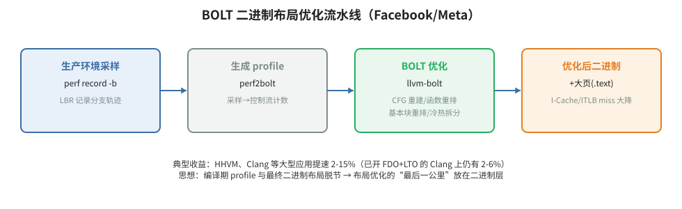


- **🎓 初学者导读**：BOLT 就像书已经印刷装订好之后，再做最后一次排版微调——不改原稿（源代码），直接对成品二进制文件重新排列章节，让翻阅更顺。当你手头没有源码、或者重编译成本太高时，这篇告诉你"事后优化"依然能拿到可观的提速。命令行参数和原理图可以先看个大概，知道"编译完之后还有一轮优化机会"这个认知就赚到了。

- **一句话概括**：Facebook 开源的后链接（post-link）二进制优化器，直接对成品 ELF 可执行文件做 profile 驱动的 CFG 重建与布局优化，在编译器 PGO+LTO 之上还能再榨出 2%–8% 的性能，并已并入 LLVM 成为 `llvm-bolt`。

- **背景与问题**：
  - 即使开了编译器 PGO，最终二进制里仍残留大量布局问题：链接器不了解热度、第三方/汇编/旧代码没有 profile、编译期与链接期信息割裂。数据中心应用代码量巨大，前端瓶颈（Kanev 论文）让"最后一公里"的布局优化价值很高。
  - 直接在二进制上优化有独特优势：看到的是最终完整程序（含静态链接库），不依赖源代码与构建系统配合，语言无关。

- **核心方法/内容详细展开**（完整流水线）：
  1. **采样**：用 perf 采集带 LBR 的样本：
     ```bash
     perf record -e cycles:u -j any,u -o perf.data -- ./app
     ```
     LBR 提供精确的边级跳转信息（源/目的地址对），BOLT 据此获得基本块级执行计数——这是它比纯指令采样 profile 更精确的关键。
  2. **CFG 重建**：`perf2bolt` 与 BOLT 前端解析 ELF，借助重定位信息（链接时需 `-Wl,--emit-relocs`）与调试信息做反汇编，重建函数与基本块边界、构建全程序 CFG；把 perf 样本映射回基本块和边。
  3. **布局优化**（核心 pass）：
     - **基本块重排**（`-reorder-blocks`，默认 `ext-tsp`）：用扩展 TSP 启发式重排函数内基本块，最大化热路径上的 fall-through，减少 taken branch 与代码跨越。
     - **函数重排**（`-reorder-functions=hfsort`）：见上一篇笔记，压缩热函数区间。
     - **Split functions（函数分裂）**：把每个函数内的冷基本块（罕用的错误处理等）物理搬到独立的 `.text.cold` 区，函数热体变得紧凑；BOLT 的分裂比编译器的 hot/cold partitioning 更激进，因为它有精确的块级计数。
     - 其他：热 PLT 调用优化、间接调用提升（indirect call promotion）、重复代码折叠（ICF）等。
  4. **二进制重写**：重排后的代码重新发射为可执行文件；所有分支目标、重定位、异常表、调试信息（借助重定位记录）同步修正。输出文件可直接部署，运行时行为与优化 profile 一致时即获得加速。
  - **与 FDO/LTO 叠加**：BOLT 的定位是"在编译器已经尽力之后再优化"。论文报告：对已经过 FDO+LTO 优化的大型应用（HHVM、MySQL、GCC、Clang 等），BOLT 再提供 **2.0%–8.0%** 的性能提升；收益来源主要是 I-cache/I-TLB 未命中减少与分支取指效率提升。

- **关键结论与数据**：
  - 在 FDO + LTO 之上再加速 2%–8%（论文给出的范围，HHVM 等大代码应用处于高端）。
  - 前端事件（I-cache miss、I-TLB miss、branch taken 相关停顿）显著下降，与加速幅度对应。
  - 二进制体积层面热区大幅压缩（函数分裂把冷代码移出热区）。

- **实战应用**（llvm-bolt 标准流程）：
  ```bash
  # 0. 链接时保留重定位（BOLT 安全重写的前提）
  g++ ... -Wl,--emit-relocs -o app

  # 1. 用代表性负载采样（带 LBR）
  perf record -e cycles:u -j any,u -o perf.data -- ./app train_input

  # 2. 转换 profile
  perf2bolt -p perf.data -o perf.fdata ./app
  # （无 LBR 环境可用基础采样模式，精度略降）

  # 3. 优化
  llvm-bolt ./app -o app.bolt -data=perf.fdata \
    -reorder-blocks=ext-tsp \
    -reorder-functions=hfsort \
    -split-functions -split-all-cold \
    -icf=1 -use-gnu-stack

  # 4. 验证收益
  perf stat -e cycles,instructions,L1-icache-load-misses,iTLB-load-misses ./app.bolt
  ```
  - BOLT 也支持用插桩/采样得到的 fdata 反复迭代；对无法重链接的二进制，BOLT 提供 instrumentation 模式（先插桩跑一遍再优化）。

- **与 perf-book 对应章节**：第 11 章（机器码布局优化，BOLT 是该章的核心案例工具）；第 6.3 节（LBR 采样）。

- **常见误区/注意事项**：
  - profile 必须有代表性：BOLT 会把"没见过"的代码当冷代码踢出热区，训练负载覆盖不到的热路径会变慢。
  - `-Wl,--emit-relocs` 缺失时 BOLT 可能无法安全处理某些间接控制流；手工汇编、异常密集代码（大量 catch）、自修改代码是已知难点。
  - BOLT 主要解决**前端/取指**问题；如果你的瓶颈在数据缓存或计算，BOLT 收益有限——先 TMA 定位再决定。
  - 大页配合：BOLT 优化后再用 2MB 大代码页（见第 10 篇笔记）常有叠加收益。

---

## 六、编译器与代码优化

> 编译器是性能工程师最重要的杠杆之一：理解编译器能做什么、不能做什么，才能知道哪些优化该手写、哪些该交给工具。这 9 篇文献分三个层次：教科书级的编译优化全景（Cooper & Torczon、Agner Fog 三件套），前沿的自动优化技术（Polly 多面体、Alive2 正确性验证、ISPC 的 SPMD 模型），以及代码布局与页面级的专项技术（Ext-TSP、大代码页）。读完后应能对"编译器为什么没把这段代码优化好"给出有依据的假设。

### 5. Engineering a Compiler（2nd Edition，Cooper & Torczon, 2012）


- **🎓 初学者导读**：如果把编译器比作一座工厂，这本书就是一份完整的工厂设计蓝图——从原料（源代码）进厂到成品（机器码）出厂，每条流水线都讲得清清楚楚。它适合当你看优化论文时遇到"寄存器分配""指令调度"这类黑话卡住时，回来查原理的字典级参考书。不必从头通读，按需查章节即可，先混个脸熟，用到时再精读。

- **一句话概括**：以"工程权衡"为主线的编译器经典教材，系统讲清从 IR、数据流分析到指令选择、调度、寄存器分配的完整优化链，是理解 GCC/LLVM 在干什么的基础读物。

- **背景与问题**：
  - 编译器教材常偏前端理论（文法、自动机），而性能工程师关心的是中后端：优化器如何变换代码、代码生成如何做决策、为什么理论上最优的变换实际可能更慢。
  - "工程"二字是本书灵魂：每个优化 pass 都讨论成本、适用条件与相互作用，而不是罗列算法。

- **核心方法/内容详细展开**：
  - **IR 与中间表示**：为什么现代编译器用多层 IR（AST → 三地址码 → SSA → 机器相关 IR）；SSA（Static Single Assignment）的构造：支配关系、支配边界（dominance frontier）、φ 函数插入与重命名。SSA 让数据流分析变得稀疏高效，是 LLVM IR 的基础。
  - **标量优化（scalar optimizations）**：
    - 局部/全局值编号（LVN/GVN）：识别冗余表达式；
    - 常量传播、死代码消除、强度削减（strength reduction，如乘 2 变移位）；
    - 循环优化：不变量外提（LICM）、归纳变量优化、循环展开（unrolling）的收益与代码膨胀代价。
  - **数据流分析框架**：格（lattice）上的迭代不动点算法，可用表达式、活跃变量等经典分析如何支撑上述优化。
  - **指令选择**：树模式匹配（tree-pattern matching）与基于文法的方法，如何把 IR 映射到目标指令。
  - **指令调度（instruction scheduling）**：列表调度（list scheduling）——构建依赖图（数据依赖/反依赖），按关键路径优先级逐拍填发射槽，减少流水线停顿；局部调度 vs 全局（跨基本块）调度。
  - **寄存器分配**：图着色（graph coloring）范式——构建冲突图（interference graph），尝试 k 着色（k = 物理寄存器数），不可着色时选择 spill 节点插入存取代码；Chaitin 与改进的 Briggs 准则；live range splitting。
  - **阶段顺序问题（phase-ordering problem）**：优化 pass 彼此影响（内联扩大作用域但也撑大代码），没有全局最优顺序，这是编译器工程的固有困难。

- **关键结论与数据**（观点性结论）：
  - "优化器的大部分收益来自少数几个 pass"：内联、常量传播、冗余消除、寄存器分配质量决定了大部分性能。
  - 编译器看到的是程序的静态近似；profile 信息（PGO）能显著改善内联与布局决策——这为后续 AutoFDO/BOLT 文献埋下伏笔。

- **实战应用**：
  - 读这本书的现实回报：看懂 `clang -O2 -mllvm -print-after-all` 或 GCC `-fdump-tree-all` 输出的每个 pass 在做什么；
  - 用 `opt -passes=gvn,licm,instcombine` 单独试验某个 LLVM pass 对热点 IR 的影响；
  - 写代码时主动配合编译器：避免让别名分析失败（`restrict`）、把不变量显式提出循环、让归纳变量简单可识别。

- **与 perf-book 对应章节**：全书编译器背景知识；尤其支撑第 9 章（优化计算——循环与向量化相关的编译器行为）与第 11 章（PGO 的编译器侧原理）。

- **常见误区/注意事项**：
  - 教材算法（如图着色）是教学范式，LLVM/GCC 实际实现有大量启发式偏离；不要把教材当实现文档。
  - 不要试图在源码里"手工做编译器的工作"（如手工强度削减），现代编译器几乎总能做得更好；人的价值在编译器看不到的层面：算法、数据布局、并行性。

### 6. Polly – Performing Polyhedral Optimizations on a Low-Level Intermediate Representation（Grosser et al., 2012）


- **🎓 初学者导读**：把嵌套循环想象成日历上的格子，Polly 做的事就是把这些格子在几何空间里旋转、平移，找出一种访问顺序让数据一次拿齐、少跑冤枉路。它能帮你理解"循环变换"为什么能自动提速科学计算类的代码。多面体模型的数学很硬核，初学者只需领会"循环的顺序和分块是可以被自动重排的"，证明部分放心跳过。

- **一句话概括**：Polly 把多面体模型（polyhedral model）引入 LLVM，自动发现循环嵌套中的 SCoP，用整数集合代数做依赖分析与循环变换（分块、交换、融合），实现自动数据局部性优化与并行化。

- **背景与问题**：
  - 循环嵌套优化（tiling/interchange/fusion/并行化）对科学计算、图像处理收益巨大，但传统编译器在抽象语法树或三地址码上做这些变换，表达力与正确性保障不足。
  - 多面体模型理论成熟（1990 年代起），但此前多停留在研究原型；Polly 的贡献是把它工程化到 LLVM 的低层 IR 上，直接面向真实 C/C++ 程序。

- **核心方法/内容详细展开**：
  - **SCoP（Static Control Part）检测**：Polly 在 LLVM IR 上识别满足条件的最大循环区域：循环边界、数组下标都是循环归纳变量与参数（循环不变量）的**仿射函数**（形如 `a*i + b*j + c`）。`for (i=0;i<n;i++) for (j=0;j<m;j++) A[i][j] += B[j][i];` 是 SCoP；下标含 `A[B[i]]` 或数据相关的 `if` 则不是（会被排除或建模为运行时条件）。
  - **多面体表示**：
    1. **迭代域（iteration domain）**：每个语句的迭代点集合用整数集合表示，如 `{ S[i,j] : 0<=i<n and 0<=j<m }`，即参数化的整数多面体；
    2. **访问关系（access relations）**：每个语句读/写哪些数组元素，表示为迭代点到数组下标的仿射映射 `{ S[i,j] -> A[i,j] }`；
    3. **依赖分析**：对"写后读/读后写/写后写"求访问关系的交集与像，得到精确的依赖集合（用 Presburger 算术与 Fourier-Motzkin 消元完成）——比传统的方向向量/距离向量精确得多；
    4. **调度（schedule）**：把每个语句映射到多维逻辑时间的仿射函数；循环变换 = 换调度函数。tiling、interchange、skewing、fusion 都统一为对调度做整数线性变换，且可用依赖集合**机械地验证合法性**；
    5. **代码生成**：从新调度反推循环嵌套结构，由 CLooG/isl 的 AST 生成器产出 LLVM IR。
  - **isl（integer set library）**：Polly 的数学引擎，提供参数化整数集合/映射的并、交、差、像、原像、coalescing 等运算以及 ILP 求解，是多面体编译的实际标准库。
  - **自动并行化**：若某层循环无携带依赖，可标记为并行（生成 OpenMP 调用或 Polly-ACC 的 GPU 卸载）；局部性变换（tiling）自动插入以匹配缓存行与容量。

- **关键结论与数据**：
  - 论文展示了在典型循环基准（如线性代数、stencil）上，Polly 的自动分块+并行化可带来数倍加速；更重要的结论是：在 LLVM 这种低层 IR 上实施多面体优化是可行的，无需保留高级语言信息。

- **实战应用**：
  ```bash
  # 让 clang 在 -O3 之外追加 Polly 流水线
  clang -O3 -mllvm -polly -mllvm -polly-parallel -o app app.c

  # 查看哪些区域被识别为 SCoP
  clang -O3 -mllvm -polly -mllvm -polly-show app.c

  # 配合向量化策略与 OpenMP 代码生成
  clang -O3 -mllvm -polly -mllvm -polly-vectorizer=stripmine -fopenmp
  ```
  - 现代写法：`clang -O3 -mllvm -polly` 依然有效；部分版本提供 `-polly-position=before-vectorizer` 使 Polly 在向量化之前运行。
  - 对无法静态证明无别名的指针，Polly 可生成**运行时别名检查**（runtime alias checks），检查成立走优化版本，否则走原版本。

- **与 perf-book 对应章节**：第 9 章（优化计算——循环优化、数据局部性与向量化的编译器自动化极限）。

- **常见误区/注意事项**：
  - Polly 只对 SCoP 有效：真实代码里指针别名、不规则下标、回调调用都会让区域被排除，"编译器为什么没优化我的循环"往往是因为不构成 SCoP。
  - 多面体优化的编译时间开销可观，大函数上可能显著拖慢构建。
  - 自动并行化只对小循环收益明显，粗粒度并行（线程池、任务划分）仍需人工设计。
  - `-polly` 默认不在 `-O3` 里，需要显式开启。

### 7. Future Directions for Optimizing Compilers（Lopes & Regehr, 2018）


- **🎓 初学者导读**：这篇像两位老师傅坐在一起聊"我们这行接下来该往哪走"，谈的是编译器优化的未来方向，比如让机器自动搜索最优代码、而不是靠人写规则。它能帮你跳出具体技巧，看清整个领域的大图景和你学的知识值不值得长期投入。篇幅短、几乎没公式，当作行业前瞻随笔读就好，不用逐句抠。

- **一句话概括**：一篇立场鲜明的编译器方向论文，指出现代优化器"既脆弱又不可信"，并给出两条出路：用 SMT 求解器自动验证优化正确性（Alive/Alive2），以及用超级优化（superoptimization）自动发现新优化。

- **背景与问题**：
  - 大型编译器（LLVM/GCC）的优化器有数十万行手工编写的模式匹配与变换规则，长期存在 miscompilation（错误优化）——尤其涉及 `undef`/`poison`、有符号溢出、别名假设时。
  - 同时，优化器"想不到"很多可做的变换：人工写规则跟不上指令集与代码模式的演化。论文核心问题：能否让优化的**正确性**和**发现**都自动化？

- **核心方法/内容详细展开**：
  - **翻译验证（translation validation）**：不验证编译器本身，而是对每次编译结果验证"优化后程序精化（refine）了优化前程序"——即目标程序的行为是源程序允许行为的子集。Alive 把 LLVM 的 peephole 优化（InstCombine 风格的 `lhs → rhs` 规则）编码为 SMT 公式，用 Z3 等求解器自动判定：
    - 对所有输入（含 `undef`/`poison` 的精妙语义），`rhs` 是否总是 `lhs` 的合法精化？
    - 若不合法，自动给出反例（输入值 + 触发路径），直接变成 bug 报告。
    Alive 在 LLVM 的 InstCombine 规则集中真实发现了多个潜伏多年的 bug，由此进入 LLVM 开发工作流。
  - **Alive2**：Alive 的重实现版，支持更完整的 LLVM IR 子集与改进的内存模型（`poison` 语义、内存访问、对齐、lifetime），可作为"优化器 CI 看门狗"接入编译器开发。
  - **超级优化（superoptimization）**：与其人工编写变换规则，不如暴力/引导式搜索：给定目标代码片段，在所有长度不超过 k 的指令序列空间中搜索语义等价且更快的序列，用 SMT 验证等价性。Souper 是面向 LLVM 的合成超级优化器，能把发现的变换反哺给优化器或作为 peephole 建议。
  - 论文还讨论了随机差分测试（Csmith 类）与形式化验证互补的角色，以及"编译器应把优化决策建立在成本模型与 profile 之上"的方向。

- **关键结论与数据**：
  - Alive/Alive2 实践证明：主流编译器的优化规则可以被机器自动证伪，且确实藏有错误——"编译器是对的"不能作为默认假设。
  - 超级优化能在小规模片段上发现人类未写过的优化规则，但搜索空间爆炸使其难以直接用于大规模编译，更适合"离线发现规则、在线应用"。

- **实战应用**：
  ```bash
  # Alive2 在线验证一条 LLVM 变换（工具链：alive-tv）
  alive-tv before.ll after.ll          # 验证两个函数间是否精化
  alive-tv --passes=instcombine src.ll # 直接验证 instcombine 对该 IR 的变换
  ```
  - 对性能工程师的意义：当怀疑"编译器把我的代码编译错了"时，Alive2 是比逐条汇编推理更快的仲裁工具；理解 `poison`/`undef` 语义也能避免写出"恰好能跑"的 UB 代码。
  - Souper 可作为优化建议器使用（对热点函数给出可能的等价更快序列）。

- **与 perf-book 对应章节**：背景性文献，支撑第 9 章（理解编译器优化能力与边界）；帮助读者建立"编译器优化可被验证、也会出错"的清醒认知。

- **常见误区/注意事项**：
  - Alive2 验证的是"精化关系"而非"性能"，一条合法变换照样可能更慢；性能问题要找成本模型。
  - SMT 验证对浮点、向量全指令集的支持有限制，报告反例时需人工复核是否为工具建模差异。
  - 超级优化的结果迁移到真实编译器仍需人工工程化（规则泛化、成本模型配套）。

### 8. ISPC: A SPMD Compiler for High-Performance CPU Programming（Pharr & Mark, InPar 2012）


- **🎓 初学者导读**：普通写法是你一个人把 100 份表格逐个填完，ISPC 的写法是你只写一份"填表说明"，编译器自动安排 8 个人同时填 8 份——这就是让 CPU 的向量单元（一次能算多个数的硬件）干活的 SPMD 思路。想给图像、数值计算类代码提速又怕手写汇编太痛苦时，这篇给你一条低门槛的路。把它当一门"写法接近 C、自动帮你并行"的小语言来了解即可，编译器实现细节可以先不看。

- **一句话概括**：ISPC 把 GPU 风格的 SPMD 编程模型搬到 CPU SIMD 上，用 `foreach`/`uniform`/`varying` 抽象让程序员以接近串行的心智写出自动利用 SSE/AVX/AVX-512 掩码执行的向量代码，性能接近手写 intrinsics。

- **背景与问题**：
  - CPU SIMD 利用率低的根源不是硬件，而是编程模型：自动向量化脆弱（对循环结构、别名、控制流极其敏感），手写 intrinsics 则冗长、不可移植（SSE→AVX→AVX-512 要重写）、难以维护。
  - GPU 的 CUDA/OpenCL 证明 SPMD（Single Program Multiple Data）模型可行：程序员写"单条数据"的逻辑，硬件/运行时负责并行到成千上万个实例。能否给 CPU 也来一套？

- **核心方法/内容详细展开**：
  - **SPMD-on-SIMD 模型**：一次 ISPC 函数调用启动一个"gang"，gang 内程序实例（program instance）数量 = SIMD 宽度（AVX2 下 float 为 8）。编译器把每个标量变量映射为向量寄存器的一条 lane，把控制流编译为**掩码执行**。
  - **uniform vs varying**（ISPC 的类型系统核心）：
    - `varying`（默认）：每个程序实例一份，编译为向量寄存器；
    - `uniform`：所有实例共享同一值，编译为标量寄存器——省寄存器、可用标量指令，分支/循环条件为 uniform 时无掩码开销。
    正确使用 `uniform` 是 ISPC 性能调优的第一课。
  - **掩码执行（masked execution）**：遇到 `varying` 条件的 `if` 时，编译器生成"先算条件掩码，两个分支都执行并用掩码混合结果"的代码（对应 AVX 的 `vblendvps`、AVX-512 的 `k` 掩码寄存器）。分支发散时代价是"两边都算"，与 GPU warp 发散同理。`foreach` 循环、`cif`（coherent if，提示编译器条件大体一致）用于缓解。
  - **gather/scatter**：`varying` 下标访问（`A[index]`，index 为 varying）编译为 gather 指令（或多条标量 load 的序列）；编译器会尽量识别连续访问并转为向量 load。
  - 代码示例：
    ```c
    export void mandel(uniform float x0, uniform float y0,
                       uniform float x1, uniform float y1,
                       uniform int maxIter, uniform int output[])
    {
        float dx = (x1 - x0) / programCount;
        foreach (i = 0 ... programCount)
        {
            float x = x0 + i * dx;
            // 每个 lane 计算自己的逃逸迭代次数，自动向量化
            ...
        }
    }
    ```
  - 编译器把上述循环体按目标 ISA 的向量宽度展开，`programCount`/`programIndex` 是内建的 lane 编号抽象；换指令集只需重新编译（`-O2 --target=avx2` 或 `avx512skx`）。

- **关键结论与数据**：
  - 论文在渲染/图像类 kernel 上报告：ISPC 相对良好编译的串行 C++，在 4 宽 SSE 上获得数倍加速（多数 kernel 达到理论向量加速比的高比例），且与手写 intrinsics 版本差距很小——以远低于 intrinsics 的开发成本拿到其大部分性能。

- **实战应用**：
  ```bash
  ispc -O2 --target=avx2-i32x8 -o kernel.o kernel.ispc   # 编译为对象文件
  ispc -O2 --target=host -h kernel.h kernel.ispc         # 生成 C 头文件
  # C++ 侧直接链接调用 export 的函数；oneAPI 版本支持多目标一次编译：
  ispc -O2 --target=sse4-i32x8,avx2-i32x8,avx512skx-i32x16 kernel.ispc
  ```
  - 调优要点：尽量让数据布局为 SoA（ISPC 提供 `<aos_to_soa>` 内建）；标记 uniform；用 `foreach` 代替手写 `programIndex` 算术；用 `--emit-asm` 检查生成的向量指令质量。

- **与 perf-book 对应章节**：第 9 章（优化计算——向量化；ISPC 是"编译器自动向量化失败时"的第三条路）。

- **常见误区/注意事项**：
  - ISPC 不是自动并行化的银弹：数据相关的控制流、pointer chasing、不规则访存照样向量化不动，只是失败方式更可预测。
  - 掩码执行意味着发散分支两侧都要付指令成本；重发散 kernel（如 BVH 遍历）需要专门技巧（`cif`、重排序）。
  - `export` 跨语言调用有 ABI 边界，细粒度调用有开销，ISPC 适合"粗粒度 kernel 整体下沉"。

### 9. Improved Basic Block Reordering（Ext-TSP，Newell & Pupyrev, 2018）


- **🎓 初学者导读**：快递小哥送货时要规划一条少绕路的配送顺序，这篇解决的就是给代码里的基本块（一小段连续执行的指令）排个"最少跳转"的执行顺序，让 CPU 少做急转弯。它是第 3 篇函数级排布的"微观版"，帮你理解代码布局优化背后的经典算法思路。图论推导可以略读，记住结论：好的排列能明显减少跳转和缓存未命中。

- **一句话概括**：把函数内基本块布局建模为扩展的旅行商问题（Ext-TSP），用带前瞻的链合并启发式求解，比经典贪心重排产生更多 fall-through，成为 BOLT 的默认基本块重排算法（`-reorder-blocks=ext-tsp`）。

- **背景与问题**：
  - 基本块重排的目标：让热路径上的后继块尽量物理相邻（fall-through），从而减少 taken branch、改善 I-cache 局部性与取指带宽。经典算法（Pettis-Hansen 风格的贪心 trace/chain 合并）只看"当前最热边"，容易做出局部最优、全局欠佳的布局。
  - 在 BOLT 等二进制优化器普及后，块级布局的质量直接决定收益上限，值得一个更好的算法。

- **核心方法/内容详细展开**：
  - **问题建模**：把 CFG 中的基本块看作节点，边权为转移频率；要找一个块的线性排列，最大化相邻块之间"恰好是热边两端"的总权重（fall-through 权重），同时被热跳转跨越的距离尽量短。这正是 TSP 的推广形式——作者称之为 Ext-TSP：节点可以先组成链（chain），链有方向、可翻转，目标函数综合 fall-through 收益与跳转距离代价。
  - **求解启发式**：
    1. 初始时每个块自成一链；
    2. 反复考虑权重最高的边：若它连接两条链的端点，则合并（必要时翻转其中一条使端点对接）；
    3. **关键改进——前瞻（lookahead）与 tie-breaking**：当多条边权重接近时，评估"合并后对剩余高权边的影响"再决策，而不是无脑取最大；论文设计了若干分解规则处理"链内块还可再移动"的情形，使结果优于纯贪心。
  - 与函数级重排（HFSort）正交：HFSort 决定函数之间的顺序，Ext-TSP 决定函数内部块的顺序，两者在 BOLT 中叠加使用。
  - 算法复杂度保持在工程可用范围（接近 O(E log E) 级别），适用于数十万函数的二进制。

- **关键结论与数据**：
  - 在大规模真实二进制上，Ext-TSP 相比此前的贪心重排：fall-through 频率更高、I-cache/I-TLB 未命中更低，端到端性能有稳定的小幅提升（大代码应用上这类算法改进的端到端收益通常在 1% 量级，但"免费"且可叠加）。
  - 因效果与效率兼备，被采纳为 llvm-bolt 的默认块重排策略。

- **实战应用**：
  ```bash
  # BOLT 中显式选择/对比块重排算法
  llvm-bolt app -o app.exttsp -data=perf.fdata -reorder-blocks=ext-tsp
  llvm-bolt app -o app.greedy -data=perf.fdata -reorder-blocks=pettis  # 旧启发式
  # 统计 fall-through 质量：对比两版二进制的
  perf stat -e br_inst_exec.taken_conditional,L1-icache-load-misses ./app.exttsp
  ```
  - 编译器侧的对应物：GCC/Clang 在 PGO 下用 `-freorder-blocks-algorithm=stc`（simple trace）默认，可尝试其他值做对比实验。

- **与 perf-book 对应章节**：第 11.5 节（基本块重排 / Basic Block Placement）；是 BOLT 内部机制的核心算法文献。

- **常见误区/注意事项**：
  - 布局算法再好也依赖 profile 质量：块级计数缺失/噪声大时，任何算法都会把热块排散。
  - fall-through 最大化与代码尺寸存在张力（块复制/对齐填充会增大体积），需配合 I-cache 指标综合评估，不能只看 taken-branch 计数。

### 10. Runtime Performance Optimization Blueprint: Intel Architecture Optimization with Large Code Pages（Srinivas et al., Intel, 2019）


- **🎓 初学者导读**：图书馆把常用书从"一页一页的小卡片索引"换成"整章整章的大目录"，管理员查起来就快多了——大页（huge pages）就是用更大的内存页减少 CPU 查地址的开销。这篇是 Intel 工程师给的实战操作手册，告诉你什么场景该开大页、能省多少、怎么开。照着手册里的步骤试一次，比纯读理论印象深得多。

- **一句话概括**：Intel 官方蓝图，给出在运行时用 2MB 大页承载应用程序热代码段（.text）的完整方法，通过消除 I-TLB 未命中来加速大代码量负载，是大代码页（large code pages）实践的标准参考文献。

- **背景与问题**：
  - 大代码量应用（数据库、JVM、HHVM、编译器）的 I-TLB 覆盖严重不足：4KB 页 × 有限的 I-TLB/STLB 条目只能映射几 MB 代码，而热代码可达数十 MB；每次 I-TLB miss 触发 page walk，取指被延迟数十周期。
  - 数据大页（2MB/1GB hugetlbfs）广为人知，代码大页却少有人用：难点在于 .text 由链接器/加载器以 4KB 映射，要在运行时把热代码"搬家"到 2MB 页上，还要处理权限（W^X）、重定位与热补丁。

- **核心方法/内容详细展开**：
  - **原理**：2MB 大页使单条 I-TLB 条目覆盖 512 倍于 4KB 页的代码；对热代码几十 MB 的应用，I-TLB miss 及 page walk 周期可接近清零。观测指标：`ITLB_MISSES.WALK_DURATION`、`ITLB_MISSES.STLB_HIT`（VTune 中的 ITLB Overhead 指标）。
  - **运行时重映射方法**（蓝图核心步骤）：
    1. 确定热代码区域：通过 profile（perf/BOLT）或保守地整个 .text；
    2. 启动时或预热后：用 `mmap` 分配 2MB 对齐的 hugetlbfs 内存（或 `madvise(MADV_HUGEPAGE)` 依赖 THP）；
    3. 把热代码字节**复制**到大页区域——由于代码内部跳转是相对寻址（x86-64 的 RIP-relative 与近跳转），同区域整体平移通常保持语义；跨区域引用需保留原 4KB 映射并修补跳板（trampoline）；
    4. `mprotect` 将新区域设为 RX（先写后改权限，满足 W^X）；
    5. 刷新/同步：Intel 要求代码自修改后的序列化（此处是跨映射别名，需确保 I-cache 一致性，x86 对取指路径有硬件保证，但仍需遵循手册流程）。
  - **替代/简化路径**：
    - 链接期：`-Wl,-Ttext-segment=0x...` 让 .text 落在 2MB 对齐位置，再用加载器/预加载库将其安置到大页；
    - libhugetlbfs：`LD_PRELOAD=libhugetlbfs.so HUGETLB_TEXT=1 ./app`（老接口，发行版支持不一）；
    - 透明大页（THP）：内核较新版本对可执行内存支持有限，通常需要 `madvise` 且文件系统支持，可靠性不如显式 hugetlbfs；
    - Intel 后续的 iodlr（Intel Optimizations for Data and code Layout Runtime）项目把该蓝图工程化为库。
  - **测量方法**：蓝图建议以 ITLB page walk 周期占比作为决策依据——若 TMA 显示前端受限且 ITLB 开销显著（例如超过低个位数百分比的周期），大代码页值得做；收益验证用 `perf stat` 前后对比。

- **关键结论与数据**：
  - 蓝图报告：对 ITLB 压力大的一类大代码应用（如某些数据库/运行时），大代码页可消除绝大部分 I-TLB page walk，带来端到端可见的加速（典型为几个百分点量级，I-TLB 越痛收益越大）。
  - 与 BOLT 互补：BOLT 压缩热代码体积，大页降低剩余热代码的映射开销，两者叠加常见于生产实践。

- **实战应用**：
  ```bash
  # 预留大页
  echo 512 > /proc/sys/vm/nr_hugepages      # 512 × 2MB = 1GB

  # 观测 I-TLB 压力（决定是否值得做）
  perf stat -e itlb_misses.walk_duration,itlb_misses.stlb_hit,cycles -- ./app

  # 简易试验：THP + madvise 路径（内核与文件系统支持时）
  echo always > /sys/kernel/mm/transparent_hugepage/enabled
  # 或使用 libhugetlbfs 式预加载（视发行版而定）
  LD_PRELOAD=/usr/lib64/libhugetlbfs.so HUGETLB_TEXT=1 ./app
  ```
  - 生产做法：在应用启动早期由运行时代码完成热区复制与权限切换（JVM、数据库均有此类实现可参考）。

- **与 perf-book 对应章节**：第 11.6 节（代码大页 / Huge Pages for Code）与第 8 章（TLB 作为内存层级的一环）。

- **常见误区/注意事项**：
  - 大页是稀缺资源：`nr_hugepages` 预留给代码就会挤占数据大页；需要全系统容量规划。
  - 只对 I-TLB 受限的负载有效；先测 ITLB walk 开销再动手，否则白忙。
  - 运行时复制代码涉及安全面（可执行内存），在 hardened 环境（SELinux、W^X 强制）需额外审批/豁免。
  - 热代码识别错误（把冷代码放进大页）会浪费大页条目，反而可能劣化。

### 11. Optimizing Software in C++（Agner Fog，持续更新）


- **🎓 初学者导读**：这是一位常年泡在汇编和性能测试里的老师傅写的"厨房秘籍"，手把手告诉你 C++ 代码怎么写才跑得快，从编译器选项到向量指令应有尽有。遇到"这段代码为什么慢""该开哪个优化开关"这类实际问题时，它往往是能直接抄答案的那本。书很厚，别试图一次读完，把它当工具书按主题查阅就好。

- **一句话概括**：最实用的免费 C++ 性能优化手册，从编译器选择到循环、向量化、内存布局、多线程，逐条给出可操作的优化清单，适合作为性能工程师的第一本行动指南。

- **背景与问题**：
  - 性能优化知识散落在论文、手册、博客中，初学者缺一份"先做什么、再做什么"的路线图。Fog 以多年实测经验把软件层优化整理成体系，配套微架构与指令表手册形成三部曲。

- **核心方法/内容详细展开**（手册的知识地图）：
  - **优化之前**：选择编译器与选项（`-O3`、`-march=native`、PGO、LTO）、用剖析器找热点（"先测再优化"）、理解测试的可重复性（对齐、环境变量、CPU 频率波动对 benchmark 的影响）。
  - **编译器能与不能**：列出编译器确定会做的优化（常量折叠、内联、循环展开、公共子表达式）与经常做不到的（跨指针别名、浮点重排——受 IEEE 语义约束、函数调用副作用），指导读者"帮助编译器"：`restrict`/const 化、减少指针别名、局部缓存中间结果。
  - **热点代码战术**：
    - 分支：把不可预测分支转为查表/条件传送/算术；可预测分支用布局与 `likely` 提示；
    - 循环：展开、合并循环、减少循环内分支、循环体尽量小以进 µop cache/循环缓冲；
    - 函数：内联热路径小函数、避免深递归、虚函数调用在热循环中的代价；
    - 浮点：`float` vs `double`、除法/平方根的倒数近似 + Newton 迭代、`-ffast-math` 的语义代价。
  - **向量化**：自动向量化的条件（连续访存、无别名、简单控制流）、intrinsics 与内联汇编的写法与寄存器分配注意点、SoA vs AoS、对齐加载。
  - **内存与缓存**：数据按访问顺序布局、结构体字段按热度排序、避免 false sharing（按缓存行对齐线程私有数据）、预取与非临时存储（streaming stores）。
  - **多线程**：线程数选择、锁粒度、锁竞争检测、原子操作成本量级。

- **关键结论与数据**：
  - 全书贯穿的定量直觉：分支误预测约十几到二十周期量级、L1/L2/L3/主存延迟的阶梯、锁与缓存行争用的巨大代价——作者所有数字均标注"实测、会随微架构变化"，并引导读者用其测试工具自行复测。

- **实战应用**：
  - 把手册当 checklist 用：拿到热点函数后，依次检查"编译器优化开了吗 → 别名/浮点语义挡路了吗 → 数据布局连续吗 → 可向量化吗 → 分支可预测吗"；
  - 配合 `perf stat`/`perf record` 验证每一项改动的效果，而不是盲目套用。

- **与 perf-book 对应章节**：第 8 章（内存访问优化）、第 9 章（计算优化/向量化）、第 10 章（分支优化）、第 13 章（多线程）——perf-book 与本书覆盖面高度重合，可互为印证。

- **常见误区/注意事项**：
  - 手册部分微架构细节以写作年代的 CPU 为例，具体数值要用新硬件复测（作者自己也强调这一点）。
  - `-ffast-math` 等选项改变浮点语义，金融/科学计算需评估精度影响，不能只看速度。
  - "手写汇编/内联汇编"一章的建议在现代编译器下多数已不必要，优先 intrinsics 或让编译器生成。

### 12. The Microarchitecture of Intel, AMD and VIA CPUs（Agner Fog，持续更新）


- **🎓 初学者导读**：想修好一辆车，得先掀开发动机盖看看里面长什么样——这份文档就是掀开 CPU 盖子，讲清流水线、缓存、分支预测（CPU 猜你下一步走哪条路的机制）这些部件在各代芯片里怎么工作。当你看到"这个指令在这代 CPU 上特别慢"却找不到原因时，这里通常有答案。内容随芯片更新不断修订，查自己手上那代 CPU 的章节即可，不必全读。

- **一句话概括**：非官方但最被广泛引用的 x86 微架构剖析手册，逐代讲解从取指、译码、乱序执行到退役的完整流水线，是 perf-book 第 3 章（CPU 微架构）的主要外部参考。

- **背景与问题**：
  - Intel/AMD 官方优化手册只讲"该做什么"，对"硬件内部究竟怎样"语焉不详；微架构爱好者与性能工程师需要一份基于实测逆向的、跨厂商统一框架的流水线参考。Fog 用自研微基准逐代测量，形成本手册。

- **核心方法/内容详细展开**（手册的微架构知识框架）：
  - **前端**：指令取指的对齐窗口（16 字节取指块）、指令长度译码、传统译码路径（MITE）与 µop cache（DSB，Sandy Bridge 起）、loop stream detector（LSD）；µop cache 命中时绕过译码，对热循环极其重要——手册给出各代 µop cache 容量与 LSD 行为差异。
  - **分支预测**：模式历史表、BTB 组织、间接分支预测器（ITTAGE 类思想在各代的体现）、返回栈缓冲（RSB）容量；手册按代给出可测的分支预测能力边界（如可追踪的分支数、历史长度量级）。
  - **乱序引擎**：重命名/分配、ROB 容量、调度器（reservation station）条目数、执行端口与发射宽度；move elimination、zero idioms（`xor eax,eax` 不占用执行单元）等微架构捷径的逐代支持情况。
  - **内存子系统**：load/store buffer 大小、store-to-load forwarding、4K aliasing（加载地址低 12 位与在途存储伪冲突造成停顿）、cache bank 冲突、各级缓存的容量/相联度/延迟、硬件预取器（L2 streamer 等）触发条件。
  - **逐代对比**：每一章对应一代微架构（Intel 从 P5 到最新 Core、AMD 到 Zen 系列），以统一的小节结构描述上述部件的量化参数，便于横向比较。
  - **方法论**：手册中所有容量/延迟数字都来自作者的时序微基准（指针追踪测延迟、填充式测容量、端口压力测试测发射能力），文中说明了测试思路，读者可自行复现。

- **关键结论与数据**（示例性、可安全引用的结构性结论）：
  - µop cache 的引入改变了"译码宽度是前端瓶颈"的旧认识，但也带来"热循环必须装得进 µop cache"的新约束；
  - 各代 ROB、load/store buffer 容量持续增长，乱序窗口的扩大是 IPC 提升的重要来源；
  - 4K aliasing、store forwarding 失败等"隐性停顿"是 profile 中难以归因的性能杀手，手册给出识别与规避方法。

- **实战应用**：
  - 解释 profile 异常：当前端受限但代码不大时，查"对齐/µop cache"一节；当 memory bound 但带宽没用满时，查 store forwarding/4K aliasing 一节；
  - 写汇编/intrinsics 前查目标微架构章节，确认指令拆分（µops）与端口分配；
  - 配合第 13 篇（指令表）一起用：先定微架构章节，再查具体指令参数。

- **与 perf-book 对应章节**：第 3 章（CPU 微架构）——perf-book 该章的大量内容与数据引自本手册；也支撑第 6 章 TMA 指标的硬件含义。

- **常见误区/注意事项**：
  - 手册是**实测逆向**结果，个别数字与官方文档不一致时，两边都可能"在特定条件下正确"，注意测试条件；
  - 不要把某一代的参数（如 ROB 大小、端口数）当成所有 x86 CPU 的常数；
  - 微架构知识用于"解释与假设"，最终仍以 profile 数据为准。

### 13. Instruction Tables（Agner Fog，持续更新）


- **🎓 初学者导读**：这是一张 CPU 指令的"营养标签表"——每条指令花几个时钟周期、一次能并行几条、占用哪个执行端口，全都列成表格。写热点循环或内联汇编时，它能帮你算清"这段代码理论上最快能跑多快"，避免瞎猜。平时不用背，把它放进收藏夹，分析具体代码段时对照着查就行。

- **一句话概括**：覆盖各代 Intel/AMD/VIA 微架构的指令级数据表——每条指令的延迟（latency）、倒数吞吐量（reciprocal throughput）、µop 数与执行端口分解，是手工分析热点汇编代码吞吐模型的必备查表手册。

- **背景与问题**：
  - 官方手册给出延迟/吞吐数据的覆盖面与更新速度常常不足；性能工程师在分析"这个循环每迭代需要几个周期"时，需要按目标微架构逐条指令查延迟、吞吐与端口占用。Fog 用自动化微基准对每条指令在每种微架构上实测，汇总成表。

- **核心方法/内容详细展开**：
  - **表的结构**：按指令助记符列出：操作数形式（reg-reg / reg-mem）、延迟（结果可用所需周期）、倒数吞吐量（背靠背独立发射时每条间隔周期）、µop 数及其在各执行端口的分解（如 `p015`、`p23` 表示可在哪些端口执行）。
  - **三个数字的正确用法**：
    1. **依赖链分析**：沿关键路径累加延迟，得到理论最小周期数（如点积循环里加法链决定下限）；
    2. **吞吐分析**：把所有指令的端口 µop 求和，除以端口数得到吞吐下限；取依赖链与吞吐下限的**较大者**作为循环的理论 CPI 下界；
    3. 与 `perf stat` 实测 IPC 对比，判断循环离理论极限还有多远。
  - **特殊行为**：表中还标注微架构特例——零惯用法（zero idioms）不占执行单元、move elimination 使寄存器移动零周期、某些指令（如 `div`、gather）的µop 数随数据变化、`popcnt`/`lzcnt` 的伪依赖（false dependency）等已知坑。
  - **测量方法学**：附录说明了自动化测试的构造（独立指令链测吞吐、串行依赖链测延迟、多端口组合测分解），是理解"这些数字从哪来"的好材料。

- **关键结论与数据**：
  - 同一指令在不同微架构上的参数差异巨大（如 `imul`、`shld`、gather/scatter 历代大幅改进），跨代优化必须查对应表；
  - 查表分析能把"凭感觉调汇编"变成有上下界的定量工作：很多"神秘 10% 提升"用端口压力一算便知缘由。

- **实战应用**：
  ```bash
  # 工作流：拿到热点反汇编 → 对照指令表做端口/依赖分析
  objdump -d --no-show-raw-insn ./app | less
  perf stat -e cycles,instructions,uops_executed.port_0,uops_executed.port_1 ./app
  ```
  - 更省事的替代：把汇编片段喂给 llvm-mca（`llvm-mca -mcpu=skylake loop.s`）或 uops.info / uiCA 等在线分析器，它们内置的数据与 Fog 表/uops.info 实测数据同源互补；
  - 分析顺序建议：先 llvm-mca 粗看，再对可疑指令查 Fog 表确认微架构特例。

- **与 perf-book 对应章节**：第 3 章（微架构与指令级参数）、第 9 章（计算优化中的依赖链与端口分析）；perf-book 的静态性能分析方法（llvm-mca）与本手册数据互为表里。

- **常见误区/注意事项**：
  - 表中的延迟/吞吐是孤立测量值；真实循环中缓存、分支、前端宽度都会抬高实际周期，表格给出的是**下界**而非预测值。
  - "µop 数"不等于"周期数"：要结合端口分解看并行度。
  - 数据以测量时点的微码版本为准；`div` 等指令近年微码更新改变过行为，关键结论要在目标机器上复测。
  - 新指令（AVX-512 新增、AMX 等）需确认手册版本是否覆盖。

---

## 附：本组文献的阅读路径建议

1. 先读 Kanev et al.（第 1 篇）建立"数据中心负载瓶颈分布"的整体图像；
2. 沿"profile 从哪来 → 编译器怎么用 → 二进制怎么补"的链条读 AutoFDO → HFSort → BOLT（第 2–4 篇），再补 Ext-TSP 与大代码页（第 9、10 篇）完成布局优化全景；
3. 用 Cooper & Torczon 与 Agner Fog 三件套（第 5、11–13 篇）打底编译器与微架构常识；
4. 最后读 Polly、Alive2、ISPC（第 6–8 篇）了解编译器自动化的前沿边界，知道什么时候该绕过编译器自己动手。

> 本文是《Performance Analysis and Tuning on Modern CPUs》（perf-book-cn，Denis Bakhvalov 著）参考文献的详细学习笔记，
> 覆盖三个主题：分支预测（4 篇）、内存层次/缓存与 TLB（7 篇）、宏观趋势与背景（6 篇，其中两篇数据统计合并为一条）。
> 每篇按统一结构展开：一句话概括、背景与问题、核心方法详细展开、关键结论与数据、实战应用、与 perf-book 对应章节、常见误区。
> 数字仅写有把握的，拿不准的一律以定性描述代替。

---

## 七、分支预测

> 现代乱序超标量处理器每周期要取指、译码、重命名十几条微指令，流水线深达十几到二十几级。一旦分支预测失败，
> 已发射的错误路径指令全部作废，代价与流水线深度成正比（十几到几十拍）。因此分支预测器是决定 IPC 的第一等公民。
> 本章 4 篇文献从硬件预测器原理（感知机、TAGE）、避免误预测代价的工程实践（Intel 白皮书）到
> 应用层的无分支改写（Lemire）覆盖了完整链条，与 perf-book 第 3 章（CPU 微架构）和第 10 章（优化分支预测）直接对应。

### 1. Dynamic Branch Prediction with Perceptrons（Jimenez & Lin, HPCA 2001）


- **🎓 初学者导读**：这篇就像教一位老司机不只看"上回左转还是右转"，而是把过去很多个路口的走法一起加权打分，再决定这次往哪猜。它能帮你理解现代 CPU 为什么能猜中那些"看着没规律、其实有长程规律"的循环分支，比如隔 5 次才触发一次的 if。数学部分（权重公式、训练规则）可以先跳过，记住结论：把机器学习里最原始的感知机搬进硬件，预测准确率就能超过传统计数器方案。

- **一句话概括**：第一个把神经网络（单层感知机）真正做成可硬件实现的分支预测器，并证明在同等存储预算下预测精度超过当时最强的 gshare/bi-mode。

- **背景与问题**：
  - 2001 年前后的主流预测器（gshare、gselect、bi-mode）本质上都是"用 PC 和全局历史的某种哈希去索引一张饱和计数器表"。
    这类方案有两个结构性缺陷：(1) 每个表项只记录一个分支局部分量，多个历史位之间的相关性无法线性组合；
    (2) 历史一旦变长，索引空间指数爆炸，表项混叠（aliasing）严重，所以实际历史长度被限制在 20 位上下。
  - 学术界早已知道"多数表决/线性组合"类方案（如感知机）表达能力更强，但普遍认为神经网络的乘加运算和训练逻辑
    无法做到每周期预测的硬件延迟预算内。Jimenez 和 Lin 的贡献恰恰是把感知机改造成纯整数、可查表流水化的形式。

- **核心方法/内容详细展开**：
  1. **数学模型**。感知机是一个单层线性分类器。对第 k 条分支：
     - 输入向量 `x = (1, x1, x2, ..., xh)`，其中 `h` 为全局历史长度（论文实验用到几十位，远超传统预测器），
       `xi ∈ {-1, +1}` 表示历史上第 i 条分支是 not-taken / taken。首元恒为 1，对应偏置（bias）权重。
     - 权重向量 `w = (w0, w1, ..., wh)`，每个 `wi` 是一个有符号小整数（硬件中用 8 bit 左右即可）。
     - 输出 `y = w0 + Σ (wi * xi)`。因为 `xi` 只有 ±1，乘法退化为"取或不取反"，硬件上是一排 XOR 加一棵加法树，
       完全可以在一两个周期内完成。
     - 预测规则：`y >= 0` 预测 taken，否则预测 not-taken。`|y|` 本身就是置信度（confidence）的度量。
  2. **训练规则**（在线、每条分支退休时执行一次）：
     - 设实际结果为 `t ∈ {-1, +1}`，训练阈值 `θ`。
     - 当 `sign(y) != t`（预测错误）**或** `|y| <= θ`（置信度不足）时更新权重：
       `w0 += t`（带饱和），对每个 i：`wi += t * xi`（即 `xi == t` 时加 1，否则减 1，同样饱和截断）。
     - 直觉：预测错一定要学；预测对但"赢得不够多"也要继续强化——这等价于 SVM 里 margin 的思想，
       让权重尽快远离决策边界。
  3. **阈值 θ 的整定**。论文给出经验公式 `θ = ⌊1.93 * h + 14⌋`（h 为历史长度），并通过全局计数器动态微调的
     "dynamic threshold adjustment" 进一步优化。θ 过大则训练过激、表项迟迟不收敛；θ 过小则对噪声分支欠学习。
  4. **硬件结构**。用 PC 哈希索引一张权重表（每项存一整行权重），全局历史寄存器（GHR）提供 `x` 向量。
     预测延迟 = 读表 + XOR/加法树，论文论证了在给定晶体管预算下可与流水线匹配。关键洞察是：
     **长历史的代价从"指数级表项"变成"线性级权重位数"**，因此可以用几十位的历史捕捉长程相关性。
  5. **与 gshare 的对比**。在相同硬件预算（KB 级存储）下，感知机在 SPEC 2000 等负载上的误预测率系统性低于
     gshare/bi-mode，尤其对具有长程历史相关性的分支优势明显；论文还给出与 gshare 做混合（hybrid）的方案。

- **关键结论与数据**：
  - 训练阈值经验公式 `θ = ⌊1.93h + 14⌋`（论文中的著名公式）。
  - 感知机可使用几十位的全局历史（如 h 在几十量级），而同等预算下 gshare 只能用十几到二十位左右。
  - 在固定的存储预算（数 KB 到几十 KB 级）下，感知机误预测率低于当时已知的各类计数器预测器（定性结论，具体百分比因负载而异）。

- **实战应用**：
  - 用几十行 C 代码即可写一个感知机预测器模拟器，直观感受训练过程：
    ```c
    #define H 32                 // 历史长度
    #define THETA ((int)(1.93 * H + 14))
    int8_t table[1024][H + 1];   // 每行一个感知机
    uint64_t ghr = 0;            // 全局历史寄存器

    int predict(unsigned pc, int *yout) {
        int y = 0, row = (pc >> 2) & 1023;
        y += table[row][0];
        for (int i = 0; i < H; i++)
            y += ((ghr >> i) & 1) ? table[row][i + 1] : -table[row][i + 1];
        *yout = y;
        return y >= 0;
    }

    void train(unsigned pc, int taken, int y) {
        int t = taken ? 1 : -1, row = (pc >> 2) & 1023;
        if ((y >= 0) != taken || (y >= -THETA && y <= THETA)) {
            int8_t *w = table[row];
            w[0] = sat_add(w[0], t);
            for (int i = 0; i < H; i++)
                w[i + 1] = sat_add(w[i + 1], ((ghr >> i) & 1) ? t : -t);
        }
        ghr = (ghr << 1) | (taken != 0);
    }
    ```
  - 工程启示：预测器的"置信度"（|y|）可以反过来指导软件——对低置信度分支优先考虑无分支改写。

- **与 perf-book 对应章节**：第 3.3 节（分支预测单元原理）、第 10 章（优化分支预测：理解硬件极限）。

- **常见误区/注意事项**：
  - 感知机需要"线性可分"才学得会；异或型分支模式（两个历史位异或决定方向）单层感知机学不到，这是它著名的软肋，
    后来的 hashed perceptron、以及 TAGE 这类基于 tagged 表的方案走的是另一条路。
  - 工业界真实 CPU 是否用了"教科书式感知机"一直有争议（AMD 曾公开提及其预测器与感知机思想有关），
    不要把论文结构当成任何商用芯片的精确描述。
  - 训练发生在"退休时"，预测发生在"取指时"，中间可能隔着几百条在飞指令——模拟器里若不建模这一点，精度数字会偏乐观。

### 2. TAGE: TAgged GEometric history length branch predictor（Seznec & Michaud, 2006）

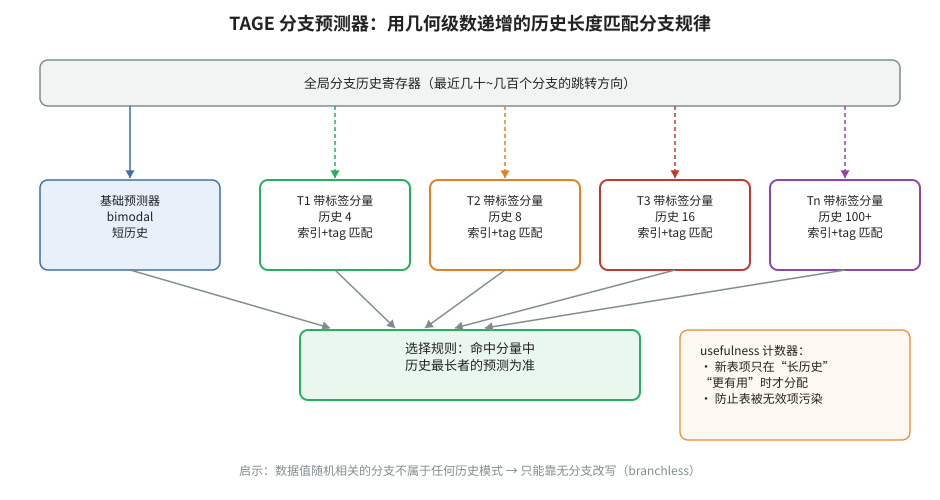


- **🎓 初学者导读**：TAGE 就像一群经验不同的老司机同时出主意——有的只记最近 2 个路口，有的记 16 个、64 个，谁的"资历"刚好配得上这个路口的规律就听谁的。它是当今几乎所有高性能分支预测器的祖师爷，读懂它就明白为什么你的代码里"历史越长才看得出规律"的分支也能被猜中。表格和公式看着吓人，其实核心思想一句话：用长度成倍增长的多张历史表，谁匹配得又准又长就用谁。

- **一句话概括**：用一组历史长度呈几何级数增长的 tagged 分量表，逼近"对每条分支自动选择最合适历史长度"的预测器，长期占据分支预测锦标赛（CBP）冠军位置，是现代高性能 CPU 预测器设计的事实标杆。

- **背景与问题**：
  - 不同分支需要的历史长度天差地别：循环计数分支几位就够，某些数据相关分支需要上百位历史。单一历史长度必然顾此失彼。
  - 此前方案（如 Alloyed history、PHT 级联）要么固定历史长度，要么用少量离散长度做选择，粒度和容量利用率都差。
  - Seznec 的洞察：**把"历史长度"本身做成资源分层**——短历史分量命中大多数分支，长历史分量只为少数难分支服务，
    并用 tag 匹配代替无标签的哈希冲突，大幅降低混叠。

- **核心方法/内容详细展开**：
  1. **总体结构**。TAGE 由一个基础分量（base predictor）+ M 个 tagged 分量组成：
     - 基础分量：一个无 tag 的双模态（bimodal）饱和计数器表，用 PC 索引，提供"兜底预测"。
     - 第 i 个 tagged 分量：用历史长度 `L(i)` 索引的表，历史长度构成几何级数：`L(i) = ⌊α^(i-1) * L1⌋`，
       其中 α 约 1.5~2，L1 为最短历史（几位），最长分量可达数百位。典型配置如 5~8 个分量、历史从几到几百。
  2. **索引与 tag 计算**。每个分量用 `PC` 与折叠后的全局历史做 XOR 生成索引；tag 也用 PC 与（另一折叠版本的）历史
     生成，且**历史越长的分量 tag 越短**（partial tags）——因为长历史分量命中稀少，少量 tag 位已足够区分。
     索引/tag 的折叠（folding）用 XOR 树把长历史压到固定位宽。
  3. **预测与分量选择规则**：
     - 所有分量并行查找；命中的分量中，**历史最长者**称为 provider，给出最终预测；
       次长命中者（或基础分量）称为 altpred（备选预测）。
     - 只有当 provider 的计数器很弱（如 2-bit 计数器处于弱状态）且 altpred 与之相反时，才用一个全局的
       "use-altpred" 计数器来决定是否听备选——这是 TAGE 的一个重要细节：**默认信 provider，弱置信时才考虑 altpred**。
  4. **usefulness（u）计数器**——TAGE 的灵魂之一：
     - 每个 tagged 表项带一个 u 计数器。当 provider 预测正确而 altpred 会预测错误时，u++（说明这个长历史表项"有用"）；
       反之 u--。
     - u 的作用：防止短历史就能搞定的分支长期霸占长历史分量的表项，把稀缺的长历史资源留给真正需要的分支。
  5. **更新规则**（分支退休时）：
     - 只更新 provider 分量的计数器和 u；若 provider 错而 altpred 对，则尝试在**比 provider 历史更长的分量**中
       分配一个新表项；分配优先选 u == 0 的项；分配失败（无空位）时按概率降级尝试更短的分量。
     - 周期性"衰老"：定期把全表的 u 计数器按位清零（比如交替清高位/低位），回收被历史遗留占据的表项——
       这是 TAGE 长期运行不退化的关键机制。
  6. **后续演化**。论文之后的 ITTAGE（间接分支版）、TAGE-SC-L（加统计校正器 statistical corrector 和循环预测器）
     连续多届 CBP 夺冠；研究界普遍认为现代 Intel/AMD/ARM 服务器核的主预测器在思想上与 TAGE 家族高度接近。

- **关键结论与数据**：
  - 几何级数历史长度（`L(i) = α^(i-1)·L1`）可以用对数级的表数量覆盖从几位到几百位的历史需求。
  - TAGE 及其衍生（TAGE-SC-L）在 CBP-2/CBP-3 等分支预测锦标赛中取得最佳精度（冠军级，定性结论）。
  - 在固定存储预算（如 32/64 Kbit 锦标赛预算）下，TAGE 显著优于 gshare 类与当时的 O-GEHL 等方案（定性结论）。

- **实战应用**：
  - 对性能工程师而言，TAGE 的直接意义在于"理解硬件喜欢什么"：
    - 分支行为依赖**很长的历史**时（深度嵌套状态机、复杂协议解析），预测器有几百位历史的容量，别轻易放弃；
    - 但如果分支是**数据驱动的随机走向**（如解析均匀随机输入），任何预测器都救不了，应当改写为无分支代码。
  - 判断某热点分支是否"数据随机"：用 `perf stat -e branches,branch-misses` 看误预测率；若接近 50%，
    硬件层面无解，走 Lemire 式改写（见本篇第 4 条笔记）。
  - 微基准警告：用固定短循环测出来的"预测器表现"不等于真实负载——TAGE 的长历史分量只在历史足够长、
    且工作集不剧烈切换时才训练充分。

- **与 perf-book 对应章节**：第 3.3 节、第 10 章（"优化分支预测"中关于可预测/不可预测分支的划分依据）。

- **常见误区/注意事项**：
  - "历史最长者获胜"不等于"历史越长越好"——过长历史训练慢、易被噪声污染，usefulness 机制正是为了约束这一点。
  - 分配新表项时只在更长历史分量中分配，这保证了一条分支"逐级升级"而不是一步到位，模拟时容易实现错。
  - u 计数器的周期清零是必需的，否则程序阶段切换（phase change）后旧表项永不释放，精度会持续劣化。
  - TAGE 论文标题页信息常被引用混乱：它作为技术报告/JILP 论文流传，常标注 2006 年；引用时写明 Seznec & Michaud 即可。

### 3. Avoiding the Cost of Branch Misprediction（Kapoor, Intel, 2009）


- **🎓 初学者导读**：这篇像导航员的实战手册——告诉你走错一个路口（分支预测失败）要绕多远，以及怎么提前把路线写清楚让司机少犯错。它是 Intel 工程师视角的优化指南，能帮你把"为什么这段 if 让程序慢了一倍"和具体的硬件代价对上号。篇幅不长，建议通读，重点记住"猜错的代价是十几二十个时钟周期"这个量级，以后写热点代码就会本能地警惕随机分支。

- **一句话概括**：Intel 官方工程白皮书，系统讲解误预测的代价来源，并给出用 `cmov`/`setcc`、查表、重排数据等手段消除难预测分支的实践清单。

- **背景与问题**：
  - 误预测的直接代价是冲刷流水线：从分支发射到退休路径上已推测执行的几十条指令作废，代价随流水线深度
    和 ROB 占用而放大（大致十几到几十拍的量级，取决于微架构和误预测发现点）。
  - 编译器默认的 `if-conversion`（把分支转成 cmov）很保守：只在两侧都很短、且无内存副作用/无潜在 fault 时才做。
    程序员手动改写常常能拿到编译器拿不到的收益。

- **核心方法/内容详细展开**：
  1. **代价模型**。一次误预测的代价 ≈ 流水线前端重启 + 错误路径 μop 排空。对高频、随机走向的小分支，
     每次误预测省掉的分支本身只有一拍，损失却是几十拍——这就是无分支改写的经济学基础。
  2. **改写手段清单**（白皮书核心内容）：
     - 用 `cmovcc`/`setcc` 替换小 if-else（如 `min/max/clamp`）；
     - 用位运算替代符号判断：`(x >> 31)`、`~(mask)` 选择；
     - 用查表替代 switch/长 if 链（小表，常驻 L1）；
     - 用"无条件计算 + 掩码选择"替代条件累加：`sum += (x > t) ? x : 0;` → `sum += x & -(x > t);`；
     - 消除"哨兵检查"型分支：把特殊情况预处理后统一走主路径；
     - 循环层面：展开减少循环控制分支占比；拆分循环使每个循环体分支行为单一化（便于训练预测器）。
  3. **何时不改写**。分支若高度可预测（如 >95% 偏向一侧），误预测代价摊薄后远低于无分支版本多出的 ALU 工作量，
     应保持原样。白皮书强调"先测量、再改写"——用 PMU 找到 `BR_MISP_RETIRED` 占比高的分支再动手。
  4. **与 PGO 的关系**。Profile-guided optimization 能让编译器知道分支概率，从而更激进地做 if-conversion
     和代码布局；白皮书建议把 PGO 与手工改写结合。

- **关键结论与数据**：
  - 定性结论：对"难以预测 + 两侧路径都很短"的分支，无分支改写可获得数倍于分支版的吞吐（具体倍数随微架构而变）；
    对可预测分支，改写可能反而变慢。
  - 误预测代价随流水线深度增长：从 Core 到后续更深流水线的微架构，单次误预测成本维持在十几到二十余拍量级（量级描述，勿当精确值）。

- **实战应用**：
  - 定位误预测热点：
    ```bash
    perf stat -e branches,branch-misses ./app
    perf record -e branch-misses ./app && perf report --sort=symbol
    ```
  - 快速验证改写收益时，给两个版本包在同一二进制里，用环境变量切换，避免编译差异干扰测量。
  - 检查编译器是否真的生成了 `cmov`：`objdump -d app | grep -i cmov`；没有时考虑手写内联汇编或使用
    `__builtin_expect_with_probability`（GCC/Clang）辅助。

- **与 perf-book 对应章节**：第 10 章（优化分支预测：无分支化技术清单与之高度重合）、第 6 章（PMU 事件）。

- **常见误区/注意事项**：
  - `cmov` 两侧都会被执行，若一侧有昂贵的加载/除法或可能触发 fault 的访存，改写反而更慢甚至更危险。
  - `cmov` 引入数据依赖链：两个输入都必须就绪才能产出，长依赖链场景下无分支版可能限制 ILP。
  - 不要全局"消灭一切分支"：可预测分支是最便宜的分支。优化目标是**误预测率 × 分支频率**高的那些。
  - 现代编译器在 `-O2/-O3` 下已会自动做部分 if-conversion，手工改写前先看反汇编，避免做无用功。

### 4. Making Your Code Faster by Taming Branches（Lemire, InfoQ 2020）


- **🎓 初学者导读**：这篇就像教练手把手教你把"临场发挥"改成"照谱演奏"——能用查表、位运算、无分支写法（branchless）搞定的，就别让 CPU 去猜。它能直接帮你解决"数据一乱序程序就慢"的实际问题，比如排序后的数组里 if 快得飞起、随机数据里慢如蜗牛。全文没有难数学，示例代码拿来就能跑，是初学者建立"分支直觉"的最佳入门读物。

- **一句话概括**：Daniel Lemire 面向开发者的科普长文，用可复现的基准展示"分支有多贵、无分支改写有多赚"，是应用层分支优化的最佳入门读物。

- **背景与问题**：
  - 多数应用开发者知道"分支慢"，但不知道慢多少、什么条件下慢。Lemire 用最小基准给出量级：
    当分支方向由**均匀随机数据**驱动时，分支版可能比无分支版慢好几倍；当数据使分支高度可预测时，两者几乎无差别。
  - 文章同时纠偏："无分支"不是银弹，盲目改写会让代码更难读且可能更慢。

- **核心方法/内容详细展开**：
  1. **实验范式**。构造一个数组，填充"可控预测难度"的数据（如 0~100 的随机数，统计大于阈值 50 的元素个数），
     分别用分支版和无分支版统计：
     ```c
     // 分支版：数据随机时误预测率接近 50%
     for (size_t i = 0; i < N; i++)
         if (data[i] >= threshold) count++;

     // 无分支版：布尔值即 0/1，直接累加
     for (size_t i = 0; i < N; i++)
         count += (data[i] >= threshold);
     ```
     无分支版编译成 `cmp` + `adc`/`setcc` 序列，无控制依赖，流水线全程满负荷。
  2. **关键曲线**。把"大于阈值的比例"从 0% 扫到 100%：分支版的耗时在中间（约 50%，最难预测）达到峰值，
     两端趋近无分支版——这条"钟形曲线"是理解分支代价最直观的一课。
  3. **典型改写模式**（文中与作者博客配套示例）：
     - 条件赋值：`x = cond ? a : b;` → `x = b + (a - b) * cond;`（布尔当整数用）或掩码 `x = b ^ ((a ^ b) & -cond);`
     - 条件计数：上文的 `count += (x >= t);`
     - 绝对值/符号：`abs` 用 `(x + m) ^ m`，其中 `m = x >> 31`；
     - 二分查找的比较分支改成算术下标（与下一篇 Khuong & Morin 的无分支二分同源）；
     - 用查表消除字符分类分支（如 `isdigit` 的 256 项表）。
  4. **方法论提醒**。Lemire 强调基准必须防止编译器把循环向量化/常量折叠掉（用 volatile、动态生成数据、
     校验结果黑洞 blackhole），否则测出来的"加速"是编译器差异而非分支差异。

- **关键结论与数据**：
  - 对均匀随机的条件，分支版统计循环可比无分支版慢数倍（作者基准中的量级结论；精确倍数随 CPU 而变）。
  - 当分支 99% 偏向一侧时，分支版与无分支版性能基本打平——再次印证"先测量误预测率再决定改写"。

- **实战应用**：
  - 把"数据随机性"作为是否需要无分支化的第一判断标准：解析协议头（可预测）不用改；
    过滤随机输入（不可预测）优先改。
  - 快速试验模板：用 `perf stat -e cycles,branch-misses` 分别测两版，观察 `branch-misses / branches` 与 cycles 的对应关系。
  - 在 Rust/Go 等语言里同样适用：布尔转整数累加、`select` 式写法，配合反汇编确认没有遗留分支。

- **与 perf-book 对应章节**：第 10 章（优化分支预测）的应用层部分；也可配合第 9 章（优化计算）一起读。

- **常见误区/注意事项**：
  - 无分支代码的额外 ALU 指令在宽发射 CPU 上几乎是"免费"的，但在低功耗小核上未必——移动/嵌入式场景要重新测量。
  - 把多个独立分支合并成一个表达式会延长依赖链，可能损失 ILP；必要时分多个累加器再合并。
  - "钟形曲线"的峰值位置取决于数据分布，基准数据若过于温和（如 90/10 分布）会严重低估分支代价。

---


## 八、内存层次、缓存与 TLB

> 寄存器→L1→L2→LLC→内存的延迟相差两个数量级以上，一次 LLC miss 去内存的代价足够执行几百条指令。
> 本章 7 篇文献覆盖内存墙问题的四个侧面：数据布局与搜索（Eytzinger）、TLB 与大页、共享缓存的 QoS 与管理
> （CAT/SWAP/BALANCER/缓存锁定综述），以及一份用 PMU 刻画真实内存层次行为的实证研究（Skylake-SP 上的 SPEC 表征）。
> 与 perf-book 第 8 章（优化内存访问）和第 3 章（内存层次）直接对应。

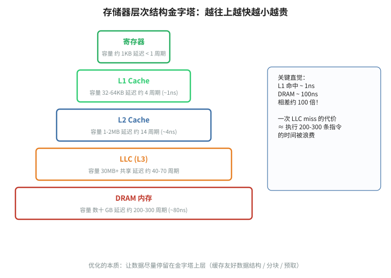

### 5. Array Layouts for Comparison-Based Searching（Khuong & Morin, 2015）

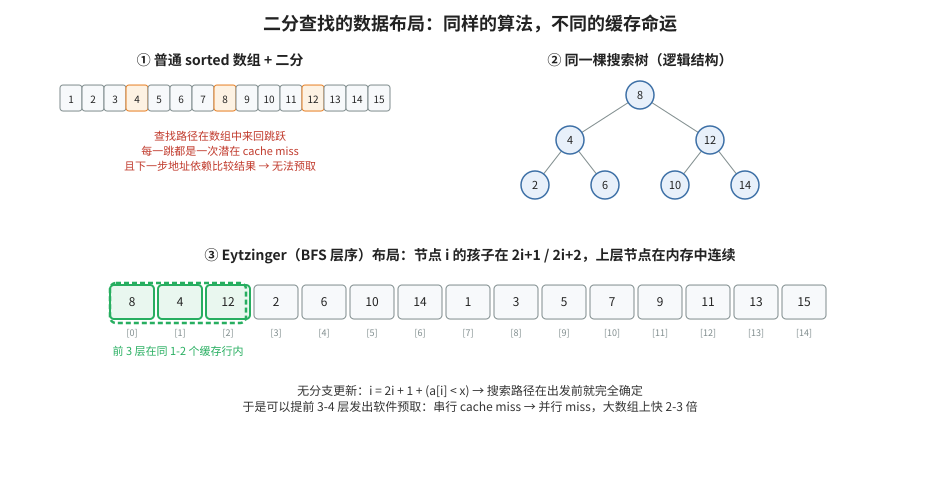


- **🎓 初学者导读**：这篇讲 Eytzinger 布局，就像把常一起用到的工具挂在同一面墙上——访问一个节点时，它的孩子大概率已经在同一趟搬运过来的缓存行（cache line）里。它帮你解决"二分查找在大数组上比预期慢"的问题：数据一超过缓存大小，排列方式比算法本身更影响速度。数学证明部分可跳过，记住结论：把数组按 BFS 顺序存，大数组查找能快好几倍，而且实现就几行代码。

- **一句话概括**：系统比较有序数组的四种内存布局（sorted/B-tree/van Emde Boas/Eytzinger）在二分查找下的缓存行为，
  并证明"Eytzinger 布局 + 无分支二分 + 显式预取"在大数组上明显优于经典二分，是数据布局优化的必读论文。

- **背景与问题**：
  - 经典二分查找对缓存极不友好：每一步跳到 `a[mid]`，访问位置近似随机，大数组下每步几乎都是一次缓存 miss，
    而中间几层的热点节点又因为分散存储而浪费缓存行。
  - 分块布局（B-tree、van Emde Boas）能改善局部性，但索引计算复杂、且不同规模下表现不一。作者要回答：
    在真实硬件上，到底哪种布局 + 哪种查找写法最快？

- **核心方法/内容详细展开**：
  1. **四种布局**：
     - **Sorted**：原始有序数组，经典二分，地址计算简单但局部性差。
     - **B-tree 布局**：按 B 阶分块存储（一个块内元素连续，可填满整条缓存行），块内线性/二分，块间跳转——
       与磁盘 B-tree 同思想，但块大小对齐缓存行。
     - **van Emde Boas（vEB）布局**：递归地把树按高度切成上下两半存储，理论上有最优的缓存无关（cache-oblivious）
       性质，但地址计算涉及复杂的位运算。
     - **Eytzinger 布局**（论文主推）：把有序数组按"完全二叉搜索树的广度优先（BFS）顺序"存进数组：
       根在 1 号位，节点 i 的左孩子在 2i、右孩子在 2i+1（1-based），等价于堆的下标规则。
       性质：树的上面若干层（约等于一条缓存行能放的层数）挤在数组开头，天然常驻缓存；访问路径与二分完全一致，
       但下标计算只有移位和加法。
  2. **无分支二分（branch-free search）**。经典二分的 `if (key < a[mid]) hi = mid; else lo = mid;` 是数据驱动的
     难预测分支。Eytzinger 版本用算术更新下标：
     ```c
     // a 为 Eytzinger 布局，n 为元素数（1-based 下标）
     size_t i = 1;
     while (i <= n)
         i = 2 * i + (a[i] < key);   // 布尔即 0/1：走左或走右
     // 退出后 i 指向叶子外位置，需按论文的回退公式恢复答案下标
     ```
     每次迭代只有 `cmp + setcc + lea/shl` 几条指令，没有任何控制流分支，循环全程流水线不空转。
  3. **显式软件预取**。Eytzinger 布局有个独特优势：**未来 k 步要访问的节点下标可以预先算出来**
     （沿路径再往下 k 层的 2^k 个候选节点，下标落在 `i * 2^k .. i * 2^k + 2^k - 1`）。循环中预取：
     ```c
     while (i <= n) {
         __builtin_prefetch(&a[i * 16]);      // 预取 4 层后的候选块
         __builtin_prefetch(&a[i * 16 + 8]);
         i = 2 * i + (a[i] < key);
     }
     ```
     这样把"串行的缓存 miss 链"变成"提前发射的并行访存"，对大数组效果显著。
  4. **实验方法**。在真实 x86 上用 C 实现四种布局的查找，数组规模从 L1 可容到远超 LLC，用硬件计数器记录
     缓存 miss 与耗时，并与 STL `lower_bound` 等基线对比。

- **关键结论与数据**：
  - 小数组（装入缓存）：各布局差异不大，sorted 甚至因地址计算简单而略快。
  - 大数组（远超 LLC）：Eytzinger + 无分支 + 预取的组合明显领先；相对朴素二分在大数组下可获得显著的
    （论文报告中可达约两倍量级的）加速，具体倍数随规模与硬件而变。
  - vEB 理论优美但地址计算开销大，实测不占优；B-tree 布局居中。

- **实战应用**：
  - 构建 Eytzinger 布局（从有序数组转换）：
    ```c
    // in: 有序数组 src[0..n-1]；out: Eytzinger 布局 dst[1..n]
    void eytzinger(const int *src, int *dst, size_t n, size_t i, size_t *pos) {
        if (i <= n) {
            eytzinger(src, dst, n, 2 * i, pos);          // 左子树
            dst[i] = src[(*pos)++];                      // 中序填充
            eytzinger(src, dst, n, 2 * i + 1, pos);      // 右子树
        }
    }
    ```
  - 适用场景：静态或准静态的有序数据集（字典、路由表、只读索引）。数据频繁更新时维护成本高，不适合。
  - 预取距离 k 要按数组规模调：太小盖不住 miss 延迟，太大浪费带宽和预取槽位。

- **与 perf-book 对应章节**：第 8 章（优化内存访问：数据布局、缓存友好结构、软件预取）、第 10 章（无分支化）。

- **常见误区/注意事项**：
  - Eytzinger 布局对 n 恰好为 `2^k - 1` 最完美，否则底层有空洞，需要在回退阶段处理（论文给出修正代码）。
  - 无分支循环体里不要塞多余指令：每多一条都加在关键依赖链上（`i` 的更新是串行链），收益会被吃掉。
  - 预取在数组已能装进 LLC 时是纯开销，记得按规模开关。
  - 该论文的结论针对**比较型搜索**；哈希表等 O(1) 结构是另一条路线，不要混用结论。

### 6. Improving TLB Performance by Increasing Hugepage Ratio（Luo et al., CCGrid 2015）


- **🎓 初学者导读**：TLB（翻译后备缓冲，CPU 里记"虚拟地址到物理地址"的小电话簿）就像只记几百个号码的通讯录，大页（hugepage）相当于让一个号码直接覆盖整个小区，通讯录立刻够用。这篇帮你理解为什么大内存程序（数据库、图计算）换大页后能凭空快一截。实验细节可以略读，记住核心直觉：程序摸的内存越多、越散，TLB 缺页惩罚越大，大页是最便宜的对策。

- **一句话概括**：通过提高工作负载中 huge page（大页）的使用比例来压缩 TLB miss，从系统层面量化大页对性能的影响。

- **背景与问题**：
  - 虚拟内存以 4KB 页为单位做地址翻译。TLB 容量有限：典型的 Intel 服务器核 L1 DTLB 只有几十项（如 64 项，
    覆盖 64×4KB = 256KB），L2 STLB 一千余项（如 1536 项，覆盖约 6MB）。工作集一旦超出 TLB 覆盖范围，
    每次访存都可能触发 page walk——x86-64 为 4 级页表，即便页表项被缓存，一次 walk 也要花十几到几十拍。
  - 2MB 大页把单个 TLB 项的覆盖范围扩大 512 倍，1GB 大页扩大约 26 万倍，是缓解 TLB 压力最直接的杠杆。

- **核心方法/内容详细展开**：
  1. **核心思想**。在不改变应用的前提下，通过内存管理策略尽可能把应用的页提升为 huge page
     （提高 hugepage ratio），从而降低 dTLB miss 率和 page walk 开销。
  2. **机制基础**（Linux 视角）：
     - **hugetlbfs**：预留式大页，通过 `/proc/sys/vm/nr_hugepages` 分配，保证拿到但需应用显式使用
       （`mmap(MAP_HUGETLB)` 或挂载 hugetlbfs）。
     - **Transparent Huge Pages（THP）**：内核自动把连续的 4KB 匿名页合并提升为 2MB 大页，应用无感知；
       模式有 `always / madvise / never`，缺页处理与 khugepaged 后台线程负责合并。
  3. **方法论**。用 PMU 事件（如 `DTLB_LOAD_MISSES.*`、`PAGE_WALK*` 类事件）量化不同 hugepage 比例下的
     TLB miss 率与运行时间变化，展示大页覆盖率与性能收益的关系。
  4. **收益与代价的权衡**。大页减少 TLB 项压力和 page walk 数量；但预留式大页会造成内存内部碎片与浪费，
     THP 的合并/拆分会带来偶发的延迟毛刺（内存规整、拆页同步），这也是内核不断打磨 THP 策略的原因。

- **关键结论与数据**：
  - 定性结论：对大面积、连续访问的负载（科学计算、内存数据库、JVM 堆），提高大页比例能显著降低 dTLB miss，
    带来可见的端到端加速；对细碎、随机、小工作集负载收益有限。
  - 2MB 大页使单个 TLB 项覆盖范围扩大 512 倍（4KB→2MB），这是全部收益的物理基础。

- **实战应用**：
  - 查看与开启 THP：
    ```bash
    cat /sys/kernel/mm/transparent_hugepage/enabled
    echo madvise | sudo tee /sys/kernel/mm/transparent_hugepage/enabled
    echo always  | sudo tee /sys/kernel/mm/transparent_hugepage/enabled
    ```
  - 应用侧（madvise 模式下）：
    ```c
    void *p = mmap(NULL, SZ, PROT_READ|PROT_WRITE,
                   MAP_PRIVATE|MAP_ANONYMOUS, -1, 0);
    madvise(p, SZ, MADV_HUGEPAGE);
    ```
  - 预留式大页：`echo 1024 | sudo tee /proc/sys/vm/nr_hugepages`，然后 `mmap(..., MAP_HUGETLB, ...)`。
  - 验证效果：`perf stat -e dTLB-load-misses,dTLB-store-misses,page-faults ./app`，
    大页生效后 dTLB miss 应显著下降；`grep -i huge /proc/meminfo` 确认大页分配量。

- **与 perf-book 对应章节**：第 8 章（TLB 优化/大页部分）、第 3 章（内存层次中的 TLB）。

- **常见误区/注意事项**：
  - `always` 模式对短生命周期、碎片化分配的服务端负载可能引起内存膨胀与延迟尖峰，生产上常用 `madvise` 精准投放。
  - 大页不是免费午餐：2MB 页内只要一个字节被用到，整页就占住内存；内存紧张时反而加剧换页。
  - NUMA 机器上大页仍按节点分配，跨节点大页访问依旧慢——大页不解决 NUMA 问题。
  - 容器/虚拟机环境里大页的可用性与宿主机配置相关，benchmark 前先确认环境一致。

### 7. Cache QoS: From Concept to Reality in the Intel Xeon Processor E5-2600 v3 Product Family（Herdrich et al., HPCA 2016）

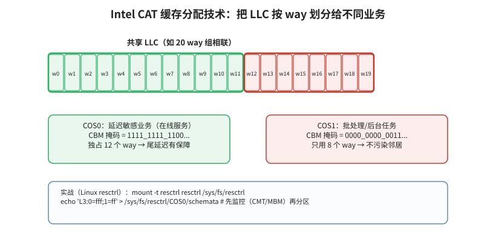


- **🎓 初学者导读**：这篇像小区物业给电梯装"贵宾优先"系统——最后一级缓存（LLC）是大家共享的，Intel 给不同程序发"通行证"，保证重要住户不被吵闹邻居挤占。它能帮你理解云服务器上" noisy neighbor（吵闹邻居）"问题是怎么用硬件治好的，也解释了 `pqos`、`resctrl` 这类工具背后的原理。作为概念科普读即可，记住关键词 CAT（缓存分配技术）和 MBM（内存带宽监控），以后排查多租户性能抖动就有方向了。

- **一句话概括**：Intel 官方介绍 Xeon E5 v3（Haswell-EP）上首次量产落地的缓存/内存 QoS 技术——CMT、MBM 与 CAT——的硬件机制、软件接口与实测效果。

- **背景与问题**：
  - 多核共享 LLC 与内存带宽时，"吵闹邻居"（noisy neighbor）会把延迟敏感型应用的性能拖垮；
    传统缓存替换策略（LRU 类）对"谁该用多少缓存"一无所知。
  - 云计算/多租户场景需要**可度量、可强制**的资源隔离：先能看见（监控），才能管控（分配）。

- **核心方法/内容详细展开**：
  1. **CMT（Cache Monitoring Technology）**：给线程/进程打 RMID（Resource Monitoring ID）标签，
     硬件按 RMID 统计其占用的 LLC 容量（occupancy）。软件把 RMID 绑定到逻辑核（写 `IA32_PQR_ASSOC` MSR），
     再周期性读 `IA32_QM_CTR` 得到占用字节数。
  2. **MBM（Memory Bandwidth Monitoring）**：同样按 RMID 统计本地/总内存带宽（local/total bytes）。
  3. **CAT（Cache Allocation Technology）**：把 LLC 的 way 用位图表示——CBM（Capacity Bitmask）的每个 bit 对应一路
     （Haswell-EP 的 LLC 为 20 路，故 CBM 为 20 bit）。定义若干 COS（Class of Service，E5 v3 上为 4 个），
     每个 COS 配一个 CBM；线程通过 `IA32_PQR_ASSOC` 绑定 COS，其访存只能填充 CBM 允许的那些 way。
     - 约束：Haswell-EP 要求 CBM 的 bit 必须**连续**，且至少置 2 个 bit（后续代际逐步放宽）；不同 COS 的 CBM 允许重叠，
       即"隔离"与"共享"可以混合配置。
     - 语义：CAT 限制的是**填充**权限，不是逐出优先级；共享 way 内仍然按普通替换策略竞争。
  4. **软件栈**：论文描述了 OS/VMM 的枚举（CPUID）与 MSR 编程模型；后来 Linux 演化为 `resctrl` 文件系统接口，
     Intel 也提供用户态 `pqos` 工具/库。
  5. **实测**：论文用 SPEC 混部、memcached 等负载展示：给延迟敏感任务独占若干 way 后，其尾延迟与吞吐显著改善，
     同时整系统吞吐损失可控——证明了"监测 + 分配"闭环的实用价值。

- **关键结论与数据**：
  - E5 v3 平台细节：LLC 20 路、4 个 COS、CBM 必须连续且最少 2 bit（引用时注意这是该代际的约束）。
  - 定性结论：CAT 能把吵闹邻居造成的性能劣化显著收敛，CMT/MBM 使"按占用观测、按类分配"的资源管理成为可能。

- **实战应用**（Linux resctrl）：
  ```bash
  mount -t resctrl resctrl /sys/fs/resctrl
  cd /sys/fs/resctrl
  mkdir latency_sensitive                 # 建一个控制组
  # 给该组分配 L3 的一部分 way（位图按实际路数，如 20 路机器的低 10 路）
  echo "L3:0=003ff" > latency_sensitive/schemata
  echo 12345 > latency_sensitive/tasks    # 把 PID 放入该组
  # 监控占用与带宽
  cat latency_sensitive/mon_data/mon_L3_00/llc_occupancy
  cat latency_sensitive/mon_data/mon_L3_00/mbm_total_bytes
  ```
  - 典型套路：用 CMT 找出"占缓存多却 miss 率低"（白占资源）的任务，限制其 CBM；
    给延迟敏感任务保留独占 way，观察 P99 延迟变化。

- **与 perf-book 对应章节**：第 8 章（共享缓存竞争）、第 6 章（PMU/监控能力）的延伸。

- **常见误区/注意事项**：
  - CAT 是"弱隔离"：CBM 重叠区域仍可互相逐出，且 CAT 不约束预取器与内存带宽——带宽型吵闹邻居要靠 MBA
    （后续代际引入的 Memory Bandwidth Allocation）。
  - CBM 连续性约束在 Haswell-EP 上容易踩坑：写非连续位图（如 `0x0F0F0`）会被拒绝或截断。
  - COS 数量有限（v3 只有 4 个），容器密度高时必须做组聚合，不能"一容器一 COS"。
  - LLC 是共享资源，缩别人的 way 等于在全体总量上动刀：误配置可能拖慢全机。改 CBM 前后都要看 CMT 数据。

### 8. SWAP: Effective Fine-Grain Management of Shared Last-Level Caches with Minimum Hardware Support（Wang et al., HPCA 2017）

- **🎓 初学者导读**：SWAP 像一位精明的仓库管理员：与其一刀切地把货架分给各家，不如盯住那些"用完就扔"的货（死块，dead block），提前腾出位置给真正需要的人。它延续第 7 篇的共享缓存话题，但走"少改硬件、巧做文章"的路线，适合作为第 7 篇的对照阅读。入门者只需抓住一个洞察：很多缓存行装进来后根本不会再被用第二次，识别并替换它们是最划算的优化。

- **一句话概括**：在"粗粒度划分（按 way 隔离）"与"纯替换策略（无隔离）"之间走出一条细粒度路线：
  用极少量硬件动态地在应用间"交换（swap）"缓存资源，兼顾隔离性与利用率。

- **背景与问题**：
  - 共享 LLC 管理的两个极端：
    - **分区类方案**（如 CAT）：按 way 静态/半静态划分，隔离性好但粒度粗、利用率低——
      某应用分到的 way 用不满时，别的应用也不能用；
    - **替换策略类方案**（各种插入/晋升策略）：全局共享、利用率高，但无法防止一个流式应用把别人的数据全冲掉。
  - SWAP 要解决的问题：能否用接近替换策略的硬件成本，获得接近分区的隔离效果？

- **核心方法/内容详细展开**：
  1. **核心思想**。应用对缓存的"效用"随时间变化，理想分配应随效用动态调整。SWAP 不维护物理上固定的分区，
     而是在**填充/替换路径上做细粒度决策**：周期性采样各应用对缓存块的访问情况，估算资源给各应用带来的收益，
     然后把"低效用的份额"从富余者手中**交换**给更需要者——因此得名 SWAP。
  2. **机制要点**（概念层面）：
     - 少量计数器/采样结构跟踪每个应用近期的缓存效用（如命中贡献）；
     - 分配策略以"单位资源换取的命中数"为目标函数做交换决策，而不是固定配额；
     - 决策落在插入/替换路径上实现（选择把新块插入到属于谁的份额里），无需改动 SRAM 阵列结构，
       因此号称 minimum hardware support。
  3. **与 CAT 的关系**。可以把 SWAP 理解为"自动化的、细粒度的、效用驱动的 CAT"：CAT 需要软件周期性计算 CBM，
     SWAP 把闭环做进硬件，反应更快、粒度更细。
  4. **评估**。论文用多核 SPEC 混部，在系统吞吐（weighted speedup 类指标）与公平性上比较 LRU、静态分区等基线，
     SWAP 在二者间取得更好的平衡（定性结论）。

- **关键结论与数据**：
  - 定性结论：相比朴素共享 LRU，SWAP 能抑制缓存饥渴型应用对邻居的挤压；相比静态分区，又能回收空闲配额、
    提高整体吞吐；硬件开销控制在少量计数器与决策逻辑层面。
  - 该工作属于体系结构研究（以模拟器评估为主），不代表任何已量产机制。

- **实战应用**：
  - 对性能工程师的直接价值是"心智模型"：在只有 CAT 可用的真实机器上，可以用软件模拟 SWAP 的思想——
    周期读取 CMT/MBM 数据，按各工作负载的 miss 曲线效用动态调整 CBM（即"软件版闭环 QoS"）。
  - 设计自研调度器/资源管理器时，把"缓存效用"（单位 way 换来的命中/加速）作为分配依据，而非简单平均分 way。

- **与 perf-book 对应章节**：第 8 章（共享缓存管理与 QoS 思想）。

- **常见误区/注意事项**：
  - 采样周期太短会震荡（频繁交换引入抖动），太长跟不上程序 phase 变化；论文的周期整定值得细读。
  - 效用估计对"预取友好型"负载容易误判（它们的块被提前填充），实际系统中要结合预取器行为理解。
  - 该类研究方案与量产 CAT/MBA 是互补关系：了解原理有助于用好现有硬件，而不是等待新硬件。

### 9. BALANCER（Navarro-Torres et al., 2023）


- **🎓 初学者导读**：BALANCER 像公交车调度员——不只看哪辆车空，还看整条线路的乘客分布，把负载均匀铺开而不造成新的拥堵。它研究的是内存层面的负载均衡：多个程序抢内存带宽时，怎么安排访问顺序让大家都少排队。这篇较新也较偏研究，初学者可以先读摘要和结论，记住"带宽也是稀缺资源，调度访问顺序能整体提速"，等有实际需要再深挖细节。

- **一句话概括**：多核共享内存层次场景下的资源均衡机制研究，目标是在多个共跑应用之间更合理地分配共享资源
  （缓存/带宽），同时改善系统吞吐与公平性。

- **背景与问题**：
  - 同一线作者群体长期研究"共享内存层次的管理"：先是用 PMU 刻画真实负载在真实机器上的行为
    （见下一篇 PLOS ONE 2019），再据此设计管理机制。
  - 共跑应用对共享资源的"敏感度"差异巨大：有的应用多分一点缓存/带宽性能就大涨，有的几乎无感。
    静态均分或先到先得都会同时伤害吞吐与公平性，因此需要按效用**均衡（balance）**分配——这正是 BALANCER 的动机。

- **核心方法/内容详细展开**（面向思想脉络的展开，具体机制细节建议对照原文）：
  1. **问题建模**。把多核共跑看作资源分配问题：给定 LLC 容量与内存带宽两类可分配资源，
     每个应用有各自的"资源-性能"响应曲线（miss 曲线、带宽敏感度），目标是让整体的 slowdown 分布更均衡，
     避免个别应用被饿死（fairness），同时不牺牲过多总吞吐。
  2. **方法论特征**（该团队的一贯做法，也是本文可学的部分）：
     - 在**真实硬件**（Intel Xeon 服务器平台）上用 PMU 采集各应用的缓存占用、miss 率、带宽；
     - 构造代表性的 SPEC CPU 多程序混合负载（mix），覆盖"缓存敏感/带宽敏感/均不敏感"的组合；
     - 用 slowdown、weighted speedup、fairness 类指标评估策略，而不是只看单一吞吐。
  3. **设计取舍**。这类均衡机制的共同难点：响应曲线在线估计的开销、调整周期与震荡控制、
     以及"均衡"与"最优吞吐"目标的冲突。阅读时重点关注作者如何做在线估计与稳定性处理。

- **关键结论与数据**：
  - 定性结论：按敏感度均衡分配共享资源，能在多程序混合负载上同时改善公平性与系统级性能指标，
    优于静态均分与无管理基线。
  - 本文为较新的机制研究，具体提升数字与平台强相关，此处不引用具体数值，建议读原文表格。

- **实战应用**：
  - 把 BALANCER 的思想落到今天就能用的工具上：
    - 用 `perf c2c`、`perf stat -e LLC-load-misses`、CMT/MBM（resctrl）先量化每个共跑应用的敏感度；
    - 用 CAT/MBA 做粗粒度分配，按"谁的 slowdown 最大就补给谁"的原则周期性再平衡；
    - 用 slowdown（共跑耗时/独跑耗时）而不是裸耗时做验收指标。
  - 写性能报告时，混部实验务必报告 mix 的构成（哪些负载是缓存敏感型、哪些是带宽敏感型），
    否则结论不可复现——这是该团队论文反复强调的方法论。

- **与 perf-book 对应章节**：第 8 章（共享资源竞争）、第 13 章（多线程应用的优化与测量）。

- **常见误区/注意事项**：
  - "公平"与"吞吐"本质冲突：任何宣称两者同时大幅最优的方案都要看其负载 mix 是否取巧。
  - 在线估计资源-性能曲线本身消耗 PMU/监控资源，生产环境要评估监控开销。
  - 机制类论文多在特定平台与 mix 上评估，迁移到自己的平台前务必重做小规模验证。

### 10. Memory Hierarchy Characterization of SPEC CPU2006 and CPU2017 on the Intel Xeon Skylake-SP（Navarro-Torres et al., PLOS ONE 2019）

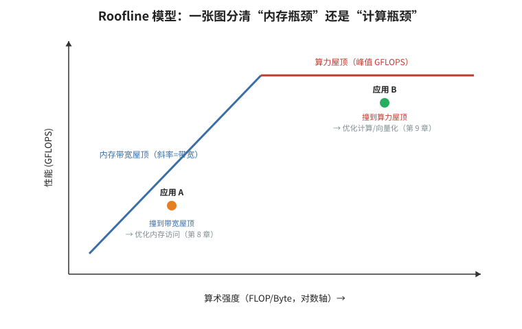


- **🎓 初学者导读**：这篇像给几十位运动员做全面体检——用标准测试程序（SPEC）量出各级缓存、内存的"命中率、延迟、带宽"到底长什么样。它帮你建立对真实工作负载的量化直觉：多数程序的瓶颈并不在你以为的地方，最后一级缓存命中率往往高得惊人。当作参考资料用，不必精读每张图，重点看它的测量方法（用了哪些性能计数器），以后自己做性能剖析可以照抄这套流程。

- **一句话概括**：在真实 Skylake-SP 服务器上用 PMU 对两代 SPEC CPU 套件做内存层次的系统刻画（工作集大小、
  各级缓存 MPKI、TLB、带宽），得出"SPEC 各基准的内存行为差异巨大、且整体上不能代表数据中心负载"的重要结论。

- **背景与问题**：
  - 大量体系结构研究用 SPEC CPU 做评估，但"SPEC 各基准在真实机器的内存层次上到底怎么表现"缺乏公开、
    可复现的系统数据；模拟器里的缓存行为与真实机器常有出入。
  - Skylake-SP 的缓存结构有代际变化：L2 从 256KB 扩到 1MB，LLC 变为非包含式（non-inclusive）且每核份额缩小
    （约 1.375MB/核），这直接改变了很多负载的 miss 分布，需要重新刻画。

- **核心方法/内容详细展开**：
  1. **平台与方法**。在 Skylake-SP（Xeon Scalable）上直接运行 SPEC CPU2006 与 CPU2017 各基准，
     用硬件性能计数器采集 L1/L2/LLC 的访问与 miss、TLB miss、内存带宽等；配套用工作集分析工具估算
     各基准的驻留集大小（working set size, WSS）。论文强调**可复现性**：机器配置、编译选项、
     计数器选择全部公开（PLOS ONE 的开放数据传统）。
  2. **刻画维度**：
     - **WSS 分布**：每个基准的工作集与 L1（32KB）/L2（1MB）/LLC（每核约 1.375MB）容量的相对关系——
       决定它主要卡在哪一级；
     - **每级 MPKI**（每千条指令的 miss 数）：把 miss 按级拆分，看清瓶颈在 L1、L2 还是 LLC；
     - **TLB 行为**：哪些基准有明显 dTLB 压力（大 footprint、随机访问的基准，如 mcf 一类）；
     - **带宽消耗**：哪些基准是带宽型（流式访问），哪些是延迟型（指针追逐）。
  3. **两代套件对比**。CPU2017 相比 2006 工作集普遍更大、输入更真实，整体对内存层次的压力上升；
     但论文也指出两代中都有相当数量基准的工作集能装进 L2/LLC——即"跑 SPEC 时很多 miss 其实发生在片上"。
  4. **对研究方法论的影响**。SPEC 是"单核计算密集"导向的套件，缺少数据中心那种大规模、多租户、
     指令足迹巨大的负载（如网页搜索、KV 存储）；用 SPEC 评估出的缓存管理/QoS 结论不能直接外推到云负载。

- **关键结论与数据**：
  - Skylake-SP 层次参数（论文背景）：L1D 32KB/核、L2 1MB/核、LLC 约 1.375MB/核、非包含式。
  - 定性结论：SPEC 各基准内存行为谱系很宽——从完全 cache-resident 到严重内存受限都有；
    CPU2017 整体压力大于 2006；部分基准有显著 TLB miss 开销。
  - 结论性建议：做内存层次研究应把 SPEC 与更接近数据中心的负载（如 cloud suites）结合使用。

- **实战应用**：
  - 复刻该论文的方法做自己的负载画像：
    ```bash
    perf stat -e instructions,L1-dcache-load-misses,l2_rqsts.miss,LLC-load-misses,\
dTLB-load-misses,cycles ./app
    # 逐级计算 MPKI = misses / (instructions/1000)，定位瓶颈级
    ```
  - 先测 WSS 再谈优化：用 `perf mem` 或周期性读 `rss` 采样，判断工作集相对各级缓存的位置；
    WSS 略超 L2 的负载，收益最大的往往是数据布局/分块，而不是换算法。
  - 选基准做实验时刻意覆盖谱系两端：cache-resident 型 + 内存受限型，避免结论片面。

- **与 perf-book 对应章节**：第 8 章（内存访问分析方法论）、第 4 章（性能指标：MPKI 等）。

- **常见误区/注意事项**：
  - MPKI 跨机器可比性有限：不同微架构的计数器口径不同，比较前先核对事件定义。
  - 非包含式 LLC 下"L2 miss 数"与"LLC 访问数"不再简单相等，老文章的分析公式要相应调整。
  - SPEC 的 rate 模式（多副本共跑）与 speed 模式（单副本）内存行为完全不同，引用数据时先确认模式。

### 11. A Survey of Techniques for Cache Locking（Mittal, ACM TODAES 2016）


- **🎓 初学者导读**：缓存锁定（cache locking）就像在公共储物柜里钉死几个格子，专门放最重要的东西，保证随时拿都得到。这篇综述帮你回答"实时系统（比如汽车控制）怎么保证关键代码永远快"的问题——靠的就是锁住缓存、牺牲灵活性换确定性。综述类文章适合翻着看，建议先读引言和分类框架，把各种锁定方案当菜谱浏览，遇到实时性需求再回来细查。

- **一句话概括**：缓存锁定（cache locking）技术的全景综述——把选中的代码/数据"钉"在缓存里不被逐出，
  以换取延迟确定性与能效，覆盖指令/数据缓存、各级粒度、静态与动态策略。

- **背景与问题**：
  - 缓存提升平均性能，却损害**可预测性**：实时系统做 WCET（最坏执行时间）分析时，
    "这次访问命中还是 miss" 的不确定性让上界分析悲观到不可用。
  - 思路反转：与其让替换策略随机决定谁留下，不如由软件显式锁定关键内容，使命中行为**确定**。
    同时锁定还能省电（命中不访问下级/主存）——嵌入式与实时领域的双重动机。

- **核心方法/内容详细展开**：
  1. **锁定的粒度与层次**（综述的分类框架）：
     - 按对象：指令缓存锁定（锁关键循环/中断处理代码）vs 数据缓存锁定（锁查找表、栈、关键缓冲区）；
     - 按粒度：整块（line）锁定、按 way 锁定、按 set 锁定；ARM 经典 CP15 提供 lockdown 寄存器，
       可按 way 锁定 L1、按 way/按主核（master）锁定 L2；
     - 按层次：L1 锁定最常见，也有 L2/LLC 锁定的研究与商用支持。
  2. **静态 vs 动态锁定**：
     - 静态：离线分析（如基于 WCET 工具）选定锁定内容，运行时不再改变；简单、可分析，但不适应 phase 变化；
     - 动态：运行时按访问行为调整锁定集（如锁最近频繁 miss 的内容）；更灵活，但重新引入不确定性，
       需要权衡可分析性。
  3. **锁定内容的选取算法**：综述比较了贪心（按 miss 代价 × 频率选）、profile 驱动、以及结合 WCET 分析的
     整数规划方法；核心目标是"单位缓存容量换到的确定性/性能收益最大化"。
  4. **与 scratchpad（SPM）的关系**：scratchpad 是"完全软件管理的片上 RAM"，确定性最强但没有自动缓存的便利；
     缓存锁定是两者折中——保留缓存硬件的透明性，又提供部分确定性。论文专门讨论了二者的取舍与混合方案。
  5. **开销与风险**：锁定减少可用容量，可能抬高未锁定部分的 miss 率；锁/解锁本身有代价（需要清理/无效化
     对应 way）；锁定内容若实际访问频率低则纯粹浪费。

- **关键结论与数据**：
  - 定性结论：对硬实时/嵌入式负载，合理锁定能显著收紧 WCET 上界并降低能耗；
    但锁定集选择不当可能使平均性能与最坏情况双双变差——"锁什么"比"锁不锁"更重要。
  - 综述横跨指令/数据、各级缓存、静/动态策略数十种方案，是进入该领域的地图。

- **实战应用**：
  - 通用 x86 没有显式缓存锁定 ISA，但可近似实现：
    - 用 CAT（resctrl）给关键任务独占若干 way，并把其它任务的 CBM 排除这些 way——效果接近 way 级锁定；
    - 用 `mlock` + 大页把数据钉在内存（防换出，但不防缓存逐出）；
    - 关键小表主动预热并周期性 touch，利用 LRU 伪锁定（脆弱，仅用于软实时）。
  - ARM 嵌入式（如 Cortex-A/R 经典核）：查 TRM 中的 L1/L2 lockdown 寄存器（CP15 c9 相关），
    配合 `MCR` 指令按 way 锁定中断向量表与 ISR 代码。
  - 做实时性能实验时，把"锁定前后 WCET 上界/实测尾延迟"作为验收指标，而不是平均耗时。

- **与 perf-book 对应章节**：第 8 章（缓存管理技术全景）、第 12 章（其他调优主题）的延伸。

- **常见误区/注意事项**：
  - 锁定不是"免费提速"：它把容量从公共池抽走，对吞吐型负载常常是负优化。
  - 动态锁定方案的"自适应"在实时认证里可能不被接受——确定性场景优先静态方案。
  - 多核共享 LLC 上做单核锁定意义有限：邻居照样能逐出你的块（除非配合 CAT 类隔离）。
  - 锁与解锁顺序涉及 cache maintenance（clean/invalidate），实现错会出现陈旧数据，务必按手册序列操作。

---

## 九、宏观趋势与背景

> 为什么要学性能工程？因为摩尔定律与 Dennard 缩放红利耗尽之后，"等下一代芯片"不再是免费的午餐，
> 性能提升的主战场回到了软件、算法与专用架构。本章 6 篇文献提供这门学科的"世界观"：
> Leiserson 的矩阵乘案例展示软件优化的惊人空间，Hennessy 的图灵奖讲座与《量化研究方法》给出方法论，
> Jin 的性能 bug 研究告诉你真实世界的性能问题长什么样，Base64 论文是"数据级并行"的样板，
> 最后两条数据统计提醒我们数据洪流还在加速。

### 12. There's Plenty of Room at the Top: What Will Drive Computer Performance after Moore's Law?（Leiserson et al., Science 2020）


- **🎓 初学者导读**：这篇像一封时代讣告加寻宝图——摩尔定律（芯片两年翻倍）到头了，但"上层"还有大把空间：更聪明的算法、更精简的软件、为问题定制的架构。它能帮你回答一个根本困惑：硬件不再白送性能，那我们学优化还有什么意义？答案是意义更大了。全文几乎无公式，当作睡前读物通读，记住作者的口号：未来拼的是软件性能工程，而这正是你能练的手艺。

- **一句话概括**：Moore 定律终结后，性能增长将来自"上层"——软件性能工程、算法与架构精简；
  论文用矩阵乘从 Python 到专家级优化获得数万倍加速的案例，证明"顶层空间"大得惊人。

- **背景与问题**：
  - 过去几十年程序员习惯了"什么也不用做，下一代芯片自动提速"。Dennard 缩放（电压随尺寸下降）在 2000 年代中期失效，
    单线程性能增长大幅放缓，业界转向多核，但多核红利也受限于 Amdahl 定律与功耗墙。
  - 论文要回答：后 Moore 时代，性能从哪来？作者给出的答案是三个方向：软件（performance engineering）、
    算法（problem-size 上的新算法）、架构（精简与专用化）——合称"Top"，对应费曼名言 "There's Plenty of Room at the Bottom"。

- **核心方法/内容详细展开**——矩阵乘案例逐层拆解（论文的招牌实验）：
  任务：乘两个 4096×4096 的 double 矩阵，在一台多核服务器上运行。七个版本逐层加速，累计约 **62,806 倍**：
  1. **V1 Python（约 25,553 秒）**：朴素三重循环 + Python 解释执行。慢在解释器开销：每次循环迭代都有
     字节码调度、类型检查、装箱/拆箱。
  2. **V2 Java（约 2,373 秒，11×）**：JIT 编译消除解释开销，但仍有数组边界检查等托管成本。
  3. **V3 C（约 543 秒，47×）**：零运行时开销的朴素三重循环。这是"程序员默认会写的版本"——但离硬件极限还远。
  4. **V4 并行循环（约 70 秒，366×）**：外层循环用 Cilk/OpenMP 并行，把几十核用起来。近线性加速。
  5. **V5 加分治（cache-aware/oblivious）（约 3.8 秒，6,700×）**：递归地把矩阵切成小块，直到块能装进缓存——
     让绝大多数乘加都命中缓存而不是去内存。**这一步是单核性能的最大跃迁**：算法没变，只是访问顺序变了。
  6. **V6 加向量化（约 1.1 秒，23,000×）**：编译器用 AVX 向量指令，一条指令做 4 个 double 的 FMA。
  7. **V7 AVX intrinsics 手工调优（约 0.41 秒，62,806×）**：手写 intrinsics、精心安排寄存器分块，
     逼近处理器的 FMA 吞吐极限。
  - **教训**：47 倍来自换语言，其余一千多倍全部来自"理解硬件"——并行、缓存层次、SIMD。
    这正是性能工程这门手艺的价值证明。
  - 论文还讨论了**软件臃肿**（software bloat）问题：现代软件栈层层抽象，每层抽走一点性能，
    积少成多；以及算法层面的"Problem size 增长时新算法收益更大"等论点。

- **关键结论与数据**：
  - 矩阵乘案例：Python 基线约 25,553 秒 → 最终版约 0.41 秒，总加速 **62,806×**（论文 Table 1 的著名数字）。
  - 单层贡献：换语言 ~47×；并行 ~7.8×（在 47× 基础上）；分治缓存优化 ~18×；向量化 ~9×；intrinsics ~2.7×
    （各层倍数按论文表格级联，读者可自行核对）。
  - 论点性结论：后 Moore 时代，软件/算法/架构的优化空间远比多数人想象的大——"顶层还有大量空间"。

- **实战应用**：
  - 把 V3→V7 当成自己的性能优化 checklist：先测（profile），再按"并行 → 内存局部性 → 向量化 → 指令级微调"
    的顺序逐层榨取。注意顺序：局部性通常优先于向量化，因为缓存 miss 的代价远大于标量执行。
  - 复现实验（简化版）：
    ```c
    // V3 朴素版
    for (i...) for (j...) for (k...) C[i][j] += A[i][k] * B[k][j];
    // V5 分块版（显式 tiling，等价于分治的效果）
    for (ii...; ii += BS) for (jj...; jj += BS) for (kk...; kk += BS)
        for (i = ii; i < min(ii+BS,n); i++)
            for (k = kk; k < min(kk+BS,n); k++)
                for (j = jj; j < min(jj+BS,n); j++)
                    C[i][j] += A[i][k] * B[k][j];   // 内层可向量化
    ```
    分块大小 BS 按 L1/L2 容量试（常见 32~128 区间）。
  - 答辩/汇报金句："优化不是玄学，是有数量级预期的工程——每一层该拿多少倍，心里有数。"

- **与 perf-book 对应章节**：全书的方法论缩影；尤其第 8 章（内存局部性）、第 9 章（向量化）、第 13 章（并行）。

- **常见误区/注意事项**：
  - 62,806× 的基线是"最慢合理解释执行"，不要拿它论证"C 比 Python 快 6 万倍"——换语言只贡献约 47×。
  - V5-V7 要求算法有"可分块"的规则访问模式；指针追逐型负载吃不到这套组合拳。
  - 论文案例中最终版仍不及 MKL 等专家库——自己写矩阵乘是学习手段，生产代码请调库。

### 13. The Future of Computing（Hennessy, 2018 图灵奖讲座）

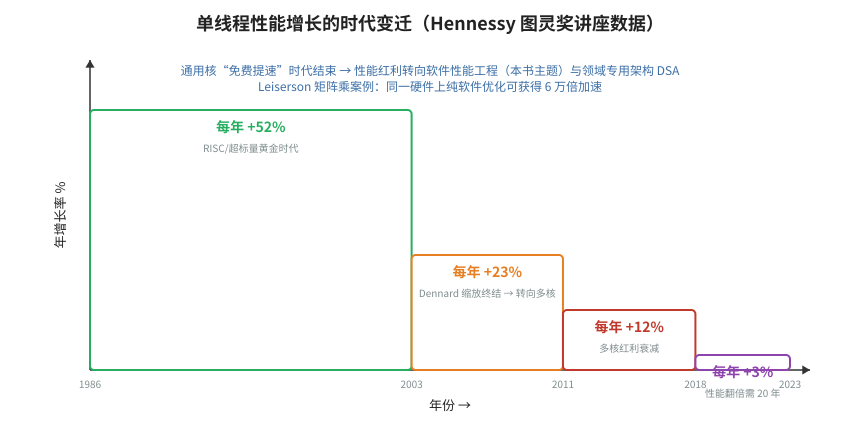


- **🎓 初学者导读**：这场讲座像一位老船长（图灵奖得主、斯坦福前校长）站在甲板上讲航海史和前方航线——通用芯片的黄金时代结束，专用加速器（为特定任务定制的芯片）接棒。它能帮你在宏观层面定位自己的学习：为什么现在值得研究 DSA（领域专用架构）、为什么"造语言造编译器"又重新吃香。视频和讲稿都轻松好懂，不需要任何先修知识，建议先看一遍建立大局观。

- **一句话概括**：Hennessy 的图灵奖讲座（常与 "A New Golden Age for Computer Architecture" 同题流传）：
  宣布通用处理器性能增长时代落幕，架构进入以 DSA（领域专用架构）、开放指令集与敏捷开发为标志的"新黄金时代"。

- **背景与问题**：
  - 单线程性能年增长率的衰减曲线（Hennessy & Patterson 长期更新的著名图表）：
    1986~2003 年约 50%/年；2003~2011 年降至约 20%+；2011 年后仅剩个位数百分比——
    "免费午餐"彻底结束。原因链：Dennard 缩放失效 → 功耗墙 → 频率停滞 → ILP 挖掘殆尽 → 多核受 Amdahl 限制。
  - 与此同时，2018 年初 Spectre/Meltdown 爆发，提醒我们"为性能做的推测执行"会以安全为代价。

- **核心方法/内容详细展开**：
  1. **历史回顾**。从 1960s 的 IBM System/360 兼容性革命，到 1980s 的 RISC 与指令级并行（MIPS 项目即 Hennessy 本人工作），
     说明每一次性能跃迁都伴随架构思想的更替——当前正处于下一个更替点。
  2. **性能方程**。CPU time = 指令数 × CPI × 时钟周期。工艺不再自动缩短时钟周期后，只能从"指令数"与"CPI"下手，
     而这两端都依赖架构-软件协同。
  3. **出路一：DSA（Domain-Specific Architecture）**。为特定领域定制硬件，牺牲通用性换数量级的效率提升。
     代表案例 Google TPU v1：为神经网络推理定制，核心是一块 256×256 的 8 bit 乘加脉动阵列（65,536 个 MAC），
     论文报告其在推理负载上的性能功耗比大幅领先同期 CPU/GPU（数量级级优势）。设计哲学：把 99% 的晶体管
     花在"这个领域真正需要的运算"上，砍掉分支预测、乱序等通用机制。
  4. **出路二：DSL 与软硬协同**。领域专用语言（TensorFlow、Halide、SQL）让编译器能向 DSA 生成代码；
     "DSA 需要 DSL 配套"，二者是硬币两面。
  5. **出路三：开放与敏捷**。RISC-V 开放指令集降低创新门槛；Chisel 等敏捷硬件设计方法把硬件迭代速度
     向软件看齐——"硬件设计的新黄金时代"的另一半含义。
  6. **安全的提醒**。推测执行侧信道说明微架构优化有隐性成本，未来架构要把安全作为一等约束。

- **关键结论与数据**：
  - 单线程性能增长：约 50%/年（1986-2003）→ 约 20%+/年（2003-2011）→ 个位数（2011 后）——
    引自 Hennessy/Patterson 长期更新的 SPECint 统计图。
  - 定性结论：未来十年计算机体系结构将迎来"寒武纪大爆发"式的多样化创新，DSA 是主旋律。

- **实战应用**：
  - 对个人学习路线的启示：通用 CPU 性能工程（本笔记主题）不会过时——因为 (1) 现存代码量巨大；
    (2) DSA 本身需要懂性能的人设计；(3) 每代 DSA 都有自己的"性能手册"要学，方法论通用。
  - 关注 GPU/NPU/FPGA 的编程模型时，带着 CPU 性能工程的词汇表（带宽、延迟、占用率、roofline）去理解，
    迁移成本很低。

- **与 perf-book 对应章节**：第 1 章（为什么要关注性能）的时代背景。

- **常见误区/注意事项**：
  - "DSA 取代通用 CPU"是误读——Hennessy 的原意是通用 CPU 性能增长停滞后，增量性能由 DSA 提供，
    两者长期共存（异构）。
  - 讲座中 TPU v1 的数字针对 2015 年前后的推理负载与同期 GPU，不要外推到今天的训练场景。
  - "新黄金时代"指的是架构创新机会，不是说性能提升会自动发生——恰恰相反，需要更多性能工程师。

### 14. Computer Architecture: A Quantitative Approach, 6th ed.（Hennessy & Patterson, 2017）


- **🎓 初学者导读**：这本"圣经"就像一整套健身房的器械说明书——每章教你一块肌肉（流水线、缓存、指令级并行）怎么练，而且所有结论都用数字说话。它是本系列所有笔记的底层依据，遇到任何"为什么"都可以回来查。别想着从头啃完：先读第 1 章建立量化思维，再按需翻附录 B（缓存）和第 3 章（指令级并行），把它当字典而不是小说来用。

- **一句话概括**：计算机体系结构的"圣经"第六版，性能工程全部概念框架（Iron Law、Amdahl、Roofline、
  ILP/DLP/TLP、WSC）的出处与最权威阐述。

- **背景与问题**：
  - 碎片化的优化技巧如果没有量化框架统摄，就变成玄学。本书的核心主张贯穿书名：**量化（Quantitative）**——
    一切设计决策用测量与公式说话。
  - 第六版（2017）做了历史性改版：以"领域专用"与"仓库级计算"重构内容，宣告以桌面/服务器单芯片为中心的时代结束。

- **核心方法/内容详细展开**（按与性能工程的相关度组织）：
  1. **基础公式**（第 1 章）：
     - Iron Law：`CPU time = IC × CPI × CT`（指令数 × 每条指令周期数 × 时钟周期）。所有优化都可归入降低三者之一；
     - Amdahl 定律：`Speedup = 1 / ((1 - f) + f / s)`——优化占比 f 的部分提速 s 倍的总加速上限。
       它解释了"为什么 90% 的热点值得拼命优化，5% 的部分随它去"；
     - 功耗方程 `P ≈ ½ × C × V² × f`：Dennard 缩放失效的数学表达，功耗墙的由来。
  2. **ILP（指令级并行，第 3 章）**：动态调度（Tomasulo）、重排序缓冲、推测执行、多发射——
     理解乱序核心的官方教材；分支预测章节与本书第七、八章文献互证。
  3. **DLP（数据级并行，第 4 章）**：SIMD、向量架构、GPU——配合本笔记 Base64 论文（第 16 条）食用最佳。
     Roofline 模型（Williams/Waterman/Patterson, 2009）在本版中得到充分使用：
     `可达性能 = min(峰值算力, 带宽 × 运算强度)`，一张图判断程序是算力受限还是带宽受限。
  4. **TLP 与内存层次（第 2、5 章）**：缓存的性能公式 `平均访存时间 = 命中时间 + miss 率 × miss 代价`，
     以及降低三项各自的所有经典手段（分块、预取、多级缓存、写缓冲……）——perf-book 第 8 章的"理论版"。
  5. **WSC 与 DSA（第 6、7 章）**：仓库级计算机的成本模型与能效（PUE）、以及领域专用架构的原理——
     与第 13 条笔记（图灵奖讲座）互为表里。

- **关键结论与数据**：
  - 框架性结论：性能优化的每一步都应能回答"它降低了 IC、CPI、CT 中的哪一项，幅度多少，怎么测"。
  - Amdahl 定律的推论：局部优化存在天花板；系统级瓶颈转移后需重新 profile。

- **实战应用**：
  - 用 Iron Law 解读 `perf stat` 输出：`instructions`、`cycles`、`IPC` 三件套直接对应公式；
    优化前后对照三者的变化，说明收益来源。
  - 用 Roofline 分析核函数：测出运算强度（FLOP/byte），落到图上判断该优化访存还是优化计算。
  - 当案头书用：遇到不懂的微架构机制（如 memory disambiguation、clustered scheduler），回查对应章节。

- **与 perf-book 对应章节**：全书对应；尤其第 3 章（CPU 微架构）、第 4 章（指标与 TMA）。

- **常见误区/注意事项**：
  - 第六版与第五版章节结构差异大（6 版按 DLP/WSC/DSA 重构），引用章节号时注明版本。
  - 教材数字有时代烙印（示例机器的延迟、容量），学的是方法而不是背具体参数。
  - Amdahl 定律假设串行部分不变；并行化常常改变问题规模（Gustafson 定律视角），两者不要混用。

### 15. Understanding and Detecting Real-World Performance Bugs（Jin et al., PLDI 2012）


- **🎓 初学者导读**：这篇像一位老刑警整理真实案件卷宗——作者翻遍开源项目的 bug 记录，归纳出真实世界里程序变慢的几种典型"作案手法"（比如循环里重复算不变的东西、用错数据结构）。它能帮你解决"我的代码没 bug 但就是慢"的困惑，因为很多性能退化根本不是算法问题而是这些惯性错误。建议通读分类章节，把这几类模式记成检查清单，以后 code review 时逐条对照，命中率很高。

- **一句话概括**：对 Apache、Chrome、GCC、Mozilla、MySQL 五大真实软件中 109 个真实性能 bug 的实证研究，
  系统回答"性能 bug 长什么样、怎么修、能不能自动检测"，是性能 bug 研究领域的奠基之作。

- **背景与问题**：
  - 功能 bug 有成熟的研究与工具生态，性能 bug 却长期被当作"优化问题"而非"正确性问题"对待。
    但真实世界里，性能 bug 会导致产品被弃用、服务器成本翻倍——其危害不亚于功能 bug。
  - 关键未知：性能 bug 的根因有什么模式？修复通常多复杂？这些模式能否驱动自动化检测工具？

- **核心方法/内容详细展开**：
  1. **数据集**。从五个成熟开源项目的 bug 追踪系统/代码仓库中人工筛选出 109 个**已被开发者确认并修复的**
     性能 bug（不含"单纯想要更快"的优化诉求），覆盖 C/C++/JS，涵盖服务器、浏览器、编译器、数据库。
  2. **根因模式分类**（论文最有价值的部分，三个维度交叉）：
     - **按症状/根因大类**：
       - 大量 bug 是**做了不必要的工作**（uncoordinated/repeated work）：重复计算相同结果（缺 memoization）、
         在循环内做可外提的不变计算、重复查询已知答案；
       - **可跳过的工作**：明明有快速路径却每次都走慢路径，缺一个廉价判断（"加一个条件判断就能跳过"型）；
       - **低效的数据结构/算法**：用链表做本应用哈希表/数组的查找，或算法复杂度错误；
       - **同步与可扩展性问题**：锁粒度过大、不必要的串行化、频繁的系统调用/IO 批量不足；
       - **GUI 响应性问题**：在 UI 线程做重活（浏览器/桌面应用特有的一类）。
     - **按修复策略**：跳过函数调用、缓存/记忆化、批量化、更换数据结构、延迟计算（lazy）、加条件快速路径等——
       多数修复只改动很少几行代码；
     - **按涉及范围**：许多 bug 根因集中在一小段代码，但理解并定位它需要跨模块的领域知识——
       这正是性能 bug 难自动发现的原因。
  3. **发现 → 检测**。作者把归纳出的模式做成**效率规则（efficiency rules）**，构建静态检查器在新版本代码上扫描，
     报告了一批此前未知的性能 bug 并被开发者接受修复——证明"模式化"路线可行（该方向后续衍生出
     Toddler、Caramel 等著名的动态/静态检测工作）。
  4. **对功能测试的启示**。性能 bug 的触发常需要**特定输入规模/分布**，普通功能测试用例（小而快）根本
     暴露不了它们——性能回归需要专门的压力测试与监控。

- **关键结论与数据**：
  - 研究对象：5 个项目、109 个真实性能 bug（论文核心数字）。
  - 定性结论：多数性能 bug 的修复很小（几行级），但定位依赖领域知识；"不必要的工作"类模式占比高；
    基于模式的规则检测能找到新的真实 bug。
  - 方法论贡献：性能 bug 可以像功能 bug 一样被分类、模式化、工具化。

- **实战应用**：
  - 把论文的"修复模式"当成 code review 清单：
    - 循环里有没有可外提的不变计算？（LICM，编译器有时做不动）
    - 这个函数的结果会被反复计算吗？能否 memoize？
    - 每次都要走完整路径吗？能否加廉价前置判断快速跳过？
    - 容器选型对吗？（`std::vector` vs `std::list`、哈希 vs 线性扫描）
    - 锁里做的事能否挪到锁外？系统调用能否批量？
  - 性能回归防线：在 CI 中加入宏基准 + 告警阈值（参考 perf-book 第 2 章的统计方法），
    因为单元测试天生看不见性能 bug。
  - 读论文附录的 bug 案例集：每个都是教科书级的反面教材。

- **与 perf-book 对应章节**：第 1 章（性能问题的现实来源）、第 2 章（测量与回归检测）的动机部分。

- **常见误区/注意事项**：
  - 109 个 bug 来自特定时期与项目，模式分布不能机械外推到今天的微服务/云原生负载（但思维框架依然有效）。
  - "修复只改几行"不等于"容易发现"——论文恰恰强调发现阶段的知识门槛。
  - 静态规则检查有误报，落地到团队时先挑高收益低误报的规则（如循环内不变计算）。

### 16. Base64 Encoding and Decoding at Almost the Speed of a Memory Copy（Muła & Lemire, SPE 2019）


- **🎓 初学者导读**：这篇像看顶级厨师做菜——同样的食材（Base64 编解码），人家用 SIMD（单指令多数据，一条指令同时处理几十个字符）把速度做到接近"纯复制内存"的极限。它是无分支、向量化编程的绝佳范本，能帮你理解第 4 篇的思想做到极致是什么样。汇编细节可以跳过，重点体会思路：把逐字节判断变成批量查表加向量运算，速度差可达十倍以上。

- **一句话概括**：用 SIMD（SSSE3/AVX2/AVX-512VBMI）把 Base64 编解码做到接近 memcpy 的速度，
  是"查表洗牌（shuffle）+ 向量乘加"这一 SIMD 设计范式的教科书级案例。

- **背景与问题**：
  - Base64 无处不在（JSON 二进制、邮件、URL、证书），在高吞吐服务里能占到可观的 CPU 时间。
  - 传统实现逐字节查表 + 位拼接，每 3 字节产出 4 字符，串行依赖强、分支多（填充、校验），吞吐被压得很低。
  - 关键观察：Base64 的"查表"本质是 6 bit → ASCII 的映射，而 SIMD 的 `PSHUFB` 指令正是"在一个 16 项表里并行查 16 次"——
    把算法改造成"全是查表与乘加"，就能吃到整条向量流水线。

- **核心方法/内容详细展开**：
  1. **Base64 回顾**。编码：每 3 个字节（24 bit）切成 4 个 6 bit 组，每组查 64 字符表
     （`A-Z a-z 0-9 + /`）得 1 个字符；尾部用 `=` 填充。解码反之：字符 → 6 bit 值 → 拼回字节。
  2. **PSHUFB 查表原理**（SSSE3 起）：`_mm_shuffle_epi8(table, idx)` 用 `idx` 每个字节的低 4 位在
     `table` 的 16 个字节里做并行查找，一条指令完成 16 次查表。但 Base64 表有 64 项（6 bit），
     单条 PSHUFB 不够，于是论文的核心技巧是**用算术把映射分解**：
     - 编码方向（6 bit 值 v ∈ [0,64) → ASCII）：观察字符表是几段连续区间：
       `A-Z`(0-25→65)、`a-z`(26-51→71)、`0-9`(52-61→-4 即 +48 偏移)、`+`(62)、`/`(63)。
       即 ASCII = v + offset(v)，offset 只有 13 个不同取值——可以用 PSHUFB 对"v 所属区间"查 offset 表，
       再用 `_mm_add_epi8` 加上。区间判定本身也用 SIMD 比较完成，全程无分支。
  3. **解码方向（ASCII → 6 bit）**：同样先判区间（`A-Z`/`a-z`/`0-9`/`+`/`/`），再减去对应基值；
     区间判定顺带完成**输入校验**（不在任何区间的字符即非法），把传统实现里昂贵的错误检查也向量化了。
  4. **位拼接的向量化**：6 bit → 8 bit 的重组用向量乘法完成：`_mm_maddubs_epi16`（无符号 8×有符号 8 乘加）
     和 `_mm_madd_epi16`（16 bit 乘加）能把相邻的 6 bit 组按权重 64/1 合并成字节——
     这是"用乘加指令做位移+或"的经典 SIMD trick，把移位、掩码、或三步压缩成两条指令。
  5. **AVX-512VBMI 的降维打击**。VBMI 的 `vpermb` 可以在一张 **64 字节表**里按 6 bit 索引并行查 64 次——
     Base64 查表从"判区间 + 查偏移 + 加"三步直接塌缩成一条指令，编码路径大幅缩短。
     论文中的 AVX-512VBMI 版本因此达到最高吞吐。
  6. **整体结构**：主循环每次处理 24 字节（SSSE3/AVX2 按寄存器宽度扩展）输入 → 洗牌重排 → 查表 → 写出；
     尾部处理填充与余数，标量兜底。校验与转码融合在同一趟数据流里，一趟 pass 完成。

- **关键结论与数据**：
  - 定性结论：在大缓冲区上，SIMD Base64 编解码吞吐达到每核数 GB/s 量级，接近同平台 memcpy 的速度，
    相对标量实现有数量级提升；AVX-512VBMI 版本最快。
  - 工程影响：该实现进入多个高性能库（如 simdjson 生态、fastbase64 等），是"SIMD 化文本处理"的范本之一。

- **实战应用**：
  - 直接调用成熟实现（Wojciech Muła 与 Daniel Lemire 的开源 base64 库），不要手撸——但读懂原理，
    因为你迟早要把同样的范式用到自己的编解码任务（hex、percent-encoding、CSV 转义）。
  - 范式提炼（可迁移）：**映射 → 查表（pshufb/vpermb）；分段映射 → 区间判定 + 偏移表；位重组 → 乘加指令**。
  - 写自己的 SIMD 转码时，先保证输入对齐与尾部处理正确，再谈性能；校验逻辑尽量融入查表过程。

- **与 perf-book 对应章节**：第 9 章（优化计算：向量化）的工业级案例。

- **常见误区/注意事项**：
  - PSHUFB 的高位置零特性（索引字节最高位为 1 时输出 0）常被解码校验利用，写汇编/内联时别漏掉这个语义。
  - AVX-512VBMI 只在 Cannon Lake/Ice Lake 及更新平台可用；部署前做 CPUID 运行时检测，准备多版本派发。
  - "接近 memcpy"只在缓冲区足够大、数据在缓存/内存带宽可及时成立；小输入上函数调用与派发开销占比大，
    需要设阈值走标量路径。
  - Base64 变体（URL-safe 的 `-_` 替换 `+/`）只需换查表常量，算法不变——这也是查表范式的优雅之处。

### 17. 全球数据量统计（DOMO "Data Never Sleeps" 与 Statista 数据量报告，合并简述）


- **🎓 初学者导读**：这份统计像一张"世界每秒发生多少事"的滚动大屏——每分钟多少条视频上传、多少 GB 数据产生，数字大到夸张。它能帮你回答"性能优化值得吗"：当数据量每年暴涨而硬件进步放缓，省下的每一个时钟周期乘以这个规模都是真金白银。不用精读，记住一两个震撼数字（比如全球数据总量已超百 ZB，1 ZB 等于十亿 TB）即可，做汇报和写引言时特别好用。

- **一句话概括**：两组被广泛引用的数据统计——全球每年创建/复制的数据总量（Statista/IDC）与
  "互联网每分钟发生什么"（DOMO 年度信息图）——共同说明驱动性能工程需求的时代背景：数据洪流。

- **背景与问题**：
  - 性能工程的需求不是凭空来的：数据产生速度持续超过单机性能增长速度（见第 13 条笔记的增长率衰减曲线），
    "处理数据的能力"与"数据本身"之间的剪刀差，是这个行业长期存在的根本理由。

- **核心内容**：
  1. **Statista/IDC 全球数据圈（Global Datasphere）**：统计全球每年创建、捕获、复制、消费的数据总量。
     量级轨迹（约数）：2010 年约 2 ZB（zettabyte，1 ZB = 10^21 字节）；2020 年约 64 ZB；
     预测 2025 年达约 180 ZB。十年间约两个数量级的增长。
  2. **DOMO "Data Never Sleeps"**：每年发布的信息图，统计"互联网一分钟"内产生的数据行为：
     发送的邮件数、上传的视频时长、发起的搜索数、产生的消息数等。各条目逐年更新、绝对值快速膨胀；
     其价值不在精确数字，而在直观呈现"每一分钟"的数据吞吐强度。
  3. **两者的关系**：一个是年度总量视角（存量/流量的宏观曲线），一个是瞬时速率视角（每分钟的微观快照），
     互相印证同一趋势。

- **关键结论与数据**：
  - 全球年数据量：约 2 ZB（2010）→ 约 64 ZB（2020）→ 预测约 180 ZB（2025）（Statista/IDC 口径，约数）。
  - 定性结论：数据增长是指数级的，而单核性能增长是亚线性的——差距必须由并行、专用硬件与性能工程填补。

- **实战应用**：
  - 写技术方案/立项报告时用这组数据论证性能优化的投入产出：数据量翻倍而硬件不翻倍时，
    每 10% 的软件效率提升都直接折算成机器成本。
  - 注意数据口径：这些统计包含"复制与消费"，不等于需要存储或计算的净增量；引用时说明口径避免夸大。

- **与 perf-book 对应章节**：第 1 章（为什么需要性能分析）的宏观动机。

- **常见误区/注意事项**：
  - 信息图类统计（DOMO）逐年变化且口径不一，只适合做背景说明，不适合做容量规划的精确依据。
  - "ZB 级"是聚合概念；落到具体业务时，自己系统的增长率才是决策依据——宏观数据用来说明趋势，不用来推算容量。

---

> 笔记结束。建议精读顺序：先读第 12 篇建立世界观，再按 perf-book 章节进度回查对应文献；
> 分支预测四篇（1-4）与内存七篇（5-11）分别配合 perf-book 第 10 章与第 8 章同步阅读。

---

## 附录：精读路线推荐

按"投入产出比"排序的精读顺序：

1. **Leiserson《There's Plenty of Room at the Top》(Science 2020)** — 建立"为什么软件优化值得做"的世界观；
2. **Kanev《Profiling a Warehouse-Scale Computer》(ISCA'15)** — 理解真实数据中心 workload 的瓶颈分布，TMA 的动机；
3. **Yasin《A Top-down Method for Performance Analysis》(ISPASS'14)** — TMA 方法论原始论文，全书分析框架的核心；
4. **Mytkowicz《Producing Wrong Data Without Doing Anything Obviously Wrong!》(ASPLOS'09)** — 理解测量陷阱，建立"测量怀疑论"；
5. **Intel 优化参考手册 + Agner Fog 指令表** — 案头工具书，随用随查；
6. **Panchenko《BOLT》+ Ottoni《HFSort》** — 代码布局优化的工业实践；
7. **Ren《Google-Wide Profiling》** — 持续剖析的奠基之作；
8. **Hennessy & Patterson《Computer Architecture》第 6 版** — 系统补课微架构原理。

> 协议说明：原书参考文献页内容遵循 CC BY-SA 4.0；本笔记为学习整理，各文献版权归原出版方所有。
> 准确性说明：本笔记在无网络环境下基于这些经典文献的公认内容撰写；个别论文的精确实验数字建议对照原文核实。
